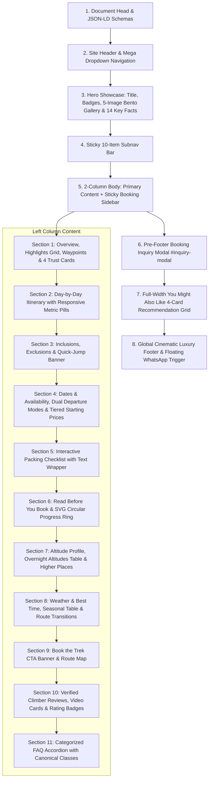

# Trek Page Builder Skill (`trek-page-builder`)

This skill provides the comprehensive design system, component hierarchy, technical requirements, production code templates, interactive JavaScript controllers, and structured schema blueprints for creating and optimizing world-class **Trek Package Detail Pages** for **Igloo Himalaya Treks**, strictly modeled on the gold standards established in [`trek/everest-base-camp-trek/index.html`](file:///c:/Users/ASUS/Desktop/igloohimalayatreks/trek/everest-base-camp-trek/index.html), [`trek/mardi-himal-trek/index.html`](file:///c:/Users/ASUS/Desktop/igloohimalayatreks/trek/mardi-himal-trek/index.html), and [`trek/nar-phu-valley-trek/index.html`](file:///c:/Users/ASUS/Desktop/igloohimalayatreks/trek/nar-phu-valley-trek/index.html).

---

## 1. Core Principles & Repository Standards

> [!IMPORTANT]
> **THE 19 MANDATORY QUALITY RULES ("NEVER-REPEAT" MISTAKES)**:
> Before developing or editing any trek page, you MUST adhere to [trek-page-quality-rules.md](file:///c:/Users/ASUS/Desktop/igloohimalayatreks/.agents/rules/trek-page-quality-rules.md) to eliminate all historical mistakes:
> 1. **Both Columns Mandatory**: Never omit `.trek-sidebar-col` (`.sidebar-booking-card`) or `#inquiry-modal`. The main layout is a 2-column grid (`2.2fr 1fr; gap: 40px;`).
> 2. **Pre-Footer Element Ordering**: The `#inquiry-modal` dialog MUST ALWAYS be placed before `.you-might-like-section`, which in turn sits before the footer.
> 3. **No Orphan Classes**: Verify all CSS classes exist in `index.css` before using them. Never invent unstyled custom classes.
> 4. **Preserve JS Hooks**: Keep `data-altitude-m`, `data-tab`, `data-trek-details-wrapper`, and modal triggers intact.
> 5. **Single Source of Truth (SSOT)**: Keep pricing, duration, altitude, and facts 100% consistent across Schema, Hero, Facts, Sidebar, and Modal.
> 6. **Authentic Hero Bento Imagery & Verbatim Hero Content**:
>    - The hero section (`<!-- Page Title Section -->`) MUST feature the exact trek title with em-dash (`{Trek Title} &mdash; {X} Days`) and the verbatim introductory summary paragraph from the client source document.
>    - NEVER replace the hero copy with AI-invented or paraphrased text. Concise summaries (~70-80 words, e.g. Mardi Himal, Nar Phu Valley, Kanchenjunga Without Flight) must render fully without artificial toggle splitting.
>    - Hero Bento galleries must showcase 5 authentic, trek-specific WebP images (1 main panoramic + 4 sub-grid tiles featuring viewpoints, lodges, local trails, culture) with TripAdvisor Travelers' Choice badge.
>    - Main photo must match `og:image` and `twitter:image`. All image paths must resolve to physical files in `/images/`.
> 7. **Comprehensive 14-Item Key Trip Facts**: Render all authentic trip facts using semantic SVG icons inside circular `#F2F4F6` background badges with `#1A96C8` stroke and a 3-tier hierarchy (Category, Headline, Subtitle).
> 8. **Clean Standalone Section Architecture**: Never nest Elevation Profile (`#section-altitude-profile`) or Weather (`#section-weather`) inside Read Before You Book (`#section-details`). Keep them standalone with their own subnav anchors.
> 9. **Authentic Region Recommendations**: Never leave generic Everest cards or dummy `#` links in `.you-might-like-section`. Recommend 4 authentic, regionally relevant packages with duration badges, starting prices, and active URLs.
> 10. **Zero Cross-Trek Copy Contamination**: Reviews (`#section-reviews`), hero read-more scripts, and itinerary copy must be 100% authentic to the trek. Never leave leftover text or IDs from other treks (e.g., Tilicho Lake, Thorong La, EBC, or `#ebc-toggle-btn`).
> 11. **Client Source Document Verbatim Parity**: When working from a client Google Doc or brief, ensure 100% verbatim capture of all sections, sub-tables, packing items, higher places, seasonal conditions, and FAQs. Validate using an automated parity script.
> 12. **Mandatory Post-Flight Verification**: Run the tag balancer script (0 diff on `div`, `section`, `article`, `main`, `form`, `table`, `ul`) and visually verify via `browser_subagent` on desktop (1440px) and mobile (390px) before returning.
> 13. **Itinerary Architecture, Timeline Dots & Semantic Badges**:
>     - Header Bar: Must use `<div class="itinerary-header-bar">` and `<button id="toggle-all-itinerary" class="itinerary-toggle-all-btn" type="button">` with animated SVG chevron (bound to `js/trek-details.js`). NEVER use unstyled `.itinerary-expand-all-btn`.
>     - Timeline Dots: `.itinerary-card` must have `overflow: visible !important;` so the 14px circular timeline dot (`::before` at `left: -28px; top: 26px; border: 3px solid #1A96C8;`) displays centered on the vertical line (`border-left: 2px solid #E2E8F0;`).
>     - Daily Fact Boxes: Render Google Doc daily facts inside `.itinerary-meta-box` and `.itinerary-meta-box-item` with color-coded `.itinerary-meta-box-badge` SVGs (Activity = blue compass, Altitude = amber mountain, Accommodation = green lodge, Meals = rose cutlery, Time = blue clock, Route = purple map pin). NEVER output plain unstyled grey wireframe tables.
>     - Rich Subtitles: Include 3-part subtitle with `data-altitude-m="{meters}"`: `[Action] — <span data-altitude-m="{meters}">[Overnight Altitude & Location]</span> — [Duration/Highlight]`.
>     - Narrative Paragraphs: Wrap narrative paragraphs inside `.itinerary-description` with verbatim client copy preserved.
> 14. **Zero-MVP First-Pass Publishing Mandate**:
>     - When publishing content from a Google Doc or brief, NEVER output wireframe or MVP placeholder sections (e.g. basic unstyled tables, grey boxes, plain bullet lists, or incomplete tabs).
>     - Every single section (Subnav, Highlights, Inclusions/Exclusions, Starting Prices, Packing List, Read Before You Book, Standalone Altitude Profile, Weather, Booking Banner, Reviews, Categorized FAQs, and Bottom CTA Card) MUST be generated in full production-grade Gold Standard styling immediately in Pass 1.
> 15. **FAQ Panel Visibility & Inline Style Rule**:
>     - NEVER write inline `style="display: none;"` on `.faq-category-content` containers.
>     - Visibility must be governed strictly by CSS (`.faq-category-content { display: none; }` and `.faq-category-content.active { display: block; }`). Hardcoded inline `display: none` overrides the active CSS class and breaks tab switching.
>     - Accordion items must include `.faq-toggle-circle` with smooth CSS rotation, and the header must include `<button id="faq-expand-all-btn" class="faq-expand-all-btn" type="button">Expand All</button>`.
> 16. **High-Conversion Book / Enquire Bottom CTA Card**:
>     - At the bottom of Section 11 (`#section-faqs`) before `</section>`, NEVER output a plain `#F8FAFC` gray box.
>     - Must feature the ultra-premium high-conversion gradient card (`background: linear-gradient(135deg, #0A2540 0%, #0E3458 55%, #144A75 100%);`) with glowing radial accents, frosted glass kicker badge (`PLAN YOUR HIMALAYAN EXPEDITION`), verbatim client copy, dual action buttons (`Enquire Now` with modal trigger + `Chat on WhatsApp` with pre-filled text), and 3 trust badges (100% Guaranteed Departures, 2–4 Hr Response, Certified High-Altitude Sherpa Guides).
> 17. **Reviews & Testimonials 3-Tab Architecture & Video Lightbox**:
>     - `#section-reviews` must strictly use `.review-tabs-container` with 3 `.review-tab-btn` buttons (`data-target="reviews-video-pane"`, `data-target="reviews-customer-pane"`, and `data-target="reviews-platform-pane"`) that cleanly hook to `setupHimalayanReviews()` in `js/trek-details.js`.
>     - Tab 1 (`#reviews-video-pane.review-pane-content.active`): Features `.video-reviews-grid` with 4 `.video-review-card` elements (`data-video-url`, `data-trekker`, `data-trek`, play button, rating pill with SVG star, date pill, verified avatar with SVG check, and trek route). Must include `#video-review-modal.video-modal-overlay` lightbox modal before `</section>`.
>     - Tab 2 (`#reviews-customer-pane.review-pane-content`): Features `.customer-reviews-stack` with 3 authentic route-specific customer reviews containing verified purchase badges, crisp inline SVG stars (`.stars-gold` with `<polygon points="...">`, NEVER unicode `★`), 3-photo memory thumbnail grid (`.review-photo-thumb` opening lightbox preview), "Guided by Sagar Gurung" badge, helpful upvote button (`.helpful-vote-btn` with `data-votes="..."` and `.vote-count`), and "See more" text expansion (`.review-see-more-btn`).
>     - Tab 3 (`#reviews-platform-pane.review-pane-content`): Features `.platform-sub-tabs-wrapper` with `.platform-sub-tab` (`data-platform="google"`, `tripadvisor`, `trustpilot`), `.platform-summary-card` (4.9 aggregate score bar with `#platform-summary-count` and inquiry button), and `.platform-review-item` cards.
> 18. **Subnav Sticky Bar Architecture & Smooth Scrolling**:
>     - Must feature exactly 10 anchor buttons with SVG icons corresponding to the 10 left-column sections.
>     - Must use `top: 76px`, `backdrop-filter: blur(12px);`, horizontal scrolling with hidden scrollbars, and active state pill indicators.
> 19. **Zero-Corrupt Glyphs & Inline SVG Star Mandate**:
>     - NEVER use raw unicode characters (such as `★`, `✓`, or `?`) in star ratings, reviews, or badges that can corrupt across text editors and UTF-8/ANSI encodings into `?????` or `?`.
>     - ALWAYS render star ratings using crisp inline SVG elements (`<svg width="15" height="15" viewBox="0 0 24 24" fill="#1A96C8" stroke="none"><polygon points="12 2 15.09 8.26 22 9.27 17 14.14 18.18 21.02 12 17.77 5.82 21.02 7 14.14 2 9.27 8.91 8.26 12 2"/></svg>`).

### Brand Identity & Design System
- Primary Navy: `#0E3458`
- Brand Accent Blue: `#1A96C8`
- Orange CTA Accent: `#F6851F` / `#FF7900`
- Emerald Green Accent: `#10B981` (Checkmarks & highlights)
- Light Panel Backgrounds: `#F8FAFC`, `#F4F9FC`
- Border Grays: `#E2E8F0`, `#CBD5E1`
- CSS Source of Truth: [`index.css`](file:///c:/Users/ASUS/Desktop/igloohimalayatreks/index.css)
- Core Trek Controller: [`js/trek-details.js`](file:///c:/Users/ASUS/Desktop/igloohimalayatreks/js/trek-details.js)

### 2-Column Responsive Body Layout
The layout must use the canonical wrapper:
```html
<section class="section-padding" style="padding-top: 10px;" data-trek-details-wrapper data-trek-key="{trek_key}">
  <div class="container trek-detail-layout" style="display: grid; grid-template-columns: 2.2fr 1fr; gap: 40px; align-items: stretch; position: relative;">
    <div style="min-width: 0;">
      <!-- Left Column Content Sections -->
    </div>
    <!-- Right Column Sticky Sidebar -->
    <div class="trek-sidebar-col" style="position: relative; height: 100%;">
      <div class="sidebar-booking-card" style="position: -webkit-sticky; position: sticky; top: 160px; z-index: 40;">
        <!-- Sidebar content -->
      </div>
    </div>
  </div>
</section>
```
Always include `data-trek-details-wrapper` and `data-trek-key="{trek_key}"` (e.g. `mardi_8`, `nar_phu`, `ebc_16`) so localStorage tracking for gear checklist and reading progress is properly scoped.

### Sub-Navigation Sticky Bar
The sticky subnav sits directly beneath the site header (`top: 76px`), providing smooth navigation across the 10 core sections of the left column with `backdrop-filter: blur(12px)` and hidden scrollbars:
```html
<nav class="trek-sticky-subnav" style="position: -webkit-sticky; position: sticky; top: 76px; z-index: 40; background: rgba(255, 255, 255, 0.95); backdrop-filter: blur(12px); -webkit-backdrop-filter: blur(12px); border-bottom: 1px solid #E2E8F0; box-shadow: 0 4px 12px rgba(0, 0, 0, 0.03);">
  <div class="container" style="display: flex; align-items: center; gap: 8px; overflow-x: auto; scrollbar-width: none; -ms-overflow-style: none; padding-top: 10px; padding-bottom: 10px;">
    <a href="#section-overview" class="subnav-tab active" data-tab="overview">
      <svg width="15" height="15" viewBox="0 0 24 24" fill="none" stroke="currentColor" stroke-width="2"><circle cx="12" cy="12" r="10"></circle><polygon points="16.24 7.76 14.12 14.12 7.76 16.24 9.88 9.88 16.24 7.76"></polygon></svg>
      <span>Overview</span>
    </a>
    <a href="#section-itinerary" class="subnav-tab" data-tab="itinerary">
      <svg width="15" height="15" viewBox="0 0 24 24" fill="none" stroke="currentColor" stroke-width="2"><rect x="3" y="4" width="18" height="18" rx="2" ry="2"></rect><line x1="16" y1="2" x2="16" y2="6"></line><line x1="8" y1="2" x2="8" y2="6"></line><line x1="3" y1="10" x2="21" y2="10"></line></svg>
      <span>Itinerary</span>
    </a>
    <a href="#section-inclusions" class="subnav-tab" data-tab="inclusions">
      <svg width="15" height="15" viewBox="0 0 24 24" fill="none" stroke="currentColor" stroke-width="2"><path d="M12 22s8-4 8-10V5l-8-3-8 3v7c0 6 8 10 8 10z"></path></svg>
      <span>Includes &amp; Excludes</span>
    </a>
    <a href="#section-dates" class="subnav-tab" data-tab="dates">
      <svg width="15" height="15" viewBox="0 0 24 24" fill="none" stroke="currentColor" stroke-width="2"><rect x="3" y="4" width="18" height="18" rx="2" ry="2"></rect><line x1="16" y1="2" x2="16" y2="6"></line><line x1="8" y1="2" x2="8" y2="6"></line><line x1="3" y1="10" x2="21" y2="10"></line></svg>
      <span>Dates &amp; Availability</span>
    </a>
    <a href="#section-packing" class="subnav-tab" data-tab="packing">
      <svg width="15" height="15" viewBox="0 0 24 24" fill="none" stroke="currentColor" stroke-width="2"><line x1="8" y1="6" x2="21" y2="6"></line><line x1="8" y1="12" x2="21" y2="12"></line><line x1="8" y1="18" x2="21" y2="18"></line><line x1="3" y1="6" x2="3.01" y2="6"></line><line x1="3" y1="12" x2="3.01" y2="12"></line><line x1="3" y1="18" x2="3.01" y2="18"></line></svg>
      <span>Packing List</span>
    </a>
    <a href="#section-details" class="subnav-tab" data-tab="details">
      <svg width="15" height="15" viewBox="0 0 24 24" fill="none" stroke="currentColor" stroke-width="2"><circle cx="12" cy="12" r="10"></circle><line x1="12" y1="16" x2="12" y2="12"></line><line x1="12" y1="8" x2="12.01" y2="8"></line></svg>
      <span>Trip Details</span>
    </a>
    <a href="#section-altitude-profile" class="subnav-tab" data-tab="altitude-profile">
      <svg width="15" height="15" viewBox="0 0 24 24" fill="none" stroke="currentColor" stroke-width="2"><polygon points="12 2 2 22 22 22"></polygon></svg>
      <span>Altitude Profile</span>
    </a>
    <a href="#section-weather" class="subnav-tab" data-tab="weather">
      <svg width="15" height="15" viewBox="0 0 24 24" fill="none" stroke="currentColor" stroke-width="2"><path d="M17.5 19H9a7 7 0 1 1 6.71-9h1.79a4.5 4.5 0 1 1 0 9Z"></path></svg>
      <span>Weather</span>
    </a>
    <a href="#section-reviews" class="subnav-tab" data-tab="reviews">
      <svg width="15" height="15" viewBox="0 0 24 24" fill="none" stroke="currentColor" stroke-width="2"><polygon points="12 2 15.09 8.26 22 9.27 17 14.14 18.18 21.02 12 17.77 5.82 21.02 7 14.14 2 9.27 8.91 8.26 12 2"></polygon></svg>
      <span>Reviews</span>
    </a>
    <a href="#section-faqs" class="subnav-tab" data-tab="faqs">
      <svg width="15" height="15" viewBox="0 0 24 24" fill="none" stroke="currentColor" stroke-width="2"><circle cx="12" cy="12" r="10"></circle><path d="M9.09 9a3 3 0 0 1 5.83 1c0 2-3 3-3 3"></path><line x1="12" y1="17" x2="12.01" y2="17"></line></svg>
      <span>FAQs</span>
    </a>
  </div>
</nav>
```

---

## 2. Standard Page Section Checklist & Structural Flow

Every trek detail page must feature the following sections in sequence:



---

## 3. Component Architecture & Production Blueprints

### A. Hero Showcase & Multi-Image Bento Collage Gallery
Features the Page Title Section (region pill, review badges, verbatim client title and introductory paragraph) paired with the 5-image bento gallery:

```html
<!-- Page Title Section (Hero Intro) -->
<section style="padding: 30px 0 10px 0; background: var(--color-neutral-50);">
  <div class="container">
    <!-- Top Row: Region Pill & Review Badges -->
    <div style="display: flex; align-items: center; gap: 12px; flex-wrap: wrap; margin-bottom: 12px;">
      <span class="pill pill-copper" style="margin-bottom: 0;">{Region Name} &bull; {Region Tagline}</span>
      
      <!-- TripAdvisor Review Badge -->
      <div style="display: inline-flex; align-items: center; gap: 8px; background: #ffffff; border: 1px solid #e2e8f0; border-radius: 100px; padding: 4px 12px; font-size: 0.85rem; color: #475569; box-shadow: 0 1px 2px rgba(0,0,0,0.05); font-family: -apple-system, BlinkMacSystemFont, 'Segoe UI', Roboto, sans-serif;">
        <span style="display: inline-flex; align-items: center; justify-content: center; width: 18px; height: 18px; background: #00af87; border-radius: 50%;">
          <svg viewBox="0 0 24 24" fill="#000000" width="10" height="10">
            <path d="M12 3.2c-4.8 0-8.8 4-8.8 8.8 0 4.8 4 8.8 8.8 8.8 4.8 0 8.8-4 8.8-8.8 0-4.8-4-8.8-8.8-8.8zm-3.3 12.1c-1.8 0-3.3-1.5-3.3-3.3 0-1.8 1.5-3.3 3.3-3.3 1.8 0 3.3 1.5 3.3 3.3.1 1.8-1.4 3.3-3.3 3.3zm6.6 0c-1.8 0-3.3-1.5-3.3-3.3 0-1.8 1.5-3.3 3.3-3.3 1.8 0 3.3 1.5 3.3 3.3 0 1.8-1.5 3.3-3.3 3.3zm-6.6-4.9c-.9 0-1.6.7-1.6 1.6 0 .9.7 1.6 1.6 1.6.9 0 1.6-.7 1.6-1.6 0-.9-.7-1.6-1.6-1.6zm6.6 0c-.9 0-1.6.7-1.6 1.6 0 .9.7 1.6 1.6 1.6.9 0 1.6-.7 1.6-1.6 0-.9-.7-1.6-1.6-1.6zM12 11.5c-.3 0-.5.2-.5.5s.2.5.5.5.5-.2.5-.5-.2-.5-.5-.5z"/>
          </svg>
        </span>
        <span style="font-weight: 700; color: #0E3458;">5.0</span>
        <span style="display: inline-flex; gap: 2px;">
          <span style="width: 8px; height: 8px; background: #00af87; border-radius: 50%;"></span>
          <span style="width: 8px; height: 8px; background: #00af87; border-radius: 50%;"></span>
          <span style="width: 8px; height: 8px; background: #00af87; border-radius: 50%;"></span>
          <span style="width: 8px; height: 8px; background: #00af87; border-radius: 50%;"></span>
          <span style="width: 8px; height: 8px; background: #00af87; border-radius: 50%;"></span>
        </span>
        <span>reviews on <strong style="font-weight: 600; color: #0E3458;">TripAdvisor</strong></span>
      </div>

      <!-- Google Review Badge -->
      <div style="display: inline-flex; align-items: center; gap: 8px; background: #ffffff; border: 1px solid #e2e8f0; border-radius: 100px; padding: 4px 12px; font-size: 0.85rem; color: #475569; box-shadow: 0 1px 2px rgba(0,0,0,0.05); font-family: -apple-system, BlinkMacSystemFont, 'Segoe UI', Roboto, sans-serif;">
        <svg width="14" height="14" viewBox="0 0 24 24">
          <path fill="#4285F4" d="M22.56 12.25c0-.78-.07-1.53-.2-2.25H12v4.26h5.92c-.26 1.37-1.04 2.53-2.21 3.31v2.77h3.57c2.08-1.92 3.28-4.74 3.28-8.09z" />
          <path fill="#34A853" d="M12 23c2.97 0 5.46-.98 7.28-2.66l-3.57-2.77c-.98.66-2.23 1.06-3.71 1.06-2.86 0-5.29-1.93-6.16-4.53H2.18v2.84C3.99 20.53 7.7 23 12 23z" />
          <path fill="#FBBC05" d="M5.84 14.09c-.22-.66-.35-1.36-.35-2.09s.13-1.43.35-2.09V7.06H2.18C1.43 8.55 1 10.22 1 12s.43 3.45 1.18 4.94l2.85-2.22.81-.63z" />
          <path fill="#EA4335" d="M12 5.38c1.62 0 3.06.56 4.21 1.64l3.15-3.15C17.45 2.09 14.97 1 12 1 7.7 1 3.99 3.47 2.18 7.06l3.66 2.84c.87-2.6 3.3-4.52 6.16-4.52z" />
        </svg>
        <span style="font-weight: 700; color: #0E3458;">5.0</span>
        <span style="color: #FBBF24; display: inline-flex; gap: 1px; font-size: 0.9rem;"><svg width="15" height="15" viewBox="0 0 24 24" fill="#1A96C8" stroke="none" style="display:inline-block; vertical-align:middle;"><polygon points="12 2 15.09 8.26 22 9.27 17 14.14 18.18 21.02 12 17.77 5.82 21.02 7 14.14 2 9.27 8.91 8.26 12 2"/></svg><svg width="15" height="15" viewBox="0 0 24 24" fill="#1A96C8" stroke="none" style="display:inline-block; vertical-align:middle;"><polygon points="12 2 15.09 8.26 22 9.27 17 14.14 18.18 21.02 12 17.77 5.82 21.02 7 14.14 2 9.27 8.91 8.26 12 2"/></svg><svg width="15" height="15" viewBox="0 0 24 24" fill="#1A96C8" stroke="none" style="display:inline-block; vertical-align:middle;"><polygon points="12 2 15.09 8.26 22 9.27 17 14.14 18.18 21.02 12 17.77 5.82 21.02 7 14.14 2 9.27 8.91 8.26 12 2"/></svg><svg width="15" height="15" viewBox="0 0 24 24" fill="#1A96C8" stroke="none" style="display:inline-block; vertical-align:middle;"><polygon points="12 2 15.09 8.26 22 9.27 17 14.14 18.18 21.02 12 17.77 5.82 21.02 7 14.14 2 9.27 8.91 8.26 12 2"/></svg><svg width="15" height="15" viewBox="0 0 24 24" fill="#1A96C8" stroke="none" style="display:inline-block; vertical-align:middle;"><polygon points="12 2 15.09 8.26 22 9.27 17 14.14 18.18 21.02 12 17.77 5.82 21.02 7 14.14 2 9.27 8.91 8.26 12 2"/></svg></span>
        <span><strong style="font-weight: 600; color: #0E3458;">169</strong> reviews on Google</span>
      </div>
    </div>

    <!-- H1 Title: Strict em-dash format matching client documentation -->
    <h1 style="font-size: 2.8rem; margin-top: 6px; margin-bottom: 8px; color: var(--color-primary-navy);">{Full Trek Title} &mdash; {Duration Days}</h1>
    
    <!-- Hero Introductory Paragraph: 100% verbatim from client document top summary with Read More toggle -->
    <p style="font-size: 1.15rem; color: var(--color-neutral-600); line-height: 1.7; margin-top: 12px; margin-bottom: 0;">{Sentence 1 and Sentence 2 from client document.}
      <span id="{trek-slug}-hero-more-text" style="display: none;"> {Remaining verbatim sentences from client document.}</span>
      <button id="{trek-slug}-read-more-btn" type="button" style="background: none; border: none; color: #1A96C8; font-weight: 700; font-size: 1.05rem; cursor: pointer; padding: 0; margin-left: 6px; text-decoration: none; display: inline-flex; align-items: center; gap: 4px; vertical-align: middle; transition: opacity 0.2s ease;">
        Read more <span style="font-size: 1.1rem; margin-left: 2px;">&rarr;</span>
      </button>
    </p>

    <script>
      document.addEventListener('DOMContentLoaded', () => {
        const toggleBtn = document.getElementById('{trek-slug}-read-more-btn');
        const moreText = document.getElementById('{trek-slug}-hero-more-text');
        if (toggleBtn && moreText) {
          toggleBtn.addEventListener('click', () => {
            const isHidden = moreText.style.display === 'none';
            moreText.style.display = isHidden ? 'inline' : 'none';
            toggleBtn.innerHTML = isHidden 
              ? 'Read less <span style="font-size: 1.1rem; margin-left: 2px;">&uarr;</span>' 
              : 'Read more <span style="font-size: 1.1rem; margin-left: 2px;">&rarr;</span>';
          });
        }
      });
    </script>
  </div>
</section>

<!-- Multi-Image Collage Gallery -->
<div class="container" style="margin-bottom: 24px;">
  <div class="trek-gallery-collage">
    <!-- Main Large Photo (Left) with TripAdvisor Travelers' Choice badge -->
    <div class="trek-gallery-main">
      
      <div class="trek-gallery-badge">
        <div class="trek-gallery-badge-icon" style="background: #00af87; display: flex; align-items: center; justify-content: center;">
          <svg class="icon-svg icon-sm icon-svg-fill" style="stroke: none; fill: white;" viewBox="0 0 24 24"><path d="M12 17.27L18.18 21l-1.64-7.03L22 9.24l-7.19-.61L12 2 9.19 8.63 2 9.24l5.46 4.73L5.82 21z"/></svg>
        </div>
        <div class="trek-gallery-badge-text">
          <span>Travelers' Choice</span>
          <span>Best of the Best 2026</span>
        </div>
      </div>
    </div>
    <!-- 4 Sub-Photos (Right 2x2 Grid) -->
    <div class="trek-gallery-sub"></div>
    <div class="trek-gallery-sub trek-gallery-sub-top-right">
      
      <button class="trek-gallery-see-all-btn" type="button">
        <span><svg class="icon-svg icon-xs icon-margin-right" viewBox="0 0 24 24"><rect x="3" y="3" width="18" height="18" rx="2" ry="2"/><circle cx="8.5" cy="8.5" r="1.5"/><polyline points="21 15 16 10 5 21"/></svg>See all photos</span>
      </button>
    </div>
    <div class="trek-gallery-sub"></div>
    <div class="trek-gallery-sub trek-gallery-sub-bottom-right"></div>
  </div>
</div>
```

> [!IMPORTANT]
> **HERO CONTENT & VERBATIM CLIENT COPY MANDATES**:
> 1. **Zero Paraphrasing / Zero AI Synthesis**: The introductory paragraph under the `<h1>` MUST be the exact verbatim summary paragraph provided at the very top of the client Google Doc or brief. NEVER rewrite it or invent promotional fluff.
> 2. **Standard Concise Summaries (~70–80 words)**: Standard concise hero introductions (such as in Mardi Himal, Nar Phu Valley, and Kanchenjunga Without Flight) must be rendered in full without artificial toggle spans or scripts. Do not split short paragraphs mid-sentence.
> 3. **Long Multi-Paragraph Hero Copy (>100 words)**: If the client document explicitly provides an unusually long hero text requiring a toggle, strictly use `{trek-slug}-read-more-btn` and `{trek-slug}-hero-more-text`. NEVER leave `#ebc-toggle-btn` or `#ebc-more-text` on non-EBC pages!
> 4. **Hero Summary vs. Section 1 Overview Separation**:
>    - The introductory summary sits in `<!-- Page Title Section -->`.
>    - The comprehensive, multi-paragraph detailed background belongs inside `Section 1: Overview (#section-overview)`. Both must match their respective client document sections verbatim!
> 5. **Em-Dash Title Format**: The `<h1>` must strictly match the client document title format using em-dash `&mdash;` (e.g. `{Trek Title} &mdash; {X} Days`).

---

### B. Key Trip Facts (14-Item Responsive Grid)
Must feature all 14 authentic items from the client Google Doc / brief with circular `#F2F4F6` SVG icon badges and a 3-tier visual hierarchy (Category, Primary Headline, and Subtitle Details):

```html
<div class="container" style="margin-bottom: 30px;">
  <div style="background: #ffffff; border: 1px solid var(--color-neutral-100); border-radius: var(--radius-md); box-shadow: var(--shadow-sm); padding: 24px 30px;">
    <h3 style="font-size: 1.3rem; margin-bottom: 24px; color: var(--color-primary-navy); display: flex; align-items: center; gap: 8px; font-weight: 700;">
      <svg width="20" height="20" viewBox="0 0 24 24" fill="none" stroke="currentColor" stroke-width="2.5" stroke-linecap="round" stroke-linejoin="round" class="icon-navy" style="color: var(--color-primary-navy);"><rect x="3" y="3" width="18" height="18" rx="2" ry="2"/><line x1="9" y1="9" x2="15" y2="9"/><line x1="9" y1="13" x2="15" y2="13"/><line x1="9" y1="17" x2="15" y2="17"/></svg>
      Key Trip Facts
    </h3>
    
    <div class="trek-facts-grid" style="display: grid; grid-template-columns: repeat(auto-fill, minmax(240px, 1fr)); gap: 24px 20px;">
      <!-- Fact Item Template (with data-altitude-m hook on altitude items) -->
      <div class="trip-fact-item" style="display: flex; align-items: flex-start; gap: 14px;">
        <div style="width: 42px; height: 42px; background: #F2F4F6; border-radius: 50%; display: flex; align-items: center; justify-content: center; flex-shrink: 0; margin-top: 2px;">
          <!-- Distinct Semantic SVG Icon with stroke="#1A96C8" -->
          <svg width="20" height="20" viewBox="0 0 24 24" fill="none" stroke="#1A96C8" stroke-width="2" stroke-linecap="round" stroke-linejoin="round">...</svg>
        </div>
        <div style="display: flex; flex-direction: column;">
          <span style="font-size: 0.72rem; text-transform: uppercase; letter-spacing: 0.05em; color: var(--color-neutral-500); font-weight: 700;">{CATEGORY LABEL}</span>
          <span style="font-size: 1.02rem; color: var(--color-neutral-800); font-weight: 700;">{Primary Headline}</span>
          <span style="font-size: 0.8rem; color: #64748B; margin-top: 2px; line-height: 1.4;">{Verbatim Google Doc Details}</span>
        </div>
      </div>
    </div>
  </div>
</div>
```

#### The 14 Standard Client Facts & Semantic SVG Mapping:
1. **Duration**: Clock / Timer SVG (`<circle cx="12" cy="12" r="10"/><polyline points="12 6 12 12 16 14"/>`)
2. **Difficulty**: Pulse / Activity SVG (`<path d="M22 12h-4l-3 9L9 3l-3 9H2"/>`)
3. **Maximum Altitude**: Mountain Peak SVG (`<path d="M4 22L12 2l8 20H4z"/><path d="M9 22l3-7 3 7H9z" fill="#1A96C8"/>`) with `data-altitude-m="{meters}"`
4. **Destination**: Globe / World SVG (`<circle cx="12" cy="12" r="10"/><path d="M12 2a14.5 14.5 0 0 0 0 20 14.5 14.5 0 0 0 0-20"/><path d="M2 12h20"/>`)
5. **Activity**: Trekking Peak SVG (`<polygon points="12 2 2 22 22 22"/>`)
6. **Accommodation**: Lodge / House SVG (`<path d="M3 9l9-7 9 7v11a2 2 0 0 1-2 2H5a2 2 0 0 1-2-2z"/><polyline points="9 22 9 12 15 12 15 22"/>`)
7. **Transport**: Bus / 4WD Jeep SVG (`<rect x="1" y="3" width="15" height="13"/><polygon points="16 8 20 8 23 11 23 16 16 16 16 8"/><circle cx="5.5" cy="18.5" r="2.5"/><circle cx="18.5" cy="18.5" r="2.5"/>`)
8. **Meals**: Dining Cup & Steam SVG (`<path d="M18 8h1a4 4 0 0 1 0 8h-1"/><path d="M2 8h16v9a4 4 0 0 1-4 4H6a4 4 0 0 1-4-4V8z"/><line x1="6" y1="1" x2="6" y2="4"/><line x1="10" y1="1" x2="10" y2="4"/><line x1="14" y1="1" x2="14" y2="4"/>`)
9. **Recommended Season**: Sun / Season SVG (`<circle cx="12" cy="12" r="4"/><path d="M12 2v2M12 20v2M4.93 4.93l1.41 1.41M17.66 17.66l1.41 1.41M2 12h2M20 12h2M6.34 17.66l-1.41 1.41M19.07 4.93l-1.41 1.41"/>`)
10. **Trek Starts**: Trailhead Map Pin SVG (`<path d="M21 10c0 7-9 13-9 13s-9-6-9-13a9 9 0 0 1 18 0z"/><circle cx="12" cy="10" r="3"/>`)
11. **Trek Ends**: Finish Flag SVG (`<path d="M4 15s1-1 4-1 5 2 8 2 4-1 4-1V3s-1 1-4 1-5-2-8-2-4 1-4 1z"/><line x1="4" y1="22" x2="4" y2="15"/>`)
12. **Trek Region**: Region Map SVG (`<circle cx="12" cy="12" r="10"/><line x1="2" y1="12" x2="22" y2="12"/><path d="M12 2a15.3 15.3 0 0 1 4 10 15.3 15.3 0 0 1-4 10 15.3 15.3 0 0 1-4-10 15.3 15.3 0 0 1 4-10z"/>`)
13. **Package Start Point**: Airport Departure Pin SVG (`<path d="M20 10c0 6-8 12-8 12s-8-6-8-12a8 8 0 0 1 16 0Z"/><circle cx="12" cy="10" r="3"/>`)
14. **Package End Point**: Airport Return Pin SVG (`<path d="M20 10c0 6-8 12-8 12s-8-6-8-12a8 8 0 0 1 16 0Z"/><circle cx="12" cy="10" r="3"/>`)

---

### C. Highlights Section (Nar Phu Valley Gold Standard - Rule 6)
> [!CAUTION]
> 1. **Never Output Wireframe Triangles or Unstyled Blocks**: NEVER output bare unstyled wireframe SVGs (`<polygon points="12 2 2 22 22 22"></polygon>`) or invent classes like `.rich-highlights-grid` without them existing in `index.css`.
> 2. **Verbatim Content Parity (Zero AI Rewrites or Synthetic Bold Prefixes)**: Every highlight bullet MUST be captured 100% verbatim from the client's source document (Google Doc) under `{Trek Title} Highlights`. NEVER invent synthetic bold prefixes (such as `<strong>Both Base Camp Areas:</strong>` or `<strong>Key Route:</strong>`) or summarize/paraphrase the bullet points when the client document provides full narrative statements.
> 3. **Container & Layout**: Always use the Nar Phu Valley gold standard: a clean `#F8FAFC` card container, an `<h2>` heading with copper-orange star icon, an auto-fit 2-column flex grid (`minmax(320px, 1fr)`), and emerald-green circular checkmark badges.

#### Production Blueprint:
```html
<!-- Highlights Component (Nar Phu Valley Gold Standard - Rule 6) -->
<div style="background: #F8FAFC; border: 1px solid #E2E8F0; border-radius: 12px; padding: 24px; margin-bottom: 30px;">
  <h2 style="font-size: 1.5rem; color: #0E3458; margin-top: 0; margin-bottom: 18px; display: flex; align-items: center; gap: 10px; font-weight: 700;">
    <svg width="22" height="22" viewBox="0 0 24 24" fill="#E67E22" stroke="none"><polygon points="12 2 15.09 8.26 22 9.27 17 14.14 18.18 21.02 12 17.77 5.82 21.02 7 14.14 2 9.27 8.91 8.26 12 2"/></svg>
    {Trek Title} Highlights
  </h2>
  <div style="display: grid; grid-template-columns: repeat(auto-fit, minmax(320px, 1fr)); gap: 14px;">
    
    <!-- Highlight Item 1 -->
    <div style="display: flex; align-items: flex-start; gap: 12px;">
      <div style="width: 24px; height: 24px; background: #ECFDF5; border: 1px solid #10B981; border-radius: 50%; display: flex; align-items: center; justify-content: center; flex-shrink: 0; margin-top: 2px;">
        <svg width="14" height="14" viewBox="0 0 24 24" fill="none" stroke="#10B981" stroke-width="2.5" stroke-linecap="round" stroke-linejoin="round">
          <polyline points="20 6 9 17 4 12"></polyline>
        </svg>
      </div>
      <span style="font-size: 0.98rem; color: #334155; line-height: 1.55; font-weight: 500;">{Verbatim Client Highlight Sentence 1}</span>
    </div>

    <!-- Highlight Item 2 -->
    <div style="display: flex; align-items: flex-start; gap: 12px;">
      <div style="width: 24px; height: 24px; background: #ECFDF5; border: 1px solid #10B981; border-radius: 50%; display: flex; align-items: center; justify-content: center; flex-shrink: 0; margin-top: 2px;">
        <svg width="14" height="14" viewBox="0 0 24 24" fill="none" stroke="#10B981" stroke-width="2.5" stroke-linecap="round" stroke-linejoin="round">
          <polyline points="20 6 9 17 4 12"></polyline>
        </svg>
      </div>
      <span style="font-size: 0.98rem; color: #334155; line-height: 1.55; font-weight: 500;">{Verbatim Client Highlight Sentence 2}</span>
    </div>

    <!-- Additional verbatim highlights as specified in the client source document -->

  </div>
</div>
```

---

### D. Why Book With Us (4 Trust Promise Cards)
> [!IMPORTANT]
> **Client Verbatim Parity**: The heading, introductory sentence, and 4 trust card titles + narrative descriptions MUST be taken 100% verbatim from the client's source document (Google Doc) under `Why Book the {Trek Title} with Igloo Himalaya Treks?`. Never substitute generic placeholder text when authentic client copy is provided.

```html
<!-- Why Book With Us Section -->
<div style="margin-top: 35px; padding-top: 25px; border-top: 1px solid var(--color-neutral-100);">
  <div style="border-left: 4px solid var(--color-copper-orange); padding-left: 14px; margin-bottom: 12px;">
    <h3 style="font-size: 1.5rem; margin: 0; color: var(--color-primary-navy); font-weight: 700;">Why Book the {Trek Title} with Igloo Himalaya Treks?</h3>
  </div>
  <p style="color: var(--color-neutral-600); font-size: 1rem; margin-bottom: 22px; line-height: 1.6;">
    {Verbatim client introductory sentence, e.g.: We help you prepare in Kathmandu and support your walking journey through Kanchenjunga. This package includes the following trekking arrangements.}
  </p>
  
  <div style="display: grid; grid-template-columns: repeat(auto-fit, minmax(280px, 1fr)); gap: 20px;">
    <!-- Card 1: Trek Briefing and Gear Check -->
    <div style="background: #FFFFFF; border: 1px solid #E2E8F0; border-radius: 14px; padding: 22px; display: flex; gap: 16px; transition: transform 0.2s ease, box-shadow 0.2s ease;">
      <div style="width: 44px; height: 44px; background: #EEF6FF; color: #1A96C8; border-radius: 10px; display: flex; align-items: center; justify-content: center; flex-shrink: 0;">
        <svg width="22" height="22" viewBox="0 0 24 24" fill="none" stroke="currentColor" stroke-width="2" stroke-linecap="round" stroke-linejoin="round">
          <path d="M14 2H6a2 2 0 0 0-2 2v16a2 2 0 0 0 2 2h12a2 2 0 0 0 2-2V8z"></path>
          <polyline points="14 2 14 8 20 8"></polyline>
          <line x1="16" y1="13" x2="8" y2="13"></line>
          <line x1="16" y1="17" x2="8" y2="17"></line>
        </svg>
      </div>
      <div>
        <h4 style="font-size: 1.05rem; font-weight: 700; color: #0E3458; margin: 0 0 6px 0;">Trek Briefing and Gear Check</h4>
        <p style="font-size: 0.92rem; color: #64748B; margin: 0; line-height: 1.55;">{Verbatim Card 1 description from client document}</p>
      </div>
    </div>

    <!-- Card 2: Guide and Porter Support -->
    <div style="background: #FFFFFF; border: 1px solid #E2E8F0; border-radius: 14px; padding: 22px; display: flex; gap: 16px; transition: transform 0.2s ease, box-shadow 0.2s ease;">
      <div style="width: 44px; height: 44px; background: #EEF6FF; color: #1A96C8; border-radius: 10px; display: flex; align-items: center; justify-content: center; flex-shrink: 0;">
        <svg width="22" height="22" viewBox="0 0 24 24" fill="none" stroke="currentColor" stroke-width="2" stroke-linecap="round" stroke-linejoin="round">
          <path d="M17 21v-2a4 4 0 0 0-4-4H5a4 4 0 0 0-4 4v2"></path>
          <circle cx="9" cy="7" r="4"></circle>
          <path d="M23 21v-2a4 4 0 0 0-3-3.87"></path>
          <path d="M16 3.13a4 4 0 0 1 0 7.75"></path>
        </svg>
      </div>
      <div>
        <h4 style="font-size: 1.05rem; font-weight: 700; color: #0E3458; margin: 0 0 6px 0;">Guide and Porter Support</h4>
        <p style="font-size: 0.92rem; color: #64748B; margin: 0; line-height: 1.55;">{Verbatim Card 2 description from client document}</p>
      </div>
    </div>

    <!-- Card 3: Equipment Provided / Medical Kit -->
    <div style="background: #FFFFFF; border: 1px solid #E2E8F0; border-radius: 14px; padding: 22px; display: flex; gap: 16px; transition: transform 0.2s ease, box-shadow 0.2s ease;">
      <div style="width: 44px; height: 44px; background: #EEF6FF; color: #1A96C8; border-radius: 10px; display: flex; align-items: center; justify-content: center; flex-shrink: 0;">
        <svg width="22" height="22" viewBox="0 0 24 24" fill="none" stroke="currentColor" stroke-width="2" stroke-linecap="round" stroke-linejoin="round">
          <path d="M6 2L3 6v14a2 2 0 0 0 2 2h14a2 2 0 0 0 2-2V6l-3-4z"></path>
          <line x1="3" y1="6" x2="21" y2="6"></line>
          <path d="M16 10a4 4 0 0 1-8 0"></path>
        </svg>
      </div>
      <div>
        <h4 style="font-size: 1.05rem; font-weight: 700; color: #0E3458; margin: 0 0 6px 0;">{Card 3 Title from client document, e.g. Equipment Provided for the Trek}</h4>
        <p style="font-size: 0.92rem; color: #64748B; margin: 0; line-height: 1.55;">{Verbatim Card 3 description from client document}</p>
      </div>
    </div>

    <!-- Card 4: Communication / Safety -->
    <div style="background: #FFFFFF; border: 1px solid #E2E8F0; border-radius: 14px; padding: 22px; display: flex; gap: 16px; transition: transform 0.2s ease, box-shadow 0.2s ease;">
      <div style="width: 44px; height: 44px; background: #EEF6FF; color: #1A96C8; border-radius: 10px; display: flex; align-items: center; justify-content: center; flex-shrink: 0;">
        <svg width="22" height="22" viewBox="0 0 24 24" fill="none" stroke="currentColor" stroke-width="2" stroke-linecap="round" stroke-linejoin="round">
          <path d="M21 15a2 2 0 0 1-2 2H7l-4 4V5a2 2 0 0 1 2-2h14a2 2 0 0 1 2 2z"></path>
        </svg>
      </div>
      <div>
        <h4 style="font-size: 1.05rem; font-weight: 700; color: #0E3458; margin: 0 0 6px 0;">{Card 4 Title from client document, e.g. Communication When Plans Change}</h4>
        <p style="font-size: 0.92rem; color: #64748B; margin: 0; line-height: 1.55;">{Verbatim Card 4 description from client document}</p>
      </div>
    </div>

  </div>
</div>
```

---

### E. Itinerary Accordion with Metric Badges & Timeline Connectors (Rule 13)

> [!CAUTION]
> **MANDATORY ITINERARY QUALITY & PARITY RULES**:
> 1. **Verbatim Section Intro (No AI Summaries)**: The paragraph directly beneath the itinerary title must be 100% verbatim from the client document under `Itinerary — Day by Day`. NEVER replace it with synthetic AI lines (e.g. *"Our authentic 20-day itinerary is expertly paced..."*).
> 2. **Zero Fact Stripping (Full Table Parity)**: Every single row from the client document's daily fact table (Walking time, Driving time, Main activity, Trail character, Highest point, Overnight altitude, Accommodation, Meals) MUST be rendered into `.itinerary-meta-box`. NEVER truncate daily tables to only 2 or 3 items.
> 3. **Altitude Data Hooks**: Whenever an altitude is rendered (in subtitles, Overnight Altitude, or Highest Point/Daytime High Route), wrap the value in `<span data-altitude-m="{meters}">` for `js/altitude-visualizer.js`.
> 4. **Timeline Dots Overflow**: `.itinerary-card` MUST have `overflow: visible !important;` so the 14px circular timeline dot (`left: -28px; top: 26px; border: 3px solid #1A96C8;`) displays centered on the vertical timeline.
> 5. **Expand All Button Hooks**: Must use `<div class="itinerary-header-bar">` and `<button id="toggle-all-itinerary" class="itinerary-toggle-all-btn" type="button">`. NEVER write unstyled or disconnected `.itinerary-expand-all-btn`.

#### Production Itinerary Markup:
```html
<section id="section-itinerary" class="trek-detail-section" style="margin-bottom: 40px;">
  <!-- Header Bar with SSOT Expand/Collapse Controller -->
  <div class="itinerary-header-bar">
    <div class="details-title-wrapper" style="margin-bottom: 0;">
      <h2 class="details-main-title" style="font-size: 1.8rem; margin: 0; color: var(--color-primary-navy); font-weight: 700;">{Trek Title} Itinerary &mdash; Day by Day</h2>
      <div style="width: 48px; height: 4px; background: var(--color-copper-orange); border-radius: 2px; margin-top: 8px;"></div>
    </div>
    <button id="toggle-all-itinerary" class="itinerary-toggle-all-btn" type="button">
      <span>Expand All</span>
      <svg width="16" height="16" viewBox="0 0 24 24" fill="none" stroke="currentColor" stroke-width="2.5" stroke-linecap="round" stroke-linejoin="round">
        <polyline points="6 9 12 15 18 9"></polyline>
      </svg>
    </button>
  </div>
  
  <!-- Verbatim Section Intro from Client Document -->
  <p style="font-size: 1.05rem; color: var(--color-neutral-600); line-height: 1.6; margin-bottom: 28px; max-width: 800px;">
    {Verbatim introductory paragraph from client document.}
  </p>
  
  <!-- Connected Vertical Timeline -->
  <div class="itinerary-timeline" style="position: relative; border-left: 2px solid #E2E8F0; margin-left: 14px; padding-left: 20px;">
    
    <!-- Day Card 1 (Active on load) -->
    <div class="itinerary-card active" data-day="1" style="overflow: visible !important;">
      <div class="itinerary-header">
        <div class="itinerary-header-left">
          <h4 class="itinerary-day-title-new">
            <span class="day-label">Day 1:</span> {Day 1 Title from Document}
          </h4>
          <p class="itinerary-day-subtitle-new">
            {Action/Stage} &mdash; <span data-altitude-m="1400">{Location}, around 1,400 m</span> &mdash; {Duration/Highlight}
          </p>
        </div>
        <div class="itinerary-header-right">
          <div class="itinerary-toggle-btn-new">
            <svg width="18" height="18" viewBox="0 0 24 24" fill="none" stroke="currentColor" stroke-width="2.5" stroke-linecap="round" stroke-linejoin="round">
              <polyline points="6 9 12 15 18 9"></polyline>
            </svg>
          </div>
        </div>
      </div>
      <div class="itinerary-content">
        <div class="itinerary-content-inner">
          <!-- Daily Fact Table with Semantic Badges (All rows captured from client table) -->
          <div class="itinerary-meta-box">
            
            <!-- Walking / Driving Time Fact -->
            <div class="itinerary-meta-box-item">
              <div class="itinerary-meta-box-badge" style="background: #EFF6FF; color: #2563EB;">
                <svg width="17" height="17" viewBox="0 0 24 24" fill="none" stroke="currentColor" stroke-width="2.2" stroke-linecap="round" stroke-linejoin="round"><circle cx="12" cy="12" r="10"></circle><polyline points="12 6 12 12 16 14"></polyline></svg>
              </div>
              <div style="display: flex; flex-direction: column; min-width: 0;">
                <span style="font-size: 0.74rem; text-transform: uppercase; letter-spacing: 0.05em; color: #64748B; font-weight: 700; line-height: 1.2; margin-bottom: 3px;">WALKING TIME</span>
                <span style="font-size: 0.93rem; color: #0E3458; font-weight: 600; line-height: 1.4;">{Verbatim time from client doc}</span>
              </div>
            </div>

            <!-- Trail Character Fact -->
            <div class="itinerary-meta-box-item">
              <div class="itinerary-meta-box-badge" style="background: #FAF5FF; color: #7C3AED;">
                <svg width="17" height="17" viewBox="0 0 24 24" fill="none" stroke="currentColor" stroke-width="2.2" stroke-linecap="round" stroke-linejoin="round"><path d="M20 10c0 6-8 12-8 12s-8-6-8-12a8 8 0 0 1 16 0Z"></path><circle cx="12" cy="10" r="3"></circle></svg>
              </div>
              <div style="display: flex; flex-direction: column; min-width: 0;">
                <span style="font-size: 0.74rem; text-transform: uppercase; letter-spacing: 0.05em; color: #64748B; font-weight: 700; line-height: 1.2; margin-bottom: 3px;">TRAIL CHARACTER</span>
                <span style="font-size: 0.93rem; color: #0E3458; font-weight: 600; line-height: 1.4;">{Verbatim trail character from client doc}</span>
              </div>
            </div>

            <!-- Overnight Altitude Fact -->
            <div class="itinerary-meta-box-item">
              <div class="itinerary-meta-box-badge" style="background: #FFFBEB; color: #D97706;">
                <svg width="17" height="17" viewBox="0 0 24 24" fill="none" stroke="currentColor" stroke-width="2.2" stroke-linecap="round" stroke-linejoin="round"><polygon points="12 2 2 22 22 22"></polygon></svg>
              </div>
              <div style="display: flex; flex-direction: column; min-width: 0;">
                <span style="font-size: 0.74rem; text-transform: uppercase; letter-spacing: 0.05em; color: #64748B; font-weight: 700; line-height: 1.2; margin-bottom: 3px;">OVERNIGHT ALTITUDE</span>
                <span style="font-size: 0.93rem; color: #0E3458; font-weight: 600; line-height: 1.4;" data-altitude-m="{meters}">{Verbatim altitude, e.g. Approximately 3,595 m}</span>
              </div>
            </div>

            <!-- Accommodation Fact -->
            <div class="itinerary-meta-box-item">
              <div class="itinerary-meta-box-badge" style="background: #ECFDF5; color: #059669;">
                <svg width="17" height="17" viewBox="0 0 24 24" fill="none" stroke="currentColor" stroke-width="2.2" stroke-linecap="round" stroke-linejoin="round"><path d="M3 9l9-7 9 7v11a2 2 0 0 1-2 2H5a2 2 0 0 1-2-2z"></path><polyline points="9 22 9 12 15 12 15 22"></polyline></svg>
              </div>
              <div style="display: flex; flex-direction: column; min-width: 0;">
                <span style="font-size: 0.74rem; text-transform: uppercase; letter-spacing: 0.05em; color: #64748B; font-weight: 700; line-height: 1.2; margin-bottom: 3px;">ACCOMMODATION</span>
                <span style="font-size: 0.93rem; color: #0E3458; font-weight: 600; line-height: 1.4;">{Verbatim accommodation from client doc}</span>
              </div>
            </div>

            <!-- Meals Fact -->
            <div class="itinerary-meta-box-item">
              <div class="itinerary-meta-box-badge" style="background: #FDF2F8; color: #DB2777;">
                <svg width="17" height="17" viewBox="0 0 24 24" fill="none" stroke="currentColor" stroke-width="2.2" stroke-linecap="round" stroke-linejoin="round"><path d="M18 8h1a4 4 0 0 1 0 8h-1"></path><path d="M2 8h16v9a4 4 0 0 1-4 4H6a4 4 0 0 1-4-4V8z"></path><line x1="6" y1="1" x2="6" y2="4"></line><line x1="10" y1="1" x2="10" y2="4"></line><line x1="14" y1="1" x2="14" y2="4"></line></svg>
              </div>
              <div style="display: flex; flex-direction: column; min-width: 0;">
                <span style="font-size: 0.74rem; text-transform: uppercase; letter-spacing: 0.05em; color: #64748B; font-weight: 700; line-height: 1.2; margin-bottom: 3px;">MEALS</span>
                <span style="font-size: 0.93rem; color: #0E3458; font-weight: 600; line-height: 1.4;">{Verbatim meals from client doc}</span>
              </div>
            </div>

          </div>

          <!-- Day Description (Verbatim narrative paragraphs) -->
          <div class="itinerary-description">
            <p style="font-size: 0.98rem; line-height: 1.7; color: var(--color-neutral-700); margin-bottom: 12px;">{Verbatim paragraph 1...}</p>
            <p style="font-size: 0.98rem; line-height: 1.7; color: var(--color-neutral-700); margin-bottom: 12px;">{Verbatim paragraph 2...}</p>
          </div>
        </div>
      </div>
    </div>
    <!-- Subsequent Day Cards (Day 2 to Day N) ... -->
  </div>
</section>
```

#### Daily Fact Category Badge Color & Icon Mapping:
When transforming client Google Doc daily fact tables, map labels using this generator helper:
| Metric Label Category | Background | Icon Color | SVG Semantic Icon |
| :--- | :--- | :--- | :--- |
| **Walking Time / Driving Time** | `#EFF6FF` | `#2563EB` | Clock (`<circle cx="12" cy="12" r="10">`, `<polyline points="12 6 12 12...">`) |
| **Main Activity** | `#EEF2FF` | `#4F46E5` | Compass (`<circle cx="12" cy="12" r="10">`, `<polygon points="16.24...">`) |
| **Trail Character / Route** | `#FAF5FF` | `#7C3AED` | Route Pin (`<path d="M20 10c0 6-8 12...">`, `<circle cx="12" cy="10" r="3">`) |
| **Overnight Altitude / High Point** | `#FFFBEB` | `#D97706` | Mountain (`<polygon points="12 2 2 22 22 22">`) with `data-altitude-m="{meters}"` |
| **Accommodation / Stay / Hotel** | `#ECFDF5` | `#059669` | Teahouse Lodge (`<path d="M3 9l9-7 9 7v11...">`) |
| **Meals Included** | `#FDF2F8` | `#DB2777` | Coffee / Dining Cup (`<path d="M18 8h1...">`) |

---

### F. Inclusions & Exclusions Section (`#section-includes`)
Two-column card design (`#section-includes`) with emerald green checkmarks and crimson red cross icons, accompanied by a quick-jump banner to Dates & Starting Prices:
```html
<section id="section-includes" class="trek-detail-section" style="margin-bottom: 40px;">
  <div class="inclusions-grid" style="display: grid; grid-template-columns: repeat(auto-fit, minmax(320px, 1fr)); gap: 24px; margin-bottom: 24px;">
    <!-- Inclusions Column -->
    <div style="background: #FFFFFF; border: 1px solid #E2E8F0; border-radius: 14px; padding: 24px; box-shadow: 0 2px 8px rgba(0,0,0,0.03);">
      <h3 style="font-size: 1.25rem; font-weight: 700; color: #0E3458; margin-bottom: 18px; display: flex; align-items: center; gap: 10px;">
        <span style="width: 32px; height: 32px; background: #ECFDF5; border-radius: 50%; display: flex; align-items: center; justify-content: center; flex-shrink: 0;">
          <svg width="16" height="16" viewBox="0 0 24 24" fill="none" stroke="#10B981" stroke-width="2.5" stroke-linecap="round" stroke-linejoin="round"><polyline points="20 6 9 17 4 12"/></svg>
        </span>
        What’s Included
      </h3>
      <ul style="list-style: none; padding: 0; margin: 0; display: flex; flex-direction: column; gap: 14px;">
        <li style="display: flex; align-items: flex-start; gap: 12px; font-size: 0.95rem; color: #334155; line-height: 1.5;">
          <div style="width: 22px; height: 22px; background: #ECFDF5; border: 1.5px solid #10B981; border-radius: 50%; display: flex; align-items: center; justify-content: center; flex-shrink: 0; margin-top: 1px;">
            <svg width="12" height="12" viewBox="0 0 24 24" fill="none" stroke="#10B981" stroke-width="3" stroke-linecap="round" stroke-linejoin="round"><polyline points="20 6 9 17 4 12"/></svg>
          </div>
          <span>{Inclusion text}</span>
        </li>
      </ul>
    </div>
    <!-- Exclusions Column -->
    <div style="background: #FFFFFF; border: 1px solid #E2E8F0; border-radius: 14px; padding: 24px; box-shadow: 0 2px 8px rgba(0,0,0,0.03);">
      <h3 style="font-size: 1.25rem; font-weight: 700; color: #0E3458; margin-bottom: 18px; display: flex; align-items: center; gap: 10px;">
        <span style="width: 32px; height: 32px; background: #FEF2F2; border-radius: 50%; display: flex; align-items: center; justify-content: center; flex-shrink: 0;">
          <svg width="16" height="16" viewBox="0 0 24 24" fill="none" stroke="#EF4444" stroke-width="2.5" stroke-linecap="round" stroke-linejoin="round"><line x1="18" y1="6" x2="6" y2="18"/><line x1="6" y1="6" x2="18" y2="18"/></svg>
        </span>
        What’s Not Included
      </h3>
      <ul style="list-style: none; padding: 0; margin: 0; display: flex; flex-direction: column; gap: 14px;">
        <li style="display: flex; align-items: flex-start; gap: 12px; font-size: 0.95rem; color: #334155; line-height: 1.5;">
          <div style="width: 22px; height: 22px; background: #FEF2F2; border: 1.5px solid #EF4444; border-radius: 50%; display: flex; align-items: center; justify-content: center; flex-shrink: 0; margin-top: 1px;">
            <svg width="12" height="12" viewBox="0 0 24 24" fill="none" stroke="#EF4444" stroke-width="3" stroke-linecap="round" stroke-linejoin="round"><line x1="18" y1="6" x2="6" y2="18"/><line x1="6" y1="6" x2="18" y2="18"/></svg>
          </div>
          <span>{Exclusion text}</span>
        </li>
      </ul>
    </div>
  </div>

  <!-- Quick-jump banner to Starting Prices & Dates -->
  <div style="background: #F8FAFC; border: 1px solid #E2E8F0; border-radius: 10px; padding: 14px 20px; display: flex; justify-content: space-between; align-items: center; flex-wrap: wrap; gap: 12px;">
    <span style="font-size: 0.92rem; color: #475569; font-weight: 600;">Looking for group rates, private trek quotes, or departure schedules?</span>
    <a href="#section-dates" style="display: inline-flex; align-items: center; gap: 6px; color: #1A96C8; font-weight: 700; font-size: 0.92rem; text-decoration: none;">View Starting Prices &amp; Dates &darr;</a>
  </div>
</section>
```

---

### F2. Booking Dates & Availability and Starting Prices Section (`#section-dates`)
> [!IMPORTANT]
> **Dates & Starting Prices Architecture Requirements**:
> 1. **Client Document Alignment**: In client briefs, `Starting Prices` belongs with `Dates & Availability`. Unifying them under Section 4 (`#section-dates`) provides optimal UX and prevents layout fragmentation.
> 2. **Dual Departure Mode Cards**: Render distinct cards for **Group Departures** (blue compass/group icon, scheduled treks) and **Private Trek Dates** (amber calendar icon, custom dates) with 100% verbatim copy and `.open-inquiry-btn` modal triggers.
> 3. **Hybrid Tiered Pricing Display**:
>    - **Top Responsive Card Deck**: 5 tier cards (`Solo Explorer`, `Small Group`, `Best Value Deal` highlighted with emerald border/badge, `Large Group`, `Custom Group`) for rapid mobile scanning.
>    - **Structured Data Table**: Full 5-row table with group size, per-person starting rate, and action buttons linked to the inquiry modal.
> 4. **Verbatim Footnote & Action**: Include client footnote regarding USD starting rates and direct action link (`Ask us about your preferred dates →`).
> 5. **SSOT Single Source of Truth**: All rates ($1,495 starting, $1,755 solo, $1,565 2–4 pax) must strictly match hero badges, schemas, and booking card.

```html
<section id="section-dates" class="trek-detail-section" style="margin-bottom: 40px;">
  <div class="dates-section-header" style="margin-bottom: 24px;">
    <div class="details-title-wrapper" style="margin-bottom: 0;">
      <h2 class="details-main-title" style="font-size: 1.8rem; margin: 0; color: var(--color-primary-navy); font-weight: 700;">{Trek Name} Dates &amp; Availability</h2>
      <div style="width: 48px; height: 4px; background: var(--color-copper-orange); border-radius: 2px; margin-top: 8px;"></div>
    </div>
  </div>

  <!-- Departure Options Grid (Group & Private) -->
  <div style="display: grid; grid-template-columns: repeat(auto-fit, minmax(320px, 1fr)); gap: 20px; margin-bottom: 28px;">
    <!-- Group Departures Card -->
    <div style="background: #FFFFFF; border: 1px solid #E2E8F0; border-radius: 14px; padding: 24px; display: flex; flex-direction: column; justify-content: space-between; box-shadow: 0 2px 8px rgba(0,0,0,0.03);">
      <div>
        <div style="display: flex; align-items: center; gap: 12px; margin-bottom: 14px;">
          <div style="width: 42px; height: 42px; border-radius: 10px; background: #EEF6FF; color: #1A96C8; display: flex; align-items: center; justify-content: center; flex-shrink: 0;">
            <svg width="22" height="22" viewBox="0 0 24 24" fill="none" stroke="currentColor" stroke-width="2" stroke-linecap="round" stroke-linejoin="round">
              <path d="M17 21v-2a4 4 0 0 0-4-4H5a4 4 0 0 0-4 4v2"></path><circle cx="9" cy="7" r="4"></circle><path d="M23 21v-2a4 4 0 0 0-3-3.87"></path><path d="M16 3.13a4 4 0 0 1 0 7.75"></path>
            </svg>
          </div>
          <div>
            <h3 style="font-size: 1.25rem; font-weight: 700; color: #0E3458; margin: 0;">Group Departures</h3>
            <span style="font-size: 0.76rem; background: #ECFDF5; color: #059669; font-weight: 700; padding: 2px 8px; border-radius: 6px; text-transform: uppercase;">Upcoming Scheduled Treks</span>
          </div>
        </div>
        <p style="font-size: 0.95rem; color: #475569; line-height: 1.6; margin-bottom: 20px;">
          {Verbatim client copy on group departures}
        </p>
      </div>
      <button type="button" class="btn open-inquiry-btn" data-trek-title="{Trek Full Title}" style="background: #0E3458; color: #FFFFFF; border: none; border-radius: 8px; padding: 12px 20px; font-size: 0.95rem; font-weight: 700; cursor: pointer; width: 100%; text-align: center;">Ask About Group Departures &rarr;</button>
    </div>

    <!-- Private Trek Dates Card -->
    <div style="background: #FFFFFF; border: 1px solid #E2E8F0; border-radius: 14px; padding: 24px; display: flex; flex-direction: column; justify-content: space-between; box-shadow: 0 2px 8px rgba(0,0,0,0.03);">
      <div>
        <div style="display: flex; align-items: center; gap: 12px; margin-bottom: 14px;">
          <div style="width: 42px; height: 42px; border-radius: 10px; background: #FEF3C7; color: #D97706; display: flex; align-items: center; justify-content: center; flex-shrink: 0;">
            <svg width="22" height="22" viewBox="0 0 24 24" fill="none" stroke="currentColor" stroke-width="2" stroke-linecap="round" stroke-linejoin="round">
              <rect x="3" y="4" width="18" height="18" rx="2" ry="2"></rect><line x1="16" y1="2" x2="16" y2="6"></line><line x1="8" y1="2" x2="8" y2="6"></line><line x1="3" y1="10" x2="21" y2="10"></line>
            </svg>
          </div>
          <div>
            <h3 style="font-size: 1.25rem; font-weight: 700; color: #0E3458; margin: 0;">Private Trek Dates</h3>
            <span style="font-size: 0.76rem; background: #FFFBEB; color: #B45309; font-weight: 700; padding: 2px 8px; border-radius: 6px; text-transform: uppercase;">Custom Departure Dates</span>
          </div>
        </div>
        <p style="font-size: 0.95rem; color: #475569; line-height: 1.6; margin-bottom: 20px;">
          {Verbatim client copy on private departures}
        </p>
      </div>
      <button type="button" class="btn open-inquiry-btn" data-trek-title="{Trek Full Title}" style="background: #1A96C8; color: #FFFFFF; border: none; border-radius: 8px; padding: 12px 20px; font-size: 0.95rem; font-weight: 700; cursor: pointer; width: 100%; text-align: center;">Inquire for Private Dates &rarr;</button>
    </div>
  </div>

  <!-- Starting Prices Card & Tiered Table -->
  <div style="background: #FFFFFF; border: 1px solid #E2E8F0; border-radius: 16px; padding: 28px; box-shadow: 0 4px 16px rgba(15, 23, 42, 0.04); margin-bottom: 20px;">
    <div style="display: flex; justify-content: space-between; align-items: center; margin-bottom: 20px; flex-wrap: wrap; gap: 12px;">
      <div style="border-left: 4px solid var(--color-copper-orange); padding-left: 12px;">
        <h3 style="font-size: 1.45rem; margin: 0; color: var(--color-primary-navy); font-weight: 700;">Starting Prices</h3>
      </div>
      <span style="font-size: 0.85rem; background: #ECFDF5; color: #059669; font-weight: 700; padding: 5px 14px; border-radius: 20px; border: 1px solid #A7F3D0; display: inline-flex; align-items: center; gap: 6px;">
        <svg width="14" height="14" viewBox="0 0 24 24" fill="none" stroke="currentColor" stroke-width="2.5" stroke-linecap="round" stroke-linejoin="round"><polyline points="20 6 9 17 4 12"/></svg>
        Transparent Tiered Rates
      </span>
    </div>
    
    <!-- Tiered Pricing Highlight Cards Grid -->
    <div style="display: grid; grid-template-columns: repeat(auto-fit, minmax(180px, 1fr)); gap: 14px; margin-bottom: 24px;">
      <!-- Tier 1: 1 person -->
      <div style="background: #F8FAFC; border: 1.5px solid #E2E8F0; border-radius: 12px; padding: 18px 16px; text-align: center; display: flex; flex-direction: column; justify-content: space-between;">
        <div>
          <span style="font-size: 0.85rem; color: #64748B; font-weight: 600; display: block; margin-bottom: 6px;">1 person</span>
          <strong style="font-size: 1.4rem; color: #0E3458; display: block; line-height: 1.2; margin-bottom: 6px;">From USD {Solo Price}</strong>
        </div>
        <span style="font-size: 0.74rem; background: #EEF6FF; color: #1D4ED8; font-weight: 700; padding: 3px 8px; border-radius: 6px; text-transform: uppercase;">Solo Explorer</span>
      </div>

      <!-- Tier 2: 2–4 people -->
      <div style="background: #F8FAFC; border: 1.5px solid #E2E8F0; border-radius: 12px; padding: 18px 16px; text-align: center; display: flex; flex-direction: column; justify-content: space-between;">
        <div>
          <span style="font-size: 0.85rem; color: #64748B; font-weight: 600; display: block; margin-bottom: 6px;">2&ndash;4 people</span>
          <strong style="font-size: 1.4rem; color: #0E3458; display: block; line-height: 1.2; margin-bottom: 6px;">From USD {Small Group Price}</strong>
        </div>
        <span style="font-size: 0.74rem; background: #ECFDF5; color: #059669; font-weight: 700; padding: 3px 8px; border-radius: 6px; text-transform: uppercase;">Small Group</span>
      </div>

      <!-- Tier 3: 5–9 people (Best Value) -->
      <div style="background: #F0FDF4; border: 2px solid #10B981; border-radius: 12px; padding: 18px 16px; text-align: center; display: flex; flex-direction: column; justify-content: space-between; position: relative;">
        <div>
          <div style="display: flex; justify-content: center; margin-bottom: 4px;">
            <span style="background: #10B981; color: #FFFFFF; font-size: 0.68rem; font-weight: 800; padding: 2px 8px; border-radius: 10px; text-transform: uppercase; letter-spacing: 0.05em;">Best Value</span>
          </div>
          <span style="font-size: 0.85rem; color: #065F46; font-weight: 700; display: block; margin-bottom: 6px;">5&ndash;9 people</span>
          <strong style="font-size: 1.45rem; color: #065F46; display: block; line-height: 1.2; margin-bottom: 6px;">From USD {Standard Starting Price}</strong>
        </div>
        <span style="font-size: 0.74rem; background: #D1FAE5; color: #065F46; font-weight: 700; padding: 3px 8px; border-radius: 6px; text-transform: uppercase;">Lowest Starting Rate</span>
      </div>

      <!-- Tier 4: 10–20 people -->
      <div style="background: #F8FAFC; border: 1.5px solid #E2E8F0; border-radius: 12px; padding: 18px 16px; text-align: center; display: flex; flex-direction: column; justify-content: space-between;">
        <div>
          <span style="font-size: 0.85rem; color: #64748B; font-weight: 600; display: block; margin-bottom: 6px;">10&ndash;20 people</span>
          <strong style="font-size: 1.25rem; color: #0E3458; display: block; line-height: 1.2; margin-bottom: 6px; padding-top: 2px;">Request a quote</strong>
        </div>
        <span style="font-size: 0.74rem; background: #F1F5F9; color: #475569; font-weight: 700; padding: 3px 8px; border-radius: 6px; text-transform: uppercase;">Large Group</span>
      </div>

      <!-- Tier 5: Other group sizes -->
      <div style="background: #F8FAFC; border: 1.5px solid #E2E8F0; border-radius: 12px; padding: 18px 16px; text-align: center; display: flex; flex-direction: column; justify-content: space-between;">
        <div>
          <span style="font-size: 0.85rem; color: #64748B; font-weight: 600; display: block; margin-bottom: 6px;">Other group sizes</span>
          <strong style="font-size: 1.25rem; color: #0E3458; display: block; line-height: 1.2; margin-bottom: 6px; padding-top: 2px;">Request a quote</strong>
        </div>
        <span style="font-size: 0.74rem; background: #F1F5F9; color: #475569; font-weight: 700; padding: 3px 8px; border-radius: 6px; text-transform: uppercase;">Custom Group</span>
      </div>
    </div>

    <!-- Full Detail Table (Verbatim from Client Document) -->
    <div style="overflow-x: auto; margin-bottom: 20px;">
      <table style="width: 100%; border-collapse: separate; border-spacing: 0; background: #FFFFFF; border: 1px solid #E2E8F0; border-radius: 10px; overflow: hidden;">
        <thead>
          <tr style="background: #0E3458; color: #FFFFFF; text-align: left;">
            <th style="padding: 14px 18px; font-size: 0.92rem; font-weight: 700;">Number of travellers</th>
            <th style="padding: 14px 18px; font-size: 0.92rem; font-weight: 700;">Starting price per person</th>
            <th style="padding: 14px 18px; font-size: 0.92rem; font-weight: 700; text-align: right;">Action</th>
          </tr>
        </thead>
        <tbody>
          <tr style="border-bottom: 1px solid #E2E8F0;">
            <td style="padding: 14px 18px; font-size: 0.95rem; font-weight: 600; color: #1E293B;">1 person</td>
            <td style="padding: 14px 18px; font-size: 1.05rem; font-weight: 700; color: #0E3458;">From USD {Solo Price}</td>
            <td style="padding: 14px 18px; text-align: right;">
              <button type="button" class="btn open-inquiry-btn" data-trek-title="{Trek Full Title}" style="background: #1A96C8; color: #FFFFFF; border: none; border-radius: 6px; padding: 7px 16px; font-size: 0.85rem; font-weight: 700; cursor: pointer;">Inquire</button>
            </td>
          </tr>
          <tr style="border-bottom: 1px solid #E2E8F0; background: #F8FAFC;">
            <td style="padding: 14px 18px; font-size: 0.95rem; font-weight: 600; color: #1E293B;">2&ndash;4 people</td>
            <td style="padding: 14px 18px; font-size: 1.05rem; font-weight: 700; color: #0E3458;">From USD {Small Group Price}</td>
            <td style="padding: 14px 18px; text-align: right;">
              <button type="button" class="btn open-inquiry-btn" data-trek-title="{Trek Full Title}" style="background: #1A96C8; color: #FFFFFF; border: none; border-radius: 6px; padding: 7px 16px; font-size: 0.85rem; font-weight: 700; cursor: pointer;">Inquire</button>
            </td>
          </tr>
          <tr style="border-bottom: 1px solid #E2E8F0; background: #F0FDF4;">
            <td style="padding: 14px 18px; font-size: 0.95rem; font-weight: 700; color: #065F46;">
              5&ndash;9 people
              <span style="background: #10B981; color: #FFFFFF; font-size: 0.72rem; padding: 2px 8px; border-radius: 12px; margin-left: 8px; font-weight: 800; text-transform: uppercase;">Best Value</span>
            </td>
            <td style="padding: 14px 18px; font-size: 1.15rem; font-weight: 800; color: #065F46;">From USD {Standard Starting Price}</td>
            <td style="padding: 14px 18px; text-align: right;">
              <button type="button" class="btn open-inquiry-btn" data-trek-title="{Trek Full Title}" style="background: #059669; color: #FFFFFF; border: none; border-radius: 6px; padding: 7px 16px; font-size: 0.85rem; font-weight: 700; cursor: pointer;">Book Now</button>
            </td>
          </tr>
          <tr style="border-bottom: 1px solid #E2E8F0; background: #F8FAFC;">
            <td style="padding: 14px 18px; font-size: 0.95rem; font-weight: 600; color: #1E293B;">10&ndash;20 people</td>
            <td style="padding: 14px 18px; font-size: 1.05rem; font-weight: 700; color: #0E3458;">Request a quote</td>
            <td style="padding: 14px 18px; text-align: right;">
              <button type="button" class="btn open-inquiry-btn" data-trek-title="{Trek Full Title}" style="background: #1A96C8; color: #FFFFFF; border: none; border-radius: 6px; padding: 7px 16px; font-size: 0.85rem; font-weight: 700; cursor: pointer;">Request Quote</button>
            </td>
          </tr>
          <tr>
            <td style="padding: 14px 18px; font-size: 0.95rem; font-weight: 600; color: #1E293B;">Other group sizes</td>
            <td style="padding: 14px 18px; font-size: 1.05rem; font-weight: 700; color: #0E3458;">Request a quote</td>
            <td style="padding: 14px 18px; text-align: right;">
              <button type="button" class="btn open-inquiry-btn" data-trek-title="{Trek Full Title}" style="background: #1A96C8; color: #FFFFFF; border: none; border-radius: 6px; padding: 7px 16px; font-size: 0.85rem; font-weight: 700; cursor: pointer;">Request Quote</button>
            </td>
          </tr>
        </tbody>
      </table>
    </div>

    <!-- Verbatim Footnote from Document -->
    <div style="background: #F8FAFC; border-left: 3px solid #1A96C8; padding: 14px 18px; border-radius: 0 8px 8px 0; display: flex; justify-content: space-between; align-items: center; flex-wrap: wrap; gap: 12px;">
      <p style="font-size: 0.9rem; color: #475569; margin: 0; line-height: 1.6;">
        Prices are in US dollars and represent starting rates. Contact us with your travel dates and group size to confirm availability and your final quotation.
      </p>
      <button type="button" class="btn open-inquiry-btn" data-trek-title="{Trek Full Title}" style="background: none; border: none; color: #1A96C8; font-weight: 700; font-size: 0.92rem; cursor: pointer; padding: 0; text-decoration: underline;">Ask us about your preferred dates &rarr;</button>
    </div>
  </div>
</section>
```

---

### G. Interactive Packing Checklist (`#section-packing`)
> [!IMPORTANT]
> **Checklist Architecture Requirements**:
> 1. **Complete Progress Pill & Action Controls**:
>    - Include `.packing-header-bar` with `.packing-header-left` (title, copper accent, lead narrative) and `.packing-header-right`.
>    - Live counter pill `.packing-progress-pill` containing `.gear-checked-count` and `.gear-total-count` alongside percentage badge `.gear-progress-percent`.
>    - Animated progress bar fill `.gear-progress-bar-fill` inside a smooth rounded container.
>    - Quick actions row `.packing-actions-row` with `Print Checklist` (`onclick="window.print()"`), `#btn-check-all-gear`, and `#btn-reset-gear`.
> 2. **Complimentary Equipment Loan Banner**:
>    - `.packing-rental-banner` with SVG equipment icon and `.packing-rental-badge` (`Included Free`).
>    - Verbatim client text covering down jacket, -20°C sleeping bag, and heavy-duty duffel bag supplied free of charge on loan.
> 3. **Category Filter Tabs Bar**:
>    - `.packing-category-tabs` with `.packing-tab-btn` buttons (`data-category="all"`, `data-category="hiking-gear"`, `data-category="clothing"`, `data-category="sleeping"`, `data-category="toiletries"`, `data-category="electronics"`, `data-category="documents"`).
>    - Each tab includes `.tab-count-bubble` displaying item count.
> 4. **Structured Category Cards & Checkbox Rows**:
>    - Render `.packing-category-card` (or `.gear-section`) matching `data-category="..."`.
>    - Header with `.gear-cat-icon-badge` (category-specific color scheme), `.gear-section-title`, subtitle description, and live count badge `.gear-cat-count-badge` (`0 / X Packed`).
>    - `.gear-grid` with `.gear-item-row` labels and matching `for="pack-{cat}-{i}"`.
>    - Checkboxes must have `class="gear-item-checkbox"` and unique `id="pack-{cat}-{i}"` to bind to `js/trek-details.js` localStorage persistence (`igloo-gear-{trekKey}`).
>    - Text container `.gear-item-text` with `.gear-item-label`, `.gear-item-desc`, and `.gear-qty-tag`. Loaned items include a green `Provided on Loan` badge.
> 5. **Category Route Tips & Weight Advisory Card**:
>    - Include route-specific `.gear-category-tip` per category card.
>    - Place `.packing-advisory-card` at the bottom detailing porter weight allowance (10–12 kg per person) and daypack requirements (5–7 kg).

```html
<section id="section-packing" class="trek-detail-section" style="margin-bottom: 40px;">
  <!-- Section Header Block -->
  <div class="packing-section-header" style="margin-bottom: 22px;">
    <h2 class="trek-section-title" style="margin-bottom: 8px; font-size: 1.85rem; font-weight: 700; color: #0E3458; line-height: 1.3;">What to Pack for the {Trek Name}</h2>
    <div style="width: 48px; height: 4px; background: var(--color-copper-orange, #F6851F); border-radius: 2px; margin-bottom: 14px;"></div>
    <p style="color: var(--color-neutral-600, #475569); font-size: 1.02rem; line-height: 1.65; margin: 0; max-width: 820px;">
      {Verbatim client packing overview lead paragraph}
    </p>
  </div>

  <!-- Interactive Progress & Controls Toolbar -->
  <div class="packing-controls-bar">
    <div style="display: flex; align-items: center; gap: 14px; flex-wrap: wrap;">
      <!-- Interactive Progress Pill Card -->
      <div class="packing-progress-pill" style="margin: 0;">
        <div class="packing-progress-icon">
          <svg width="16" height="16" viewBox="0 0 24 24" fill="none" stroke="currentColor" stroke-width="2.5" stroke-linecap="round" stroke-linejoin="round">
            <path d="M22 11.08V12a10 10 0 1 1-5.93-9.14"></path>
            <polyline points="22 4 12 14.01 9 11.01"></polyline>
          </svg>
        </div>
        <div class="packing-progress-text">
          Packed: <strong><span class="gear-checked-count">0</span> / <span class="gear-total-count">{Total Items}</span></strong> Items
        </div>
        <span class="packing-progress-badge gear-progress-percent">0%</span>
      </div>

      <!-- Sleek Animated Progress Bar -->
      <div style="width: 140px; height: 8px; background: #E2E8F0; border-radius: 9999px; overflow: hidden;">
        <div class="gear-progress-bar-fill" style="width: 0%; height: 100%; background: linear-gradient(90deg, #1A96C8 0%, #10B981 100%); border-radius: 9999px; transition: width 0.3s ease;"></div>
      </div>
    </div>

    <!-- Quick Action Buttons -->
    <div class="packing-actions-row" style="margin: 0;">
      <button type="button" class="packing-action-btn" onclick="window.print();">
        <svg width="14" height="14" viewBox="0 0 24 24" fill="none" stroke="currentColor" stroke-width="2" stroke-linecap="round" stroke-linejoin="round">
          <polyline points="6 9 6 2 18 2 18 9"></polyline>
          <path d="M6 18H4a2 2 0 0 1-2-2v-5a2 2 0 0 1 2-2h16a2 2 0 0 1 2 2v5a2 2 0 0 1-2 2h-2"></path>
          <rect x="6" y="14" width="12" height="8"></rect>
        </svg>
        Print Checklist
      </button>
      <button type="button" id="btn-check-all-gear" class="packing-action-btn btn-check-all-gear">
        <svg width="13" height="13" viewBox="0 0 24 24" fill="none" stroke="currentColor" stroke-width="2.5" stroke-linecap="round" stroke-linejoin="round">
          <polyline points="20 6 9 17 4 12"></polyline>
        </svg>
        Check All
      </button>
      <button type="button" id="btn-reset-gear" class="packing-action-btn btn-reset-gear">
        <svg width="13" height="13" viewBox="0 0 24 24" fill="none" stroke="currentColor" stroke-width="2.2" stroke-linecap="round" stroke-linejoin="round">
          <path d="M3 12a9 9 0 1 0 9-9 9.75 9.75 0 0 0-6.74 2.74L3 8"></path>
          <path d="M3 3v5h5"></path>
        </svg>
        Reset
      </button>
    </div>
  </div>

  <!-- Complimentary Equipment Loan Banner -->
  <div class="packing-rental-banner">
    <div class="packing-rental-icon-wrap">
      <svg width="22" height="22" viewBox="0 0 24 24" fill="none" stroke="currentColor" stroke-width="2" stroke-linecap="round" stroke-linejoin="round">
        <path d="M4 19.5A2.5 2.5 0 0 1 6.5 17H20"></path>
        <path d="M6.5 2H20v20H6.5A2.5 2.5 0 0 1 4 19.5v-15A2.5 2.5 0 0 1 6.5 2z"></path>
        <polyline points="10 6 14 10 10 14"></polyline>
      </svg>
    </div>
    <div class="packing-rental-content">
      <h4 class="packing-rental-title">
        Complimentary Equipment Provided by Igloo
        <span class="packing-rental-badge">Included Free</span>
      </h4>
      <p class="packing-rental-desc">
        We supply an expedition-grade 4-season down sleeping bag (-20°C rated), a heavy-duty down jacket, and an 80–100L waterproof duffel bag free of charge for the duration of the trek. These loan items must be returned afterwards.
      </p>
    </div>
  </div>

  <!-- Category Filter Tabs Bar -->
  <div class="packing-category-tabs">
    <button type="button" class="packing-tab-btn active" data-category="all">
      All Categories <span class="tab-count-bubble">{Total}</span>
    </button>
    <button type="button" class="packing-tab-btn" data-category="hiking-gear">
      🥾 Hiking Gear <span class="tab-count-bubble">{Count}</span>
    </button>
    <button type="button" class="packing-tab-btn" data-category="clothing">
      🧥 Clothing &amp; Layering <span class="tab-count-bubble">{Count}</span>
    </button>
    <!-- Additional category tabs -->
  </div>

  <!-- Category Card -->
  <div class="packing-category-card" data-category="hiking-gear">
    <div class="packing-category-header">
      <div class="gear-section-header-left">
        <div class="gear-cat-icon-badge" style="background: #FEF3C7; color: #D97706;">
          <svg width="20" height="20" viewBox="0 0 24 24" fill="none" stroke="currentColor" stroke-width="2.2" stroke-linecap="round" stroke-linejoin="round"><path d="m8 3 4 8 5-5 5 15H2L8 3z"></path><path d="M12 2v20"></path></svg>
        </div>
        <div>
          <h3 class="gear-section-title">Footwear &amp; Hiking Gear</h3>
          <div style="font-size: 0.82rem; color: #64748B; margin-top: 2px;">Footwear, trekking poles, daypack and trail protection</div>
        </div>
      </div>
      <span class="gear-cat-count-badge">0 / 7 Packed</span>
    </div>
    <div class="gear-grid">
      <label class="gear-item-row" for="pack-hiking-0">
        <input type="checkbox" id="pack-hiking-0" class="gear-item-checkbox">
        <div class="gear-item-text">
          <span class="gear-item-label">Comfortable, waterproof trekking boots</span>
          <span class="gear-item-desc">Sturdy ankle support, waterproof membrane, broken in before departure <span class="gear-qty-tag">1 pair</span></span>
        </div>
      </label>
      <!-- Additional gear item rows -->
    </div>
    <div class="gear-category-tip">
      <svg width="16" height="16" viewBox="0 0 24 24" fill="none" stroke="currentColor" stroke-width="2.2" stroke-linecap="round" stroke-linejoin="round"><circle cx="12" cy="12" r="10"></circle><line x1="12" y1="16" x2="12" y2="12"></line><line x1="12" y1="8" x2="12.01" y2="8"></line></svg>
      <span><strong>Category Tip:</strong> {Route-specific advice for this category}</span>
    </div>
  </div>

  <!-- Porter Weight Allowance & Luggage Advisory Card -->
  <div class="packing-advisory-card">
    <div class="packing-advisory-icon">
      <svg width="20" height="20" viewBox="0 0 24 24" fill="none" stroke="currentColor" stroke-width="2.2" stroke-linecap="round" stroke-linejoin="round">
        <path d="M12 22s8-4 8-10V5l-8-3-8 3v7c0 6 8 10 8 10z"></path>
      </svg>
    </div>
    <div>
      <h4 class="packing-advisory-title">Porter Weight Allowance &amp; Daypack Advisory</h4>
      <p class="packing-advisory-text">
        One porter carries main luggage up to 10–12 kg per person (20–24 kg total per porter duffel). You will carry your own daypack (5–7 kg) containing daily water, warm layers, rain protection, medicines and camera.
      </p>
    </div>
  </div>
</section>
```

---

### H. Read Before You Book (Trip Details Accordion & SVG Progress Ring)
> [!IMPORTANT]
> **Read Before You Book Architecture Requirements**:
> 1. **Zero-AI Copy Parity**: Render all 10 topics using 100% verbatim narrative paragraphs from the client source document. NEVER summarize or synthesize bullet points.
> 2. **Canonical CSS & JavaScript Hooks**:
>    - Reading progress bar SVG: `.details-progress-ring-bar` (stroke-dasharray 113.1, radius 18, circumference 113.1) inside `.details-progress-ring-box`.
>    - Live count text: `.details-progress-count` (`0/10 read`) and dynamic status `.details-progress-status`.
>    - Expand/Collapse All toggle button: `<button id="toggle-all-details" class="details-toggle-all-btn" type="button">`.
>    - Card container: `.detail-accordion-card` with mandatory attribute `data-detail-id="{topic_slug}"` (e.g. `difficulty`, `altitude`, `insurance`, `accommodation`, `food`, `water`, `support`, `communication`, `permits`, `delays`).
>    - Status check bubble: `.detail-check-bubble` housed inside `.detail-icon-container`.
>    - Accordion wrapper: `.detail-accordion-content` containing `.detail-accordion-content-inner`. Never introduce unstyled `.detail-accordion-body` wrappers!
> 3. **Clean Standalone Section Architecture**: Never nest Elevation Profile (`#section-altitude-profile`) or Weather (`#section-weather`) inside Read Before You Book (`#section-details`). Keep them standalone with their own subnav anchors.

```html
<section id="section-details" class="trek-detail-section" style="margin-bottom: 45px;">
  <!-- Section Header Block -->
  <div class="details-header-wrapper" style="margin-bottom: 24px;">
    <div style="margin-bottom: 12px;">
      <h2 class="details-main-title" style="font-size: 1.85rem; margin: 0; color: var(--color-primary-navy); font-weight: 700; line-height: 1.3;">Read Before You Book: Essential Expedition Information</h2>
      <div style="width: 48px; height: 4px; background: var(--color-copper-orange); border-radius: 2px; margin-top: 8px;"></div>
    </div>
    <p class="details-subtitle-text" style="font-size: 1.02rem; color: var(--color-neutral-600); line-height: 1.65; margin-bottom: 8px; max-width: 820px;">
      {Verbatim client lead paragraph on route requirements and logistics}
    </p>
    <p class="details-subtitle-text" style="margin-bottom: 0; font-size: 0.95rem;">
      Need personalized guidance on fitness, health or preparations? <a href="https://wa.me/9779860843980" target="_blank" style="color: #1A96C8; font-weight: 700;">Chat with our expedition specialists on WhatsApp</a>.
    </p>
  </div>

  <!-- Unified Controls Bar (Reading Progress Ring & Expand/Collapse All Button) -->
  <div class="details-controls-bar">
    <div class="details-progress-badge">
      <div class="details-progress-ring-box">
        <svg width="44" height="44">
          <circle class="details-progress-ring-bg" r="18" cx="22" cy="22"></circle>
          <circle class="details-progress-ring-bar" r="18" cx="22" cy="22"></circle>
        </svg>
      </div>
      <div class="details-progress-text-box">
        <span class="details-progress-count">0/10 read</span>
        <span class="details-progress-status">Click topics below to explore essential briefings</span>
      </div>
    </div>

    <div class="details-header-actions">
      <button id="toggle-all-details" class="details-toggle-all-btn" type="button">
        <svg width="15" height="15" viewBox="0 0 24 24" fill="none" stroke="currentColor" stroke-width="2.5" stroke-linecap="round" stroke-linejoin="round">
          <polyline points="6 9 12 15 18 9"></polyline>
        </svg>
        <span>Expand All Topics</span>
      </button>
    </div>
  </div>

  <!-- 10 Details Accordion Cards -->
  <div class="detail-accordion-list">
    <!-- Sample Card: Difficulty -->
    <div class="detail-accordion-card" data-detail-id="difficulty">
      <div class="detail-accordion-header">
        <div class="detail-accordion-header-left">
          <div class="detail-icon-container" style="background: #EEF2FF; color: #4F46E5;">
            <svg width="20" height="20" viewBox="0 0 24 24" fill="none" stroke="currentColor" stroke-width="2" stroke-linecap="round" stroke-linejoin="round">
              <polygon points="13 2 3 14 12 14 11 22 21 10 12 10 13 2"></polygon>
            </svg>
            <div class="detail-check-bubble">
              <svg width="8" height="8" viewBox="0 0 24 24" fill="none" stroke="currentColor" stroke-width="3" stroke-linecap="round" stroke-linejoin="round">
                <polyline points="20 6 9 17 4 12"></polyline>
              </svg>
            </div>
          </div>
          <h4 class="detail-accordion-title">1. Trek Difficulty and Fitness</h4>
        </div>
        <div class="detail-accordion-chevron">
          <svg width="14" height="14" viewBox="0 0 24 24" fill="none" stroke="currentColor" stroke-width="2.5" stroke-linecap="round" stroke-linejoin="round">
            <polyline points="6 9 12 15 18 9"></polyline>
          </svg>
        </div>
      </div>
      <div class="detail-accordion-content">
        <div class="detail-accordion-content-inner">
          <p>{Verbatim client copy paragraph 1}</p>
          <p>{Verbatim client copy paragraph 2}</p>
        </div>
      </div>
    </div>
    <!-- 9 Additional Topic Cards matching client document -->
  </div>
</section>
```

---

### I. Standalone Altitude Profile & Overnight Altitudes Table (`#section-altitude-profile`)
Standalone section featuring the elevation visualizer, overnight altitudes table, and higher places cards:
```html
<section id="section-altitude-profile" class="trek-detail-section" style="margin-bottom: 40px;">
  <!-- Section Header (Clean single orange underline bar, no double accent) -->
  <div style="margin-bottom: 20px;">
    <h2 style="font-size: 1.8rem; margin: 0; color: var(--color-primary-navy); font-weight: 700;">Altitude Profile of the {Trek Name}</h2>
    <div style="width: 48px; height: 4px; background: var(--color-copper-orange); border-radius: 2px; margin-top: 8px;"></div>
  </div>

  <!-- Verbatim Client Intro Paragraph -->
  <p style="font-size: 1.05rem; color: var(--color-neutral-700); line-height: 1.7; margin-bottom: 24px;">
    {Verbatim introductory narrative paragraph from client source document.}
  </p>

  <!-- Interactive Elevation Visualizer Chart Wrapper -->
  <div style="background: white; padding: 24px; border-radius: var(--radius-md); border: 1px solid var(--color-neutral-100); box-shadow: var(--shadow-sm); margin-bottom: 30px;">
    <p style="font-size: 0.9rem; color: var(--color-neutral-600); margin-bottom: 16px;">
      Interactive elevation map showing daily gain and acclimatisation stopping points. Switch units below to convert between metres (m) and feet (ft).
    </p>
    <div id="altitude-chart-wrapper" data-trek-key="{trek_key}"></div>
  </div>

  <!-- Overnight Altitudes Table (Verbatim from Google Doc) -->
  <div style="background: #F8FAFC; border: 1px solid #E2E8F0; border-radius: 14px; padding: 24px; margin-bottom: 30px;">
    <div style="display: flex; justify-content: space-between; align-items: center; margin-bottom: 16px; flex-wrap: wrap; gap: 10px;">
      <h3 style="font-size: 1.3rem; margin: 0; color: var(--color-primary-navy); font-weight: 700;">Overnight Altitudes</h3>
      <span style="font-size: 0.85rem; font-weight: 600; color: #1E3A8A; background: #DBEAFE; padding: 4px 12px; border-radius: 20px;">Elevation Breakdown</span>
    </div>
    <div style="overflow-x: auto;">
      <table style="width: 100%; border-collapse: separate; border-spacing: 0; background: #FFFFFF; border: 1px solid #E2E8F0; border-radius: 8px; font-size: 0.92rem;">
        <thead>
          <tr style="background: #0E3458; color: #FFFFFF; text-align: left;">
            <th style="padding: 12px 16px; font-weight: 700; width: 15%;">Day</th>
            <th style="padding: 12px 16px; font-weight: 700; width: 45%;">Overnight stop</th>
            <th style="padding: 12px 16px; font-weight: 700; width: 40%;">Approximate altitude</th>
          </tr>
        </thead>
        <tbody>
          <!-- Rows with data-altitude-m hooks -->
          <tr style="border-bottom: 1px solid #E2E8F0;">
            <td style="padding: 11px 16px; font-weight: 600; border-bottom: 1px solid #E2E8F0;">1</td>
            <td style="padding: 11px 16px; border-bottom: 1px solid #E2E8F0;">Kathmandu</td>
            <td style="padding: 11px 16px; font-weight: 700; color: #0E3458; border-bottom: 1px solid #E2E8F0;" data-altitude-m="1400">1,400 m</td>
          </tr>
          <!-- Repeat for all days verbatim -->
        </tbody>
      </table>
    </div>
    <p style="font-size: 0.85rem; color: #64748B; margin-top: 12px; margin-bottom: 0;">Elevations are approximate and follow the overnight stops in our itinerary.</p>
  </div>

  <!-- Higher Places You Visit Cards -->
  <div style="margin-bottom: 24px;">
    <div style="margin-bottom: 16px;">
      <h3 style="font-size: 1.3rem; margin: 0; color: var(--color-primary-navy); font-weight: 700;">Higher Places You Visit</h3>
      <p style="font-size: 0.92rem; color: #64748B; margin-top: 4px; margin-bottom: 0;">Day excursions and high pass crossings reaching higher elevations than overnight lodges</p>
    </div>
    <div style="display: grid; grid-template-columns: repeat(auto-fit, minmax(280px, 1fr)); gap: 16px;">
      <div style="background: #FFFFFF; border: 1px solid #E2E8F0; border-radius: 12px; padding: 20px; display: flex; flex-direction: column; justify-content: space-between; box-shadow: 0 1px 3px rgba(0,0,0,0.04);">
        <div>
          <div style="display: flex; justify-content: space-between; align-items: center; margin-bottom: 10px;">
            <span style="font-size: 0.75rem; font-weight: 700; text-transform: uppercase; letter-spacing: 0.05em; color: #92400E; background: #FEF3C7; padding: 3px 8px; border-radius: 4px;">Day {X} &bull; Highest Planned Point</span>
            <span style="font-size: 0.82rem; font-weight: 800; color: #D97706; background: #FFFBEB; border: 1px solid #FDE68A; padding: 3px 8px; border-radius: 6px;" data-altitude-m="{meters}">~{Altitude}</span>
          </div>
          <h4 style="font-size: 1.05rem; color: #0E3458; margin: 0 0 8px 0; font-weight: 700;">{Place Name}</h4>
          <p style="font-size: 0.92rem; color: #475569; margin: 0; line-height: 1.6;">{Verbatim bullet statement from client document.}</p>
        </div>
      </div>
    </div>
  </div>

  <!-- Verbatim Concluding Acclimatisation Note -->
  <div style="background: #EFF6FF; border-left: 4px solid #1A96C8; border-radius: 0 10px 10px 0; padding: 18px 20px; margin-top: 10px;">
    <p style="font-size: 0.95rem; color: #1E3A8A; line-height: 1.65; margin: 0; font-weight: 500;">
      {Verbatim concluding note regarding repeat nights and acclimatisation from client document.}
    </p>
  </div>
</section>
```

---

### J. Standalone Weather & Best Time Section (`#section-weather`)
Standalone section with seasonal table, route transitions, and season recommendations:
```html
<section id="section-weather" class="trek-detail-section" style="margin-bottom: 40px;">
  <!-- Section Header (Clean single orange underline bar, no double accent) -->
  <div style="margin-bottom: 20px;">
    <h2 style="font-size: 1.8rem; margin: 0; color: var(--color-primary-navy); font-weight: 700;">Weather and Best Time for the {Trek Name}</h2>
    <div style="width: 48px; height: 4px; background: var(--color-copper-orange); border-radius: 2px; margin-top: 8px;"></div>
  </div>

  <!-- Verbatim Intro Narrative Paragraph from Client Source Document -->
  <p style="font-size: 1.05rem; color: var(--color-neutral-700); line-height: 1.7; margin-bottom: 20px;">
    {Verbatim introductory climate paragraph from client source document.}
  </p>

  <!-- Weather Visualizer Interactive Chart Wrapper -->
  <div style="background: white; padding: 24px; border-radius: var(--radius-md); border: 1px solid var(--color-neutral-100); box-shadow: var(--shadow-sm); margin-bottom: 30px;">
    <p style="font-size: 0.9rem; color: var(--color-neutral-600); margin-bottom: 16px;">
      Find out the temperature ranges you will experience along the trail. Toggle between daily variation and monthly averages, and switch units below to convert between Celsius (&deg;C) and Fahrenheit (&deg;F).
    </p>
    <div id="weather-chart-wrapper" data-trek-key="{trek_key}"></div>
  </div>

  <!-- Seasonal Weather Conditions Table -->
  <div style="background: #F8FAFC; border: 1px solid #E2E8F0; border-radius: 14px; padding: 24px; margin-bottom: 28px;">
    <div style="display: flex; justify-content: space-between; align-items: center; margin-bottom: 16px; flex-wrap: wrap; gap: 10px;">
      <h3 style="font-size: 1.3rem; margin: 0; color: var(--color-primary-navy); font-weight: 700;">Seasonal Weather Conditions</h3>
      <span style="font-size: 0.85rem; font-weight: 600; color: #0284C7; background: #E0F2FE; padding: 4px 12px; border-radius: 20px;">Year-Round Patterns</span>
    </div>
    
    <div style="overflow-x: auto;">
      <table style="width: 100%; border-collapse: separate; border-spacing: 0; background: #FFFFFF; border: 1px solid #E2E8F0; border-radius: 8px; font-size: 0.92rem;">
        <thead>
          <tr style="background: #0E3458; color: #FFFFFF; text-align: left;">
            <th style="padding: 12px 16px; font-weight: 700; width: 16%;">Season</th>
            <th style="padding: 12px 16px; font-weight: 700; width: 22%;">Months</th>
            <th style="padding: 12px 16px; font-weight: 700;">What to Expect</th>
          </tr>
        </thead>
        <tbody>
          <!-- Spring, Autumn, Winter, Monsoon rows verbatim -->
        </tbody>
      </table>
    </div>

    <!-- Verbatim Footnote from Client Google Doc -->
    <div style="display: flex; align-items: center; gap: 8px; font-size: 0.85rem; color: #64748B; margin-top: 14px;">
      <svg width="15" height="15" viewBox="0 0 24 24" fill="none" stroke="#64748B" stroke-width="2"><circle cx="12" cy="12" r="10"/><line x1="12" y1="16" x2="12" y2="12"/><line x1="12" y1="8" x2="12.01" y2="8"/></svg>
      <span>These are seasonal patterns; conditions can vary from year to year and during an individual trek.</span>
    </div>
  </div>

  <!-- Route Weather Changes & Season Selection Grid (2-Column Comparative Layout) -->
  <div style="display: grid; grid-template-columns: repeat(auto-fit, minmax(320px, 1fr)); gap: 24px; margin-bottom: 24px;">
    
    <!-- Card 1: How Weather Changes Along the Route -->
    <div style="background: #FFFFFF; border: 1px solid #E2E8F0; border-radius: 14px; padding: 24px; box-shadow: 0 1px 3px rgba(0,0,0,0.04); display: flex; flex-direction: column; justify-content: space-between;">
      <div>
        <div style="display: flex; align-items: center; gap: 12px; margin-bottom: 18px;">
          <div style="width: 38px; height: 38px; border-radius: 8px; background: #E0F2FE; display: flex; align-items: center; justify-content: center; flex-shrink: 0;">
            <svg width="20" height="20" viewBox="0 0 24 24" fill="none" stroke="#0284C7" stroke-width="2" stroke-linecap="round" stroke-linejoin="round">
              <path d="M17.5 19H9a7 7 0 1 1 6.71-9h1.79a4.5 4.5 0 1 1 0 9Z"/>
            </svg>
          </div>
          <div>
            <h3 style="font-size: 1.22rem; font-weight: 700; color: var(--color-primary-navy); margin: 0;">How Weather Changes Along the Route</h3>
            <span style="font-size: 0.8rem; color: #64748B; font-weight: 500;">Elevation gradients &amp; trail exposure</span>
          </div>
        </div>

        <!-- Zone A: Lower Valleys -->
        <div style="background: #F8FAFC; border: 1px solid #E2E8F0; border-left: 4px solid #10B981; border-radius: 8px; padding: 14px 16px; margin-bottom: 12px;">
          <div style="display: flex; justify-content: space-between; align-items: center; margin-bottom: 5px;">
            <strong style="color: #0E3458; font-size: 0.92rem;">Lower Valleys to Higher Camps</strong>
            <span style="font-size: 0.75rem; font-weight: 700; color: #047857; background: #D1FAE5; padding: 2px 8px; border-radius: 4px;">Low &rarr; High Progression</span>
          </div>
          <p style="font-size: 0.9rem; color: #334155; margin: 0; line-height: 1.6;">
            {Verbatim lower valley and higher approach description.}
          </p>
        </div>

        <!-- Zone B: High Camps & Ridges -->
        <div style="background: #F8FAFC; border: 1px solid #E2E8F0; border-left: 4px solid #0284C7; border-radius: 8px; padding: 14px 16px; margin-bottom: 14px;">
          <div style="display: flex; justify-content: space-between; align-items: center; margin-bottom: 5px;">
            <strong style="color: #0E3458; font-size: 0.92rem;">Above 4,000 m &amp; Ridge Passes</strong>
            <span style="font-size: 0.75rem; font-weight: 700; color: #0369A1; background: #E0F2FE; padding: 2px 8px; border-radius: 4px;">Freezing Nights</span>
          </div>
          <p style="font-size: 0.9rem; color: #334155; margin: 0; line-height: 1.6;">
            {Verbatim high elevation cold, cloud, and snow description.}
          </p>
        </div>
      </div>

      <!-- Essential Gear Tip Callout -->
      <div style="background: #FFFBEB; border: 1px solid #FDE68A; border-left: 4px solid #D97706; border-radius: 8px; padding: 12px 14px; display: flex; align-items: flex-start; gap: 10px;">
        <svg width="18" height="18" viewBox="0 0 24 24" fill="none" stroke="#D97706" stroke-width="2" style="flex-shrink: 0; margin-top: 2px;">
          <path d="M12 22s8-4 8-10V5l-8-3-8 3v7c0 6 8 10 8 10z"/>
        </svg>
        <p style="font-size: 0.88rem; color: #92400E; margin: 0; line-height: 1.5; font-weight: 600;">
          {Verbatim gear accessibility advisory sentence from client document.}
        </p>
      </div>
    </div>

    <!-- Card 2: Which Season Should You Choose? -->
    <div style="background: #FFFFFF; border: 1px solid #E2E8F0; border-radius: 14px; padding: 24px; box-shadow: 0 1px 3px rgba(0,0,0,0.04); display: flex; flex-direction: column; justify-content: space-between;">
      <div>
        <div style="display: flex; align-items: center; gap: 12px; margin-bottom: 18px;">
          <div style="width: 38px; height: 38px; border-radius: 8px; background: #ECFDF5; display: flex; align-items: center; justify-content: center; flex-shrink: 0;">
            <svg width="20" height="20" viewBox="0 0 24 24" fill="none" stroke="#10B981" stroke-width="2" stroke-linecap="round" stroke-linejoin="round">
              <circle cx="12" cy="12" r="10"/><polygon points="16.24 7.76 14.12 14.12 7.76 16.24 9.88 9.88 16.24 7.76"/>
            </svg>
          </div>
          <div>
            <h3 style="font-size: 1.22rem; font-weight: 700; color: var(--color-primary-navy); margin: 0;">Which Season Should You Choose?</h3>
            <span style="font-size: 0.8rem; color: #64748B; font-weight: 500;">Optimal timing for trek priorities</span>
          </div>
        </div>

        <!-- Spring Recommendation -->
        <div style="background: #F0FDF4; border: 1px solid #BBF7D0; border-left: 4px solid #10B981; border-radius: 8px; padding: 12px 14px; margin-bottom: 12px;">
          <div style="display: flex; justify-content: space-between; align-items: center; margin-bottom: 3px;">
            <strong style="color: #065F46; font-size: 0.9rem;">Spring Expedition (March&ndash;May)</strong>
            <span style="font-size: 0.75rem; font-weight: 700; color: #047857; background: #D1FAE5; padding: 2px 8px; border-radius: 4px;">Flowering Forests</span>
          </div>
          <p style="font-size: 0.88rem; color: #334155; margin: 0; line-height: 1.55;">
            {Verbatim spring statement.}
          </p>
        </div>

        <!-- Autumn Recommendation -->
        <div style="background: #EFF6FF; border: 1px solid #BFDBFE; border-left: 4px solid #1E40AF; border-radius: 8px; padding: 12px 14px; margin-bottom: 12px;">
          <div style="display: flex; justify-content: space-between; align-items: center; margin-bottom: 3px;">
            <strong style="color: #1E3A8A; font-size: 0.9rem;">Autumn Expedition (September&ndash;November)</strong>
            <span style="font-size: 0.75rem; font-weight: 700; color: #1E40AF; background: #DBEAFE; padding: 2px 8px; border-radius: 4px;">Peak Visibility</span>
          </div>
          <p style="font-size: 0.88rem; color: #334155; margin: 0; line-height: 1.55;">
            {Verbatim autumn statement.}
          </p>
        </div>

        <!-- Route & Lodge Dependency -->
        <div style="background: #F8FAFC; border: 1px solid #E2E8F0; border-radius: 8px; padding: 11px 14px; margin-bottom: 12px;">
          <p style="font-size: 0.87rem; color: #475569; margin: 0; line-height: 1.5;">
            {Verbatim pass and lodge condition statement.}
          </p>
        </div>
      </div>

      <!-- Winter & Monsoon Flexibility Advisory -->
      <div style="background: #F8FAFC; border: 1px solid #CBD5E1; border-left: 4px solid #64748B; border-radius: 8px; padding: 11px 14px;">
        <p style="font-size: 0.86rem; color: #475569; margin: 0; line-height: 1.5;">
          {Verbatim winter and monsoon schedule flexibility statement.}
        </p>
      </div>
    </div>

  </div>
</section>
```

---

### K. Direct Booking CTA Banner Section (`#section-booking`)
Positioned immediately prior to `#section-reviews`:
```html
<section id="section-booking" class="trek-detail-section" style="margin-top: 40px; margin-bottom: 40px;">
  <div style="background: linear-gradient(135deg, #0E3458 0%, #1A96C8 100%); border-radius: 16px; padding: 36px 32px; color: #FFFFFF; display: flex; flex-wrap: wrap; align-items: center; justify-content: space-between; gap: 24px; box-shadow: 0 10px 25px rgba(14, 52, 88, 0.15);">
    <div style="max-width: 580px;">
      <span style="background: rgba(255,255,255,0.18); font-size: 0.72rem; font-weight: 800; padding: 4px 12px; border-radius: 50px; text-transform: uppercase; letter-spacing: 0.5px;">SECURE YOUR DATES</span>
      <h2 style="font-size: 1.6rem; font-weight: 800; color: #FFFFFF; margin: 10px 0 8px 0;">Book the {Trek Name}</h2>
      <p style="font-size: 0.92rem; color: rgba(255,255,255,0.9); margin: 0; line-height: 1.55;">
        Experience seamless logistics, certified wilderness guides, and 100% financial protection. Starting from ${Price} per person with flexible rescheduling.
      </p>
    </div>
    <div style="display: flex; gap: 12px; flex-wrap: wrap;">
      <button class="btn open-inquiry-btn" data-trek-title="{Trek Title}" style="padding: 14px 28px; background: #F6851F; color: #FFFFFF; border: none; border-radius: 50px; font-weight: 800; cursor: pointer; box-shadow: 0 4px 14px rgba(246, 133, 31, 0.4);">
        Book This Trek
      </button>
      <a href="https://wa.me/9779851000000?text={WhatsApp Pre-filled Text}" target="_blank" rel="noopener" style="padding: 14px 24px; background: rgba(255,255,255,0.15); color: #FFFFFF; border: 1px solid rgba(255,255,255,0.3); border-radius: 50px; font-weight: 700; text-decoration: none; display: flex; align-items: center; gap: 8px;">
        Chat on WhatsApp
      </a>
    </div>
  </div>
</section>
```

---

### L. Authentic Reviews & Testimonials Section Architecture (`#section-reviews`)
> [!CAUTION]
> **REVIEWS ARCHITECTURE RULES**:
> 1. **Zero Cross-Trek Contamination**: NEVER leave copy, trek names, or reviewer quotes from other treks (e.g. Tilicho Lake, Thorong La Pass, Annapurna, or EBC) in reviews.
> 2. **Canonical 3-Tab Structure**: Must strictly use `.review-tabs-container` and `.review-tab-btn` buttons with `data-target` matching the three panes:
>    - `data-target="reviews-video-pane"` -> **Video Reviews**
>    - `data-target="reviews-customer-pane"` -> **Customer Reviews**
>    - `data-target="reviews-platform-pane"` -> **Platform Reviews**
>    *(NEVER use ad-hoc attributes like `data-review-tab="all"` or `data-category="video"` which fail to hook into `js/trek-details.js`!)*
> 3. **Inline SVG Star Icons (Never Unicode)**: NEVER embed raw Unicode `★` characters. Encodings and editors corrupt them into `?????` or `?`. Always use inline SVG polygons (`<svg width="15" height="15" viewBox="0 0 24 24" fill="#1A96C8" stroke="none"><polygon points="12 2 15.09 8.26 22 9.27 17 14.14 18.18 21.02 12 17.77 5.82 21.02 7 14.14 2 9.27 8.91 8.26 12 2"/></svg>`).
> 4. **Lightbox Modal**: Always place `#video-review-modal.video-modal-overlay` right before `</section>`.

```html
<section id="section-reviews" class="trek-detail-section">
  <h2 class="trek-section-title" style="font-size: 2.2rem; margin-bottom: 8px; text-align: left;">Best Himalayan Trekking Reviews</h2>
  <p style="color: var(--color-neutral-600); font-size: 1.05rem; margin-bottom: 28px; text-align: left; max-width: 100%; margin-left: 0; margin-right: 0;">
    Over 15,000 adventure seekers have explored Everest, Annapurna, and Manaslu with Igloo Himalaya Treks.
  </p>

  <!-- 3-Pill Tab Switcher Navigation -->
  <div class="review-tabs-container">
    <button type="button" class="review-tab-btn active" data-target="reviews-video-pane">
      <svg width="18" height="18" viewBox="0 0 24 24" fill="none" stroke="currentColor" stroke-width="2" stroke-linecap="round" stroke-linejoin="round">
        <path d="M23 7l-7 5 7 5V7z"></path>
        <rect x="1" y="5" width="15" height="14" rx="2" ry="2"></rect>
      </svg>
      Video Reviews
    </button>
    <button type="button" class="review-tab-btn" data-target="reviews-customer-pane">
      <svg width="18" height="18" viewBox="0 0 24 24" fill="none" stroke="currentColor" stroke-width="2" stroke-linecap="round" stroke-linejoin="round">
        <path d="M21 15a2 2 0 0 1-2 2H7l-4 4V5a2 2 0 0 1 2-2h14a2 2 0 0 1 2 2z"></path>
      </svg>
      Customer Reviews
    </button>
    <button type="button" class="review-tab-btn" data-target="reviews-platform-pane">
      <svg width="18" height="18" viewBox="0 0 24 24" fill="#EAB308" stroke="#EAB308" stroke-width="2" stroke-linecap="round" stroke-linejoin="round">
        <polygon points="12 2 15.09 8.26 22 9.27 17 14.14 18.18 21.02 12 17.77 5.82 21.02 7 14.14 2 9.27 8.91 8.26 12 2"></polygon>
      </svg>
      Platform Reviews
    </button>
  </div>

  <!-- Tab 1: Video Reviews Grid/Carousel -->
  <div id="reviews-video-pane" class="review-pane-content active">
    <div class="video-reviews-grid">
      <!-- Video Card 1 -->
      <div class="video-review-card" data-video-url="../../video/Clip%20Video%20Third.mp4" data-trekker="{Trekker Name}" data-trek="{Trek Name}">
        
        <div class="video-card-badge-top">
          <span class="video-rating-pill"><svg width="15" height="15" viewBox="0 0 24 24" fill="#1A96C8" stroke="none" style="display:inline-block; vertical-align:middle;"><polygon points="12 2 15.09 8.26 22 9.27 17 14.14 18.18 21.02 12 17.77 5.82 21.02 7 14.14 2 9.27 8.91 8.26 12 2"/></svg> 4.9</span>
          <span class="video-date-pill">9 May</span>
        </div>
        <button type="button" class="video-play-btn" aria-label="Play video review">
          <svg width="24" height="24" viewBox="0 0 24 24" fill="#0E3458" stroke="none">
            <polygon points="8 5 19 12 8 19 8 5"></polygon>
          </svg>
        </button>
        <div class="video-card-user-info">
          <div class="video-user-avatar">
            
            <span class="verified-check"><svg width="16" height="16" viewBox="0 0 24 24" fill="none" stroke="#1A96C8" stroke-width="2.5" stroke-linecap="round" stroke-linejoin="round" style="display:inline-block; vertical-align:middle;"><polyline points="20 6 9 17 4 12"/></svg></span>
          </div>
          <div class="video-user-meta">
            <div class="video-user-name">{Trekker Name} <span class="blue-check"><svg width="16" height="16" viewBox="0 0 24 24" fill="none" stroke="#1A96C8" stroke-width="2.5" stroke-linecap="round" stroke-linejoin="round" style="display:inline-block; vertical-align:middle;"><polyline points="20 6 9 17 4 12"/></svg></span></div>
            <div class="video-user-trek">{Trek Name}</div>
          </div>
        </div>
      </div>

      <!-- Additional Video Cards... -->
    </div>
  </div>

  <!-- Tab 2: Customer Written Reviews -->
  <div id="reviews-customer-pane" class="review-pane-content" style="display: none;">
    <div class="customer-reviews-stack">
      <!-- Customer Review Card -->
      <div class="customer-review-card">
        <div class="customer-review-header">
          <div class="reviewer-profile">
            
            <div class="reviewer-info">
              <div class="reviewer-name-row">
                <span class="reviewer-name">{Reviewer Name}</span>
                <span class="reviewer-country">· {COUNTRY}</span>
              </div>
              <div class="review-date-txt">{Date}</div>
            </div>
          </div>
          <div class="verified-badge">
            <svg width="14" height="14" viewBox="0 0 24 24" fill="none" stroke="currentColor" stroke-width="2.5" stroke-linecap="round" stroke-linejoin="round">
              <polyline points="20 6 9 17 4 12"></polyline>
            </svg>
            Verified Purchase
          </div>
        </div>

        <div class="review-rating-row">
          <span class="stars-gold">
            <svg width="15" height="15" viewBox="0 0 24 24" fill="#1A96C8" stroke="none" style="display:inline-block; vertical-align:middle;"><polygon points="12 2 15.09 8.26 22 9.27 17 14.14 18.18 21.02 12 17.77 5.82 21.02 7 14.14 2 9.27 8.91 8.26 12 2"/></svg>
            <svg width="15" height="15" viewBox="0 0 24 24" fill="#1A96C8" stroke="none" style="display:inline-block; vertical-align:middle;"><polygon points="12 2 15.09 8.26 22 9.27 17 14.14 18.18 21.02 12 17.77 5.82 21.02 7 14.14 2 9.27 8.91 8.26 12 2"/></svg>
            <svg width="15" height="15" viewBox="0 0 24 24" fill="#1A96C8" stroke="none" style="display:inline-block; vertical-align:middle;"><polygon points="12 2 15.09 8.26 22 9.27 17 14.14 18.18 21.02 12 17.77 5.82 21.02 7 14.14 2 9.27 8.91 8.26 12 2"/></svg>
            <svg width="15" height="15" viewBox="0 0 24 24" fill="#1A96C8" stroke="none" style="display:inline-block; vertical-align:middle;"><polygon points="12 2 15.09 8.26 22 9.27 17 14.14 18.18 21.02 12 17.77 5.82 21.02 7 14.14 2 9.27 8.91 8.26 12 2"/></svg>
            <svg width="15" height="15" viewBox="0 0 24 24" fill="#1A96C8" stroke="none" style="display:inline-block; vertical-align:middle;"><polygon points="12 2 15.09 8.26 22 9.27 17 14.14 18.18 21.02 12 17.77 5.82 21.02 7 14.14 2 9.27 8.91 8.26 12 2"/></svg>
          </span>
          <h3 class="review-heading-title">{Authentic Review Title}</h3>
        </div>

        <div class="review-meta-subline">
          Review for {Trek Name} · <a href="#section-dates" class="book-trek-link">Book this trek</a>
        </div>

        <div class="review-body-text">
          <p class="review-text-content">
            {Detailed authentic review mentioning specific route waypoints, guide support, lodge comfort, and highlights...}
          </p>
          <button type="button" class="review-see-more-btn">See more</button>
        </div>

        <!-- 3 Photo Thumbnails -->
        <div class="review-photos-grid">
          
          
          
        </div>

        <div class="customer-review-footer">
          <div class="guided-by-tag">
            
            Guided by <strong>Sagar Gurung</strong>
          </div>
          <button type="button" class="helpful-vote-btn" data-votes="19">
            <svg width="15" height="15" viewBox="0 0 24 24" fill="none" stroke="currentColor" stroke-width="2" stroke-linecap="round" stroke-linejoin="round">
              <path d="M14 9V5a3 3 0 0 0-3-3l-4 9v11h11.28a2 2 0 0 0 2-1.7l1.38-9a2 2 0 0 0-2-2.3zM7 22H4a2 2 0 0 1-2-2v-7a2 2 0 0 1 2-2h3"></path>
            </svg>
            Helpful (<span class="vote-count">19</span>)
          </button>
        </div>
      </div>
    </div>
  </div>

  <!-- Tab 3: Platform Reviews -->
  <div id="reviews-platform-pane" class="review-pane-content" style="display: none;">
    <!-- Secondary Platform Sub-Navigation Bar -->
    <div class="platform-sub-tabs-wrapper">
      <div class="platform-sub-tabs">
        <button type="button" class="platform-sub-tab active" data-platform="google">
          <svg width="18" height="18" viewBox="0 0 24 24" fill="none">
            <path d="M22.56 12.25c0-.78-.07-1.53-.2-2.25H12v4.26h5.92c-.26 1.37-1.04 2.53-2.21 3.31v2.77h3.57c2.08-1.92 3.28-4.74 3.28-8.09z" fill="#4285F4" />
            <path d="M12 23c2.97 0 5.46-.98 7.28-2.66l-3.57-2.77c-.98.66-2.23 1.06-3.71 1.06-2.86 0-5.29-1.93-6.16-4.53H2.18v2.84C3.99 20.53 7.7 23 12 23z" fill="#34A853" />
            <path d="M5.84 14.09c-.22-.66-.35-1.36-.35-2.09s.13-1.43.35-2.09V7.06H2.18C1.43 8.55 1 10.22 1 12s.43 3.45 1.18 4.94l2.85-2.22.81-.63z" fill="#FBBC05" />
            <path d="M12 5.38c1.62 0 3.06.56 4.21 1.64l3.15-3.15C17.45 2.09 14.97 1 12 1 7.7 1 3.99 3.47 2.18 7.06l3.66 2.84c.87-2.6 3.3-4.52 6.16-4.52z" fill="#EA4335" />
          </svg>
          Google Reviews
        </button>
        <button type="button" class="platform-sub-tab" data-platform="tripadvisor">
          <svg width="18" height="18" viewBox="0 0 24 24" fill="#00AA6C">
            <circle cx="12" cy="12" r="10" />
          </svg>
          TripAdvisor
        </button>
        <button type="button" class="platform-sub-tab" data-platform="trustpilot">
          <svg width="18" height="18" viewBox="0 0 24 24" fill="#00B67A">
            <polygon points="12 2 15.09 8.26 22 9.27 17 14.14 18.18 21.02 12 17.77 5.82 21.02 7 14.14 2 9.27 8.91 8.26 12 2" />
          </svg>
          Trustpilot
        </button>
      </div>
    </div>

    <!-- Rating Summary Header Card -->
    <div class="platform-summary-card">
      <div class="summary-left">
        <span class="stars-gold" style="font-size: 1.25rem;">
          <svg width="15" height="15" viewBox="0 0 24 24" fill="#1A96C8" stroke="none" style="display:inline-block; vertical-align:middle;"><polygon points="12 2 15.09 8.26 22 9.27 17 14.14 18.18 21.02 12 17.77 5.82 21.02 7 14.14 2 9.27 8.91 8.26 12 2"/></svg>
          <svg width="15" height="15" viewBox="0 0 24 24" fill="#1A96C8" stroke="none" style="display:inline-block; vertical-align:middle;"><polygon points="12 2 15.09 8.26 22 9.27 17 14.14 18.18 21.02 12 17.77 5.82 21.02 7 14.14 2 9.27 8.91 8.26 12 2"/></svg>
          <svg width="15" height="15" viewBox="0 0 24 24" fill="#1A96C8" stroke="none" style="display:inline-block; vertical-align:middle;"><polygon points="12 2 15.09 8.26 22 9.27 17 14.14 18.18 21.02 12 17.77 5.82 21.02 7 14.14 2 9.27 8.91 8.26 12 2"/></svg>
          <svg width="15" height="15" viewBox="0 0 24 24" fill="#1A96C8" stroke="none" style="display:inline-block; vertical-align:middle;"><polygon points="12 2 15.09 8.26 22 9.27 17 14.14 18.18 21.02 12 17.77 5.82 21.02 7 14.14 2 9.27 8.91 8.26 12 2"/></svg>
          <svg width="15" height="15" viewBox="0 0 24 24" fill="#1A96C8" stroke="none" style="display:inline-block; vertical-align:middle;"><polygon points="12 2 15.09 8.26 22 9.27 17 14.14 18.18 21.02 12 17.77 5.82 21.02 7 14.14 2 9.27 8.91 8.26 12 2"/></svg>
        </span>
        <span class="summary-score">4.9</span>
        <span class="summary-count" id="platform-summary-count">(1,549 Verified Reviews)</span>
      </div>
      <button type="button" class="btn-leave-review open-inquiry-btn" data-trek-title="{Trek Title}">Leave a Review</button>
    </div>

    <!-- Platform Rich Review Cards Stack -->
    <div class="customer-reviews-stack" id="platform-cards-container">
      <!-- Google Review Item -->
      <div class="customer-review-card platform-review-item" data-platform="google">
        <div class="customer-review-header">
          <div class="reviewer-profile">
            
            <div class="reviewer-info">
              <div class="reviewer-name-row">
                <span class="reviewer-name">{Reviewer Name}</span>
                <span class="reviewer-country">· {COUNTRY}</span>
              </div>
              <div class="review-date-txt">{Date}</div>
            </div>
          </div>
          <div class="verified-badge">
            <svg width="14" height="14" viewBox="0 0 24 24" fill="none" stroke="currentColor" stroke-width="2.5" stroke-linecap="round" stroke-linejoin="round">
              <polyline points="20 6 9 17 4 12"></polyline>
            </svg>
            Verified Purchase
          </div>
        </div>
        <div class="review-rating-row">
          <span class="stars-gold">
            <svg width="15" height="15" viewBox="0 0 24 24" fill="#1A96C8" stroke="none" style="display:inline-block; vertical-align:middle;"><polygon points="12 2 15.09 8.26 22 9.27 17 14.14 18.18 21.02 12 17.77 5.82 21.02 7 14.14 2 9.27 8.91 8.26 12 2"/></svg>
            <svg width="15" height="15" viewBox="0 0 24 24" fill="#1A96C8" stroke="none" style="display:inline-block; vertical-align:middle;"><polygon points="12 2 15.09 8.26 22 9.27 17 14.14 18.18 21.02 12 17.77 5.82 21.02 7 14.14 2 9.27 8.91 8.26 12 2"/></svg>
            <svg width="15" height="15" viewBox="0 0 24 24" fill="#1A96C8" stroke="none" style="display:inline-block; vertical-align:middle;"><polygon points="12 2 15.09 8.26 22 9.27 17 14.14 18.18 21.02 12 17.77 5.82 21.02 7 14.14 2 9.27 8.91 8.26 12 2"/></svg>
            <svg width="15" height="15" viewBox="0 0 24 24" fill="#1A96C8" stroke="none" style="display:inline-block; vertical-align:middle;"><polygon points="12 2 15.09 8.26 22 9.27 17 14.14 18.18 21.02 12 17.77 5.82 21.02 7 14.14 2 9.27 8.91 8.26 12 2"/></svg>
            <svg width="15" height="15" viewBox="0 0 24 24" fill="#1A96C8" stroke="none" style="display:inline-block; vertical-align:middle;"><polygon points="12 2 15.09 8.26 22 9.27 17 14.14 18.18 21.02 12 17.77 5.82 21.02 7 14.14 2 9.27 8.91 8.26 12 2"/></svg>
          </span>
          <h3 class="review-heading-title">{Review Headline}</h3>
        </div>
        <div class="review-meta-subline">
          Review for {Trek Name} · <a href="#section-dates" class="book-trek-link">Book this trek</a>
        </div>
        <div class="review-body-text">
          <p class="review-text-content">{Review text...}</p>
          <button type="button" class="review-see-more-btn">See more</button>
        </div>
        <div class="review-photos-grid">
          
          
          
        </div>
        <div class="customer-review-footer">
          <div class="guided-by-tag">
            
            Guided by <strong>Sagar Gurung</strong>
          </div>
          <button type="button" class="helpful-vote-btn" data-votes="15">
            <svg width="15" height="15" viewBox="0 0 24 24" fill="none" stroke="currentColor" stroke-width="2" stroke-linecap="round" stroke-linejoin="round">
              <path d="M14 9V5a3 3 0 0 0-3-3l-4 9v11h11.28a2 2 0 0 0 2-1.7l1.38-9a2 2 0 0 0-2-2.3zM7 22H4a2 2 0 0 1-2-2v-7a2 2 0 0 1 2-2h3"></path>
            </svg>
            Helpful (<span class="vote-count">15</span>)
          </button>
        </div>
      </div>
    </div>
  </div>

  <!-- Video Player Lightbox Modal -->
  <div id="video-review-modal" class="video-modal-overlay">
    <div class="video-modal-card">
      <button type="button" id="video-modal-close" class="video-modal-close-btn">&times;</button>
      <div class="video-modal-header">
        <h3 id="video-modal-title" style="color: var(--color-primary-navy); margin-bottom: 4px;">Video Review</h3>
        <span id="video-modal-sub" style="color: var(--color-copper-orange); font-weight: 600; font-size: 0.9rem;">Igloo Himalaya Treks Experience</span>
      </div>
      <div class="video-modal-player-wrapper">
        <video id="video-modal-player" controls poster="../../images/video-thumb-david.png" style="width: 100%; height: 100%; border-radius: 12px; object-fit: cover;">
          <source src="../../video/Clip%20Video%20Third.mp4" type="video/mp4">
          Your browser does not support HTML5 video.
        </video>
      </div>
    </div>
  </div>
</section>
```

---

### M. Frequently Asked Questions (FAQ) Section
> [!CAUTION]
> **CRITICAL FAQ RULES**:
> 1. **NEVER write inline `style="display: none;"` on `.faq-category-content` panels!** Doing so overrides the CSS rule `.faq-category-content.active { display: block; }` and causes tab switching to fail silently. Let CSS control panel visibility!
> 2. Always use canonical CSS classes from `index.css`. Never invent class names like `.faq-top-banner` or `.faq-expand-btn` — doing so produces an unstyled gray default HTML button and breaks the header alignment!
> 3. Accordion questions must include `<span class="faq-toggle-circle">∨</span>` for smooth CSS chevron rotation.
> 4. Header must feature `<button type="button" class="faq-expand-all-btn" id="faq-expand-all-btn">Expand All</button>`.

```html
<section id="section-faqs" class="trek-detail-section">
  <h2 class="faq-section-accent-title">
    <span class="faq-accent-bar"></span>
    {Trek Name} FAQs
  </h2>

  <div class="faq-layout-container">
    <!-- Left Sidebar Category Navigation -->
    <div class="faq-sidebar-card">
      <div class="faq-category-nav">
        <button type="button" class="faq-category-btn active" data-category="general">
          <span class="faq-cat-icon"><svg width="18" height="18" viewBox="0 0 24 24" fill="none" stroke="currentColor" stroke-width="2"><circle cx="12" cy="12" r="10"></circle><polyline points="12 6 12 12 16 14"></polyline></svg></span>
          <span class="faq-cat-label">General &amp; Route</span>
          <span class="faq-cat-badge">5</span>
        </button>
        <button type="button" class="faq-category-btn" data-category="altitude">
          <span class="faq-cat-icon"><svg width="18" height="18" viewBox="0 0 24 24" fill="none" stroke="currentColor" stroke-width="2"><polygon points="12 2 2 22 22 22"></polygon></svg></span>
          <span class="faq-cat-label">Altitude &amp; Acclimatisation</span>
          <span class="faq-cat-badge">3</span>
        </button>
        <button type="button" class="faq-category-btn" data-category="gear">
          <span class="faq-cat-icon"><svg width="18" height="18" viewBox="0 0 24 24" fill="none" stroke="currentColor" stroke-width="2"><path d="M21 16V8a2 2 0 0 0-1-1.73l-7-4a2 2 0 0 0-2 0l-7 4A2 2 0 0 0 3 8v8a2 2 0 0 0 1 1.73l7 4a2 2 0 0 0 2 0l7-4A2 2 0 0 0 21 16z"></path></svg></span>
          <span class="faq-cat-label">Gear &amp; Bag</span>
          <span class="faq-cat-badge">2</span>
        </button>
        <button type="button" class="faq-category-btn" data-category="booking">
          <span class="faq-cat-icon"><svg width="18" height="18" viewBox="0 0 24 24" fill="none" stroke="currentColor" stroke-width="2"><rect x="3" y="4" width="18" height="18" rx="2" ry="2"></rect><line x1="16" y1="2" x2="16" y2="6"></line><line x1="8" y1="2" x2="8" y2="6"></line><line x1="3" y1="10" x2="21" y2="10"></line></svg></span>
          <span class="faq-cat-label">Booking &amp; Solo</span>
          <span class="faq-cat-badge">2</span>
        </button>
      </div>
    </div>

    <!-- Right FAQ Content Panel -->
    <div class="faq-main-panel">
      <div class="faq-panel-header">
        <h3 class="faq-active-category-title" id="faq-current-category-title">General &amp; Route</h3>
        <button type="button" class="faq-expand-all-btn" id="faq-expand-all-btn">Expand All</button>
      </div>

      <!-- Category 1 (Active on load - NO INLINE DISPLAY: NONE) -->
      <div class="faq-category-content active" id="faq-cat-general">
        <div class="faq-item">
          <div class="faq-item-question">
            <span>{Question Text}</span>
            <span class="faq-toggle-circle">∨</span>
          </div>
          <div class="faq-item-answer">
            <p style="margin: 0; line-height: 1.65;">{Answer Text}</p>
          </div>
        </div>
      </div>

      <!-- Category 2 (Inactive on load - MUST NOT HAVE style="display: none;") -->
      <div class="faq-category-content" id="faq-cat-altitude">
        <div class="faq-item">
          <div class="faq-item-question">
            <span>{Question Text}</span>
            <span class="faq-toggle-circle">∨</span>
          </div>
          <div class="faq-item-answer">
            <p style="margin: 0; line-height: 1.65;">{Answer Text}</p>
          </div>
        </div>
      </div>
    </div>
  </div>

  <!-- Book / Enquire Bottom CTA Card (End of Section 11 FAQs) -->
  <div style="position: relative; overflow: hidden; background: linear-gradient(135deg, #0A2540 0%, #0E3458 55%, #144A75 100%); border: 1px solid rgba(255, 255, 255, 0.14); border-radius: 20px; padding: 44px 32px; margin-top: 40px; text-align: center; color: #FFFFFF; box-shadow: 0 16px 40px rgba(10, 37, 64, 0.18);">
    <!-- Ambient Glow Accents -->
    <div style="position: absolute; top: -70px; right: -70px; width: 220px; height: 220px; background: radial-gradient(circle, rgba(26, 150, 200, 0.28) 0%, transparent 70%); border-radius: 50%; pointer-events: none;"></div>
    <div style="position: absolute; bottom: -70px; left: -70px; width: 220px; height: 220px; background: radial-gradient(circle, rgba(246, 133, 31, 0.2) 0%, transparent 70%); border-radius: 50%; pointer-events: none;"></div>

    <div style="position: relative; z-index: 2; max-width: 720px; margin: 0 auto;">
      <!-- Top Kicker Badge -->
      <div style="display: inline-flex; align-items: center; gap: 8px; background: rgba(255, 255, 255, 0.12); backdrop-filter: blur(8px); -webkit-backdrop-filter: blur(8px); border: 1px solid rgba(255, 255, 255, 0.22); padding: 6px 16px; border-radius: 9999px; font-size: 0.78rem; font-weight: 800; color: #93C5FD; text-transform: uppercase; letter-spacing: 0.8px; margin-bottom: 16px;">
        <span style="width: 8px; height: 8px; background: #10B981; border-radius: 50%; box-shadow: 0 0 8px #10B981; display: inline-block;"></span>
        <span>Plan Your Himalayan Expedition</span>
      </div>

      <!-- Main Heading -->
      <h3 style="font-size: clamp(1.4rem, 2.3vw, 1.85rem); font-weight: 800; color: #FFFFFF; margin-bottom: 14px; line-height: 1.3; letter-spacing: -0.01em;">Book the {Trek Title} — {Duration} Days</h3>

      <!-- Verbatim Client Body Description -->
      <p style="font-size: 1rem; color: #E2E8F0; line-height: 1.7; max-width: 660px; margin: 0 auto 28px auto;">
        {Verbatim client Google Doc closing booking paragraph.}
      </p>

      <!-- Dual Action Buttons -->
      <div style="display: flex; flex-wrap: wrap; align-items: center; justify-content: center; gap: 14px; margin-bottom: 30px;">
        <button type="button" class="btn open-inquiry-btn" data-trek-title="{Trek Title} ({Duration} Days)" style="padding: 14px 34px; font-size: 1.02rem; font-weight: 800; border-radius: 9999px; background: linear-gradient(135deg, #F6851F 0%, #EA580C 100%); color: #FFFFFF; border: none; cursor: pointer; display: inline-flex; align-items: center; justify-content: center; gap: 9px; box-shadow: 0 8px 24px rgba(246, 133, 31, 0.4); transition: transform 0.2s ease, box-shadow 0.2s ease;">
          <span>Enquire Now</span>
          <svg width="18" height="18" viewBox="0 0 24 24" fill="none" stroke="currentColor" stroke-width="2.5" stroke-linecap="round" stroke-linejoin="round"><line x1="5" y1="12" x2="19" y2="12"></line><polyline points="12 5 19 12 12 19"></polyline></svg>
        </button>

        <a href="https://wa.me/9779860843980?text={Encoded WhatsApp Text}" target="_blank" rel="noopener" style="padding: 14px 28px; font-size: 1rem; font-weight: 700; border-radius: 9999px; background: rgba(255, 255, 255, 0.12); backdrop-filter: blur(8px); -webkit-backdrop-filter: blur(8px); color: #FFFFFF; border: 1px solid rgba(255, 255, 255, 0.28); text-decoration: none; display: inline-flex; align-items: center; justify-content: center; gap: 9px; transition: background 0.2s ease, transform 0.2s ease;">
          <svg width="18" height="18" viewBox="0 0 24 24" fill="#25D366"><path d="M17.472 14.382c-.297-.149-1.758-.867-2.03-.967-.273-.099-.471-.148-.67.15-.197.297-.767.966-.94 1.164-.173.199-.347.223-.644.075-.297-.15-1.255-.463-2.39-1.475-.883-.788-1.48-1.761-1.653-2.059-.173-.297-.018-.458.13-.606.134-.133.298-.347.446-.52.149-.174.198-.298.298-.497.099-.198.05-.371-.025-.52-.075-.149-.669-1.612-.916-2.207-.242-.579-.487-.5-.669-.51-.173-.008-.371-.01-.57-.01-.198 0-.52.074-.792.372-.272.297-1.04 1.016-1.04 2.479 0 1.462 1.065 2.875 1.213 3.074.149.198 2.096 3.2 5.077 4.487.709.306 1.262.489 1.694.625.712.227 1.36.195 1.871.118.571-.085 1.758-.719 2.006-1.413.248-.694.248-1.289.173-1.413-.074-.124-.272-.198-.57-.347m-5.421 7.403h-.004a9.87 9.87 0 01-5.031-1.378l-.361-.214-3.741.982.998-3.648-.235-.374a9.86 9.86 0 01-1.51-5.26c.001-5.45 4.436-9.884 9.888-9.884 2.64 0 5.122 1.03 6.988 2.898a9.825 9.825 0 012.893 6.994c-.003 5.45-4.437 9.884-9.885 9.884m8.413-18.297A11.815 11.815 0 0012.05 0C5.495 0 .16 5.335.157 11.892c0 2.096.547 4.142 1.588 5.945L.057 24l6.305-1.654a11.882 11.882 0 005.683 1.448h.005c6.554 0 11.89-5.335 11.893-11.893a11.821 11.821 0 00-3.48-8.413z"/></svg>
          <span>Chat on WhatsApp</span>
        </a>
      </div>

      <!-- Trust Indicators Ribbon -->
      <div style="display: flex; flex-wrap: wrap; justify-content: center; align-items: center; gap: 20px; padding-top: 22px; border-top: 1px solid rgba(255, 255, 255, 0.14); font-size: 0.85rem; color: #CBD5E1;">
        <div style="display: flex; align-items: center; gap: 7px;">
          <svg width="16" height="16" viewBox="0 0 24 24" fill="none" stroke="#38BDF8" stroke-width="2.5" stroke-linecap="round" stroke-linejoin="round"><path d="M12 22s8-4 8-10V5l-8-3-8 3v7c0 6 8 10 8 10z"></path></svg>
          <span style="font-weight: 600;">100% Guaranteed Departures</span>
        </div>
        <div style="display: flex; align-items: center; gap: 7px;">
          <svg width="16" height="16" viewBox="0 0 24 24" fill="none" stroke="#38BDF8" stroke-width="2.5" stroke-linecap="round" stroke-linejoin="round"><circle cx="12" cy="12" r="10"></circle><polyline points="12 6 12 12 16 14"></polyline></svg>
          <span style="font-weight: 600;">Instant Response Within 2–4 Hours</span>
        </div>
        <div style="display: flex; align-items: center; gap: 7px;">
          <svg width="16" height="16" viewBox="0 0 24 24" fill="none" stroke="#38BDF8" stroke-width="2.5" stroke-linecap="round" stroke-linejoin="round"><path d="M22 11.08V12a10 10 0 1 1-5.93-9.14"></path><polyline points="22 4 12 14.01 9 11.01"></polyline></svg>
          <span style="font-weight: 600;">Licensed High-Altitude Guides</span>
        </div>
      </div>
    </div>
  </div>
</section>
```

```html
<section id="section-faqs" class="trek-detail-section">
  <h2 class="faq-section-accent-title">
    <span class="faq-accent-bar"></span>
    {Trek Name} FAQs
  </h2>

  <div class="faq-layout-container">
    <!-- Left Sidebar Category Navigation -->
    <div class="faq-sidebar-card">
      <div class="faq-category-nav">
        <button type="button" class="faq-category-btn active" data-category="general">
          <span class="faq-cat-icon"><svg width="18" height="18" viewBox="0 0 24 24" fill="none" stroke="currentColor" stroke-width="2"><circle cx="12" cy="12" r="10"></circle><polyline points="12 6 12 12 16 14"></polyline></svg></span>
          <span class="faq-cat-label">General & Route</span>
          <span class="faq-cat-badge">5</span>
        </button>
      </div>
    </div>

    <!-- Right FAQ Content Panel -->
    <div class="faq-main-panel">
      <div class="faq-panel-header">
        <h3 class="faq-active-category-title" id="faq-current-category-title">General & Route</h3>
        <button type="button" class="faq-expand-all-btn" id="faq-expand-all-btn">Expand All</button>
      </div>

      <div class="faq-category-content active" id="faq-cat-general">
        <div class="faq-item">
          <div class="faq-item-question">
            <span>{Question Text}</span>
            <span class="faq-toggle-circle">∨</span>
          </div>
          <div class="faq-item-answer">
            <p style="margin: 0; line-height: 1.65;">{Answer Text}</p>
          </div>
        </div>
      </div>
    </div>
  </div>
</section>
```

---

### N. Sticky Booking Sidebar (Right Column)
The sticky sidebar card on the right column:
```html
<div class="trek-sidebar-col" style="position: relative; height: 100%;">
  <div class="sidebar-booking-card" style="position: -webkit-sticky; position: sticky; top: 160px; z-index: 40;">
    <div style="position: absolute; top: 18px; right: 0; background: #F59E0B; color: #FFFFFF; font-size: 0.72rem; font-weight: 800; padding: 5px 14px; border-radius: 4px 0 0 4px; text-transform: uppercase;">
      RECOMMENDED 2026
    </div>

    <span style="font-size: 0.75rem; font-weight: 800; color: #475569; text-transform: uppercase;">FROM</span>
    <div style="display: flex; align-items: baseline; gap: 6px; margin-bottom: 16px; flex-wrap: wrap;">
      <span style="font-size: 2.5rem; font-weight: 800; color: #0E3458; line-height: 1;">${Price}</span>
      <span style="font-size: 0.92rem; color: #64748B; font-weight: 500;">/ person</span>
      <a href="#section-itinerary" style="font-size: 0.92rem; color: #475569; font-weight: 600; text-decoration: underline;">{Duration} days trip</a>
    </div>

    <!-- Tiered Group Pricing Toggle -->
    <div class="group-discount-toggle" onclick="const table = this.nextElementSibling; const arrow = this.querySelector('.gd-arrow'); if (table.style.display === 'none') { table.style.display = 'block'; arrow.style.transform = 'rotate(180deg)'; } else { table.style.display = 'none'; arrow.style.transform = 'rotate(0deg)'; }" style="border-top: 1px dashed #CBD5E1; border-bottom: 1px dashed #CBD5E1; padding: 10px 0; margin-bottom: 18px; cursor: pointer; display: flex; justify-content: space-between; align-items: center;">
      <span style="font-size: 0.78rem; font-weight: 800; color: #0E3458; text-transform: uppercase;">TIERED GROUP PRICING</span>
      <span class="gd-arrow" style="font-size: 0.85rem; color: #0E3458; transition: transform 0.2s ease;">▼</span>
    </div>
    <!-- Tiered pricing table... -->

    <!-- Action Buttons -->
    <button class="btn open-inquiry-btn" data-trek-title="{Trek Title}" style="width: 100%; padding: 14px; background: #F6851F; color: #FFFFFF; border: none; border-radius: 50px; font-size: 1.05rem; font-weight: 800; cursor: pointer; margin-bottom: 12px; box-shadow: 0 4px 14px rgba(246, 133, 31, 0.35);">
      Book Now
    </button>
    <button class="btn open-inquiry-btn" data-trek-title="{Trek Title}" style="width: 100%; padding: 12px; background: #FFFFFF; color: #0E3458; border: 1px solid #CBD5E1; border-radius: 50px; font-size: 0.98rem; font-weight: 700; cursor: pointer; margin-bottom: 22px;">
      Make an Enquiry
    </button>
  </div>
</div>
```

---

### O. Pre-Footer Booking Inquiry Modal
Must be positioned directly after the main 2-column layout and before `.you-might-like-section`:
```html
<div id="inquiry-modal" class="modal-overlay">
  <div class="modal-card">
    <button class="modal-close" id="modal-close-btn">&times;</button>
    <h3 id="modal-trek-title" style="font-size: 1.5rem; margin-bottom: 6px;">Inquire About {Trek Title}</h3>
    <p style="font-size: 0.9rem; color: var(--color-neutral-600); margin-bottom: 20px;">
      Fill out this quick form and our lead Himalayan guide will respond within 4 hours.
    </p>
    <form id="inquiry-form">
      <div class="filter-grid" style="grid-template-columns: repeat(2, 1fr); margin-bottom: 14px;">
        <div class="form-group">
          <label class="form-label" for="inq-name">Full Name *</label>
          <input type="text" id="inq-name" class="form-input" required placeholder="e.g. Sarah Jenkins">
        </div>
        <div class="form-group">
          <label class="form-label" for="inq-email">Email Address *</label>
          <input type="email" id="inq-email" class="form-input" required placeholder="e.g. sarah@example.com">
        </div>
      </div>
      <div class="form-group" style="margin-bottom: 20px;">
        <label class="form-label" for="inq-notes">Preferred Start Date & Questions</label>
        <textarea id="inq-notes" class="form-textarea" rows="3" placeholder="Tell us your target travel month, group size, or special requests..."></textarea>
      </div>
      <button type="submit" class="btn btn-primary" style="width: 100%; padding: 12px;">Submit Booking Inquiry</button>
    </form>
  </div>
</div>
```

---

### P. Full-Width "You Might Also Like" Recommendation Section
Must feature 4 authentic, regionally relevant packages with duration badges, valid links, real webp imagery, and auto-fit grid:
```html
<section class="you-might-like-section">
  <div class="container">
    <div class="yml-header">
      <span class="yml-pill-tag">MORE ADVENTURES</span>
      <div class="yml-title-row">
        <span class="yml-accent-bar"></span>
        <h2 class="yml-title">You Might Also Like</h2>
      </div>
      <p class="yml-subtitle">Explore alternative routes in the {Region} region from Igloo Himalaya Treks.</p>
    </div>

    <div class="yml-cards-grid yml-grid-4">
      <a href="../../trek/{alt-trek-slug}/" class="yml-card">
        <div class="yml-card-image">
          
          <div class="yml-card-overlay"></div>
          <span class="yml-card-badge yml-badge-duration">
            <svg width="13" height="13" viewBox="0 0 24 24" fill="none" stroke="currentColor" stroke-width="2.5" stroke-linecap="round" stroke-linejoin="round" style="margin-right: 4px;"><circle cx="12" cy="12" r="10"></circle><polyline points="12 6 12 12 16 14"></polyline></svg>
            {Duration} Days
          </span>
        </div>
        <div class="yml-card-body">
          <div class="yml-card-rating">
            <div class="yml-stars">
              <svg width="13" height="13" viewBox="0 0 24 24" fill="#1A96C8" stroke="none"><polygon points="12 2 15.09 8.26 22 9.27 17 14.14 18.18 21.02 12 17.77 5.82 21.02 7 14.14 2 9.27 8.91 8.26 12 2"/></svg>
              <!-- 5 inline SVG stars -->
            </div>
            <span class="yml-rating-text">5.0 (40+ reviews)</span>
          </div>
          <h3 class="yml-card-title">{Alt Trek Title}</h3>
          <div class="yml-card-meta">
            <span class="yml-meta-chip">
              <svg width="12" height="12" viewBox="0 0 24 24" fill="none" stroke="#1A96C8" stroke-width="2"><path d="m8 3 4 8 5-5 5 15H2L8 3z"/></svg>
              {Max Altitude}
            </span>
            <span class="yml-meta-chip">
              <svg width="12" height="12" viewBox="0 0 24 24" fill="none" stroke="#10B981" stroke-width="2"><circle cx="12" cy="12" r="10"/><polygon points="16.24 7.76 14.12 14.12 7.76 16.24 9.88 9.88 16.24 7.76"/></svg>
              {Key Feature}
            </span>
          </div>
          <p class="yml-card-desc">
            {Verbatim client comparative statement.}
          </p>
          <div class="yml-card-footer">
            <div class="yml-card-price">
              <span class="yml-price-label">Starting from</span>
              <span class="yml-price-value">USD <strong>${Price}</strong></span>
            </div>
            <span class="yml-view-trip-btn">
              View Trip
              <svg width="13" height="13" viewBox="0 0 24 24" fill="none" stroke="currentColor" stroke-width="2.5"><line x1="5" y1="12" x2="19" y2="12"></line><polyline points="12 5 19 12 12 19"></polyline></svg>
            </span>
          </div>
        </div>
      </a>
      <!-- Cards 2, 3, 4 ... -->
    </div>

    <!-- Verbatim Concluding Prompt Bar (when provided in client document) -->
    <div style="margin-top: 36px; text-align: center;">
      <div style="display: inline-flex; align-items: center; gap: 16px; background: #FFFFFF; border: 1px solid #E2E8F0; padding: 12px 24px; border-radius: 50px; box-shadow: 0 2px 8px rgba(0,0,0,0.04); flex-wrap: wrap; justify-content: center;">
        <span style="font-size: 0.95rem; color: #334155; font-weight: 600;">
          Enquire about your preferred package for current prices and availability.
        </span>
        <button class="btn open-inquiry-btn" data-trek-title="{Full Trek Title}" style="background: var(--color-copper-orange); color: #FFFFFF; font-weight: 700; font-size: 0.85rem; padding: 8px 18px; border-radius: 30px; border: none; cursor: pointer; display: inline-flex; align-items: center; gap: 6px; box-shadow: 0 2px 8px rgba(246, 133, 31, 0.3);">
          <span>Enquire Today</span>
          <svg width="14" height="14" viewBox="0 0 24 24" fill="none" stroke="currentColor" stroke-width="2.5"><line x1="5" y1="12" x2="19" y2="12"></line><polyline points="12 5 19 12 12 19"></polyline></svg>
        </button>
      </div>
    </div>
  </div>
</section>
```

---

## 4. Compilation & Verification Workflow

When generating or refactoring a trek package page:

### 1. Structured Data Separation
- Store raw text from the client source doc in `scratch/{slug}_doc.txt`.
- Store structured data arrays in `scratch/{slug}_data.js`.
- Write dedicated review components in `scratch/{slug}_reviews.html`.
- Compile using `node scratch/generate_{slug}_page.js`.

### 2. Client Doc Parity Verification (`check_doc_match.js`)
Create and execute an automated check script verifying every major heading, waypoint, pricing tier, and FAQ:
```javascript
// scratch/check_doc_match.js
const fs = require('fs');
const targetFile = process.argv[2] || 'trek/{slug}/index.html';
const html = fs.readFileSync(targetFile, 'utf8');

const checks = [
  'Exact Trek Title (X Days)',
  'Tagline text',
  'Highlights heading & key items',
  'Why Book Trust cards',
  'All Itinerary Days',
  'Inclusions and Exclusions',
  'Starting Prices table values',
  'Packing categories',
  'Read Before You Book (10 topics)',
  'Altitude Profile & Higher Places',
  'Seasonal Weather table & route transitions',
  'Book CTA banner',
  'All FAQs',
  '4 Region recommendations'
];

let failed = 0;
checks.forEach(c => {
  if (!html.includes(c)) {
    console.error(`❌ Missing: "${c}"`);
    failed++;
  } else {
    console.log(`✅ ${c}`);
  }
});
console.log(`Result: ${checks.length - failed}/${checks.length} checks passed.`);
if (failed > 0) process.exit(1);
```

### 3. Automated Tag Balancing Verification
Run the node tag counter script to ensure exactly 0 tag divergence on all structural tags:
```bash
node -e "
const fs = require('fs');
const html = fs.readFileSync('trek/{slug}/index.html', 'utf8');
const tags = ['div', 'section', 'article', 'main', 'form', 'table', 'ul'];
tags.forEach(t => {
  const open = (html.match(new RegExp('<' + t + '[^a-zA-Z0-9_-]', 'gi')) || []).length;
  const close = (html.match(new RegExp('</' + t + '>', 'gi')) || []).length;
  console.log(t + ': open=' + open + ', close=' + close + ', diff=' + (open - close));
});
"
```

### 4. Cross-Contamination & Orphan Term Scan
Ensure no leftover elements or text from other treks exist:
```bash
node -e "
const fs = require('fs');
const html = fs.readFileSync('trek/{slug}/index.html', 'utf8').toLowerCase();
const forbidden = ['tilicho', 'thorong', 'ebc-', 'ebc-toggle']; // customize per trek
forbidden.forEach(term => {
  const count = (html.match(new RegExp(term, 'g')) || []).length;
  console.log(term + ' count: ' + count);
});
"
```

### 5. Single Source of Truth (SSOT) Consistency Check
Verify Trek Title, Duration (e.g. `8 Days`), Starting Price (e.g. `$625`), Max Altitude (e.g. `4,500 m`), and WhatsApp pre-filled text match 100% across:
- JSON-LD schemas (`TouristTrip` and `FAQPage`)
- Hero title, description, and review badges
- Key Trip Facts grid (`data-altitude-m`)
- Sticky Booking Sidebar and discount tiers
- Pre-footer Inquiry Modal

### 6. Asset Existence Verification
Verify every referenced image exists on disk in `images/`.

### 7. Visual Verification with Browser Subagent
- Navigate to `http://localhost:3000/trek/{slug}/`.
- **Desktop (1440px)**:
  - Verify sticky sidebar sticks at `top: 160px` on scroll.
  - Verify Highlights component renders emerald checkmark badges.
  - Verify Read Before You Book progress ring animates and check bubbles illuminate on card expand.
  - Verify Reviews section has no cross-trek mentions.
  - Verify 4-card recommendation grid is symmetrical.
- **Mobile (390px)**:
  - Verify layout collapses to clean single-column without horizontal scroll or clipping.
  - Verify sticky mobile booking bar works.
