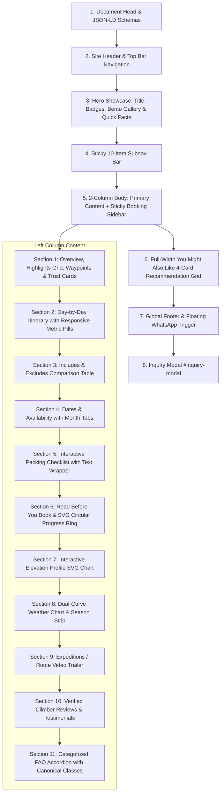

# Trek Page Builder Skill (`trek-page-builder`)

This skill provides the comprehensive design system, component hierarchy, technical requirements, code templates, interactive JavaScript controllers, and structured schema blueprints for creating and optimizing world-class **Trek Package Detail Pages** for **Igloo Himalaya Treks**, strictly modeled on the gold standard established in [`trek/everest-base-camp-trek/index.html`](file:///c:/Users/ASUS/Desktop/igloohimalayatreks/trek/everest-base-camp-trek/index.html) and [`trek/everest-base-camp-trek-16-days/index.html`](file:///c:/Users/ASUS/Desktop/igloohimalayatreks/trek/everest-base-camp-trek-16-days/index.html).

---

## 1. Core Principles & Repository Standards

> [!IMPORTANT]
> **MANDATORY QUALITY RULES**: Before developing or editing any trek page, you MUST adhere to [trek-page-quality-rules.md](file:///c:/Users/ASUS/Desktop/igloohimalayatreks/.agents/rules/trek-page-quality-rules.md) to eliminate all past mistakes:
> 1. **Both Columns Mandatory**: Never omit `.trek-sidebar-col` (`.sidebar-booking-card`) or `#inquiry-modal`.
> 2. **No Orphan Classes**: Verify all CSS classes exist in `index.css` before using them.
> 3. **Preserve JS Hooks**: Keep `data-altitude-m`, `data-tab`, `data-trek-details-wrapper`, and modal triggers intact.
> 4. **Single Source of Truth**: Keep pricing, duration, altitude, and facts 100% consistent across Schema, Hero, Facts, Sidebar, and Modal.
> 5. **Mandatory Visual Verification**: Never mark complete without verifying on desktop (1440px) and mobile (390px) via browser subagent.
> 6. **Highlights Component**: Strict adherence to Nar Phu Valley gold standard (no wireframe triangles `<polygon>`, emerald circular check badges, `<h2>` heading).

Every trek package detail page must adhere to these non-negotiable architectural and design rules:

1. **Brand Identity & Design System**:
   - Primary Navy: `#0E3458`
   - Brand Accent Blue: `#1A96C8`
   - Orange CTA Accent: `#F6851F`
   - Turquoise Highlight / Bars: `#00a8b5`
   - Light Panel Backgrounds: `#F8FAFC`, `#F4F9FC`
   - Border Grays: `#E2E8F0`, `#CBD5E1`
   - CSS Source of Truth: [`index.css`](file:///c:/Users/ASUS/Desktop/igloohimalayatreks/index.css)
   - Core Trek Controller: [`js/trek-details.js`](file:///c:/Users/ASUS/Desktop/igloohimalayatreks/js/trek-details.js)

2. **2-Column Responsive Body Layout**:
   - The layout must use the canonical wrapper:
   ```html
   <section class="section-padding" style="padding-top: 10px;" data-trek-details-wrapper data-trek-key="{trek_key}">
     <div class="container trek-detail-layout" style="display: grid; grid-template-columns: 2.2fr 1fr; gap: 40px; align-items: stretch; position: relative;">
       <div style="min-width: 0;">
         <!-- Left Column Sections -->
       </div>
       <!-- Right Column Sidebar -->
     </div>
   </section>
   ```
   - Always include `data-trek-details-wrapper` and `data-trek-key="{trek_key}"` (e.g. `ebc_16`, `ebc_14`, `abc_short`) so localStorage tracking for gear checklist and reading progress is properly scoped.

3. **Sub-Navigation Sticky Bar**:
   - Exactly 10 anchor buttons with SVG icons:
     `Overview`, `Itinerary`, `Includes & Excludes`, `Dates & Availability`, `Packing List`, `Trip Details`, `Map`, `Booking`, `Reviews`, `FAQs`.

4. **Zero Missing Assets**:
   - All referenced images must exist in `/images/`.
   - Never leave broken or placeholder image paths.

---

## 2. Standard Page Section Checklist

Every trek detail page must feature the following sections in sequence:



---

## 3. Component Architecture & Production Blueprints

### A. Highlights Section (Nar Phu Valley Gold Standard)
> [!CAUTION]
> NEVER output bare unstyled wireframe triangles (`<polygon points="12 2 2 22 22 22"></polygon>`) or invent classes like `.rich-highlights-grid` without them existing in `index.css`. Doing so drops an unstyled open triangle icon on top of text!
> Always use the Nar Phu Valley gold standard: a clean `#F8FAFC` card container, an `<h2>` heading with the copper-orange star icon, an auto-fit 2-column flex grid (`minmax(320px, 1fr)`), and emerald green circular checkmark badges:

```html
<div style="background: #F8FAFC; border: 1px solid #E2E8F0; border-radius: 12px; padding: 24px; margin-bottom: 30px;">
  <h2 style="font-size: 1.25rem; font-weight: 700; color: var(--color-primary-navy); margin-bottom: 18px; display: flex; align-items: center; gap: 8px;">
    <svg width="22" height="22" viewBox="0 0 24 24" fill="none" stroke="var(--color-copper-orange)" stroke-width="2.5" stroke-linecap="round" stroke-linejoin="round">
      <polygon points="12 2 15.09 8.26 22 9.27 17 14.14 18.18 21.02 12 17.77 5.82 21.02 7 14.14 2 9.27 8.91 8.26 12 2"></polygon>
    </svg>
    {Trek Title} Highlights
  </h2>
  <div style="display: grid; grid-template-columns: repeat(auto-fit, minmax(320px, 1fr)); gap: 14px;">
    <div style="display: flex; align-items: flex-start; gap: 12px;">
      <div style="width: 24px; height: 24px; background: #ECFDF5; border: 1px solid #10B981; border-radius: 50%; display: flex; align-items: center; justify-content: center; flex-shrink: 0; margin-top: 2px;">
        <svg width="14" height="14" viewBox="0 0 24 24" fill="none" stroke="#10B981" stroke-width="2.5" stroke-linecap="round" stroke-linejoin="round">
          <polyline points="20 6 9 17 4 12"></polyline>
        </svg>
      </div>
      <span style="font-size: 0.98rem; color: #334155; line-height: 1.55; font-weight: 500;">{Highlight narrative statement.}</span>
    </div>
  </div>
</div>
```

---

### B. Itinerary Accordion with Metric Badge Pills
Each itinerary day accordion must feature responsive metric pills (`.itinerary-metrics-list` and `.itinerary-metric-item`):

```html
<div class="itinerary-accordion-card active" data-day="1">
  <div class="itinerary-accordion-header">
    <div class="itinerary-header-left">
      <div class="itinerary-day-badge">Day 1</div>
      <div class="itinerary-title-group">
        <h3 class="itinerary-card-title">Arrival in Kathmandu & Hotel Transfer</h3>
        <ul class="itinerary-metrics-list">
          <li class="itinerary-metric-item">
            <svg width="14" height="14" viewBox="0 0 24 24" fill="none" stroke="currentColor" stroke-width="2"><path d="M21 10c0 7-9 13-9 13s-9-6-9-13a9 9 0 0 1 18 0z"></path><circle cx="12" cy="10" r="3"></circle></svg>
            <span>Tribhuvan Int'l Airport (KTM)</span>
          </li>
          <li class="itinerary-metric-item">
            <svg width="14" height="14" viewBox="0 0 24 24" fill="none" stroke="currentColor" stroke-width="2"><polygon points="12 2 2 22 22 22"></polygon></svg>
            <span>1,400 m / 4,593 ft</span>
          </li>
          <li class="itinerary-metric-item">
            <svg width="14" height="14" viewBox="0 0 24 24" fill="none" stroke="currentColor" stroke-width="2"><circle cx="12" cy="12" r="10"></circle><polyline points="12 6 12 12 16 14"></polyline></svg>
            <span>Welcome Meeting</span>
          </li>
          <li class="itinerary-metric-item">
            <svg width="14" height="14" viewBox="0 0 24 24" fill="none" stroke="currentColor" stroke-width="2"><path d="M3 9l9-7 9 7v11a2 2 0 0 1-2 2H5a2 2 0 0 1-2-2z"></path></svg>
            <span>3-Star Hotel, Thamel</span>
          </li>
        </ul>
      </div>
    </div>
    <span class="itinerary-accordion-chevron">∨</span>
  </div>
  <div class="itinerary-accordion-content" style="max-height: 2000px;">
    <div class="itinerary-accordion-content-inner">
      <p>{Day description narrative.}</p>
    </div>
  </div>
</div>
```

---

### C. Packing Checklist with Flex Column Text Wrapper
> [!IMPORTANT]
> To prevent descriptions from squishing the item labels on 2-column grids or mobile screens, the label and description MUST be wrapped in a `.gear-item-text` flex-column container, and the checkbox aligned with `margin-top: 3px;`.

```html
<label class="gear-item-row" for="gear-boots">
  <input type="checkbox" id="gear-boots" class="gear-checkbox" style="margin-top: 3px;">
  <div class="gear-item-text" style="display: flex; flex-direction: column; gap: 2px; flex: 1; min-width: 0;">
    <span class="gear-item-label">Waterproof Hiking Boots</span>
    <span class="gear-item-desc" style="margin-left: 0;">High ankle support, Gore-Tex, broken in • <strong>1 pair</strong></span>
  </div>
</label>
```

---

### D. Read Before You Book (Trip Details Accordion & SVG Progress Ring)
> [!WARNING]
> Do NOT introduce intermediate wrapper elements (like `.detail-accordion-body`) inside `.detail-accordion-card`. The script `js/trek-details.js` expects `.detail-accordion-content` directly under the card!

```html
<div class="detail-accordion-card" data-topic="difficulty">
  <div class="detail-accordion-header">
    <div class="detail-header-left">
      <div class="detail-icon-pill">
        <svg width="18" height="18" viewBox="0 0 24 24" fill="none" stroke="currentColor" stroke-width="2"><circle cx="12" cy="12" r="10"></circle><polyline points="12 6 12 12 16 14"></polyline></svg>
      </div>
      <div>
        <h3 class="detail-card-title">1. Trek Difficulty & Preparation</h3>
        <p class="detail-card-snippet">Moderate to challenging; requires regular cardio training.</p>
      </div>
    </div>
    <span class="detail-accordion-chevron">∨</span>
  </div>
  <div class="detail-accordion-content">
    <div class="detail-accordion-content-inner">
      <p>{Full topic details...}</p>
    </div>
  </div>
</div>
```

Circular SVG reading progress ring markup:
```html
<div class="reading-progress-card">
  <div class="progress-ring-container">
    <svg class="progress-ring-svg" width="60" height="60">
      <circle class="progress-ring-circle-bg" stroke="#E2E8F0" stroke-width="5" fill="transparent" r="24" cx="30" cy="30"/>
      <circle id="readProgressCircle" class="progress-ring-circle" stroke="#1A96C8" stroke-width="5" stroke-dasharray="150.79" stroke-dashoffset="150.79" stroke-linecap="round" fill="transparent" r="24" cx="30" cy="30"/>
    </svg>
    <span id="readProgressPercent" class="progress-percent-text">0%</span>
  </div>
  <div class="progress-text-group">
    <h4 class="progress-card-title">Reading Progress</h4>
    <p id="readProgressText" class="progress-card-subtitle">0 of 10 topics read</p>
  </div>
</div>
```

---

### E. Frequently Asked Questions (FAQ) Section
> [!CAUTION]
> Always use the canonical CSS classes from `index.css`. Never invent class names like `.faq-top-banner` or `.faq-expand-btn` — doing so produces an unstyled gray default HTML button and breaks the header alignment!

#### Canonical FAQ Markup:
```html
<section id="section-faqs" class="trek-detail-section">
  <h2 class="faq-section-accent-title">
    <span class="faq-accent-bar"></span>
    {Trek Name} FAQs
  </h2>

  <div class="faq-layout-container">

    <!-- Left Sidebar Category Navigation -->
    <div class="faq-sidebar-card">
      <div class="faq-category-nav">
        <button type="button" class="faq-category-btn active" data-category="general">
          <span class="faq-cat-icon">
            <svg width="18" height="18" viewBox="0 0 24 24" fill="none" stroke="currentColor" stroke-width="2"><circle cx="12" cy="12" r="10"></circle><polyline points="12 6 12 12 16 14"></polyline></svg>
          </span>
          <span class="faq-cat-label">General & Route</span>
          <span class="faq-cat-badge">5</span>
        </button>
        <button type="button" class="faq-category-btn" data-category="gear">
          <span class="faq-cat-icon">
            <svg width="18" height="18" viewBox="0 0 24 24" fill="none" stroke="currentColor" stroke-width="2"><path d="M21 16V8a2 2 0 0 0-1-1.73l-7-4a2 2 0 0 0-2 0l-7 4A2 2 0 0 0 3 8v8a2 2 0 0 0 1 1.73l7 4a2 2 0 0 0 2 0l7-4A2 2 0 0 0 21 16z"></path></svg>
          </span>
          <span class="faq-cat-label">Gear & Porters</span>
          <span class="faq-cat-badge">4</span>
        </button>
        <button type="button" class="faq-category-btn" data-category="health">
          <span class="faq-cat-icon">
            <svg width="18" height="18" viewBox="0 0 24 24" fill="none" stroke="currentColor" stroke-width="2"><path d="M22 12h-4l-3 9L9 3l-3 9H2"></path></svg>
          </span>
          <span class="faq-cat-label">Health & Altitude</span>
          <span class="faq-cat-badge">3</span>
        </button>
        <button type="button" class="faq-category-btn" data-category="booking">
          <span class="faq-cat-icon">
            <svg width="18" height="18" viewBox="0 0 24 24" fill="none" stroke="currentColor" stroke-width="2"><rect x="3" y="4" width="18" height="18" rx="2" ry="2"></rect><line x1="16" y1="2" x2="16" y2="6"></line><line x1="8" y1="2" x2="8" y2="6"></line><line x1="3" y1="10" x2="21" y2="10"></line></svg>
          </span>
          <span class="faq-cat-label">Booking & Flights</span>
          <span class="faq-cat-badge">3</span>
        </button>
      </div>
    </div>

    <!-- Right FAQ Content Panel -->
    <div class="faq-main-panel">
      <!-- Header Bar -->
      <div class="faq-panel-header">
        <h3 class="faq-active-category-title" id="faq-current-category-title">General & Route</h3>
        <button type="button" class="faq-expand-all-btn" id="faq-expand-all-btn">Expand All</button>
      </div>

      <!-- Category 1: General & Route -->
      <div class="faq-category-content active" id="faq-cat-general">
        <div class="faq-item">
          <div class="faq-item-question">
            <span>{Question Text}</span>
            <span class="faq-toggle-circle">∨</span>
          </div>
          <div class="faq-item-answer">
            <p style="margin: 0; line-height: 1.65;">{Answer Text}</p>
          </div>
        </div>
      </div>

      <!-- Other Category Panels (without .active) -->
      <div class="faq-category-content" id="faq-cat-gear">...</div>
      <div class="faq-category-content" id="faq-cat-health">...</div>
      <div class="faq-category-content" id="faq-cat-booking">...</div>

    </div>
  </div>
</section>
```

#### FAQ Design System Reference in `index.css`:
- `.faq-main-panel`: `background: #ffffff; border-radius: 16px; border: 1px solid #eef2f6; box-shadow: 0 4px 20px rgba(0,0,0,0.04); overflow: hidden;`
- `.faq-panel-header`: `display: flex; justify-content: space-between; align-items: center; background: #f4f9fc; padding: 18px 24px; border-bottom: 1px solid #e5f0f6;`
- `.faq-active-category-title`: `font-size: 1.15rem; font-weight: 700; color: var(--color-primary-navy);`
- `.faq-expand-all-btn`: `background: #ffffff; border: 1px solid #cce3ee; color: #1A96C8; padding: 6px 16px; border-radius: 20px; font-size: 0.82rem; font-weight: 600; cursor: pointer;`
- `.faq-toggle-circle`: `width: 26px; height: 26px; border-radius: 50%; border: 1px solid #dbe7ee; display: inline-flex; align-items: center; justify-content: center;`
- `.faq-item.active .faq-toggle-circle`: `transform: rotate(180deg); background-color: #1A96C8; color: #ffffff;`

---

### F. Sticky Booking Sidebar
The sticky sidebar card on the right column:
```html
<div class="trek-sidebar-col" style="position: relative; height: 100%;">
  <div class="sidebar-booking-card" style="position: -webkit-sticky; position: sticky; top: 148px; z-index: 50;">
    <!-- Top Right Ribbon Badge -->
    <div style="position: absolute; top: 18px; right: 0; background: #F59E0B; color: #FFFFFF; font-size: 0.72rem; font-weight: 800; padding: 5px 14px; border-radius: 4px 0 0 4px; text-transform: uppercase;">
      RECOMMENDED 2026
    </div>

    <!-- Pricing Header -->
    <span style="font-size: 0.75rem; font-weight: 800; color: #475569; text-transform: uppercase;">FROM</span>
    <div style="display: flex; align-items: baseline; gap: 6px; margin-bottom: 16px; flex-wrap: wrap;">
      <span style="font-size: 2.5rem; font-weight: 800; color: #0E3458; line-height: 1;">${Price}</span>
      <span style="font-size: 0.92rem; color: #64748B; font-weight: 500;">/ person</span>
      <a href="#section-itinerary" style="font-size: 0.92rem; color: #475569; font-weight: 600; text-decoration: underline;">{Duration} days trip</a>
    </div>

    <!-- Tiered Group Pricing Toggle -->
    <div class="group-discount-toggle" onclick="const table = this.nextElementSibling; const arrow = this.querySelector('.gd-arrow'); if (table.style.display === 'none') { table.style.display = 'block'; arrow.style.transform = 'rotate(180deg)'; } else { table.style.display = 'none'; arrow.style.transform = 'rotate(0deg)'; }" style="border-top: 1px dashed #CBD5E1; border-bottom: 1px dashed #CBD5E1; padding: 10px 0; margin-bottom: 18px; cursor: pointer; display: flex; justify-content: space-between; align-items: center;">
      <span style="font-size: 0.78rem; font-weight: 800; color: #0E3458; text-transform: uppercase;">TIERED GROUP PRICING</span>
      <span class="gd-arrow" style="font-size: 0.85rem; color: #0E3458; transition: transform 0.2s ease;">▼</span>
    </div>

    <!-- Action Buttons -->
    <button class="btn open-inquiry-btn" data-trek-title="{Trek Title}" style="width: 100%; padding: 14px; background: #F6851F; color: #FFFFFF; border: none; border-radius: 50px; font-size: 1.05rem; font-weight: 800; cursor: pointer; margin-bottom: 12px; box-shadow: 0 4px 14px rgba(246, 133, 31, 0.35);">
      Book Now
    </button>
    <button class="btn open-inquiry-btn" data-trek-title="{Trek Title}" style="width: 100%; padding: 12px; background: #FFFFFF; color: #0E3458; border: 1px solid #CBD5E1; border-radius: 50px; font-size: 0.98rem; font-weight: 700; cursor: pointer; margin-bottom: 22px;">
      Make an Enquiry
    </button>

    <!-- Trust Bullets & WhatsApp CTA -->
    ...
  </div>
</div>
```

---

## 4. Compilation & Verification Workflow

When generating or refactoring a trek package page:

1. **Structured Data Separation**:
   - Store itinerary days in `scratch/{slug}_itinerary_data.js`.
   - Store sections (highlights, inclusions, packing items, trip details, FAQs, departures) in `scratch/{slug}_sections_data.js`.
   - Compile using `node scratch/build_{slug}.js`.

2. **Automated Validation**:
   - Verify HTML tag balancing (0 diff on `div`, `section`, `article`, `header`, `footer`, `nav`).
   - Validate that all local image paths resolve to physical files on disk.

3. **Browser Testing with Automated Subagent**:
   - Navigate to `http://localhost:3000/trek/{slug}/`.
   - Test Packing List checkboxes: verify packed count increment.
   - Test "Read Before You Book": expand cards and confirm circular SVG reading progress ring updates.
   - Test FAQ: verify "Expand All" / "Collapse All" button styling and behavior across all categories.
   - Verify desktop and mobile responsive layout integrity.
