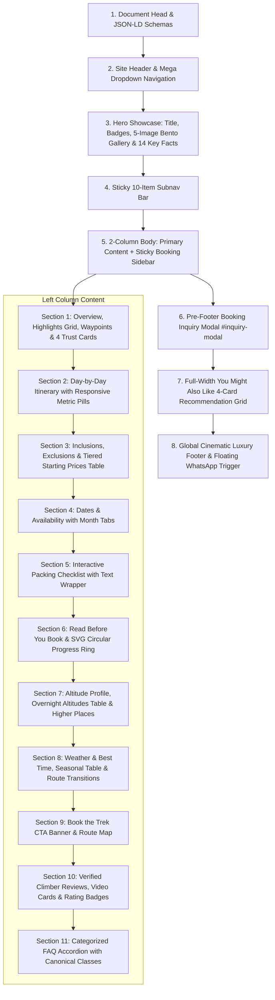

# Trek Page Builder Skill (`trek-page-builder`)

This skill provides the comprehensive design system, component hierarchy, technical requirements, production code templates, interactive JavaScript controllers, and structured schema blueprints for creating and optimizing world-class **Trek Package Detail Pages** for **Igloo Himalaya Treks**, strictly modeled on the gold standards established in [`trek/everest-base-camp-trek/index.html`](file:///c:/Users/ASUS/Desktop/igloohimalayatreks/trek/everest-base-camp-trek/index.html), [`trek/mardi-himal-trek/index.html`](file:///c:/Users/ASUS/Desktop/igloohimalayatreks/trek/mardi-himal-trek/index.html), and [`trek/nar-phu-valley-trek/index.html`](file:///c:/Users/ASUS/Desktop/igloohimalayatreks/trek/nar-phu-valley-trek/index.html).

---

## 1. Core Principles & Repository Standards

> [!IMPORTANT]
> **THE 18 MANDATORY QUALITY RULES ("NEVER-REPEAT" MISTAKES)**:
> Before developing or editing any trek page, you MUST adhere to [trek-page-quality-rules.md](file:///c:/Users/ASUS/Desktop/igloohimalayatreks/.agents/rules/trek-page-quality-rules.md) to eliminate all historical mistakes:
> 1. **Both Columns Mandatory**: Never omit `.trek-sidebar-col` (`.sidebar-booking-card`) or `#inquiry-modal`. The main layout is a 2-column grid (`2.2fr 1fr; gap: 40px;`).
> 2. **Pre-Footer Element Ordering**: The `#inquiry-modal` dialog MUST ALWAYS be placed before `.you-might-like-section`, which in turn sits before the footer.
> 3. **No Orphan Classes**: Verify all CSS classes exist in `index.css` before using them. Never invent unstyled custom classes.
> 4. **Preserve JS Hooks**: Keep `data-altitude-m`, `data-tab`, `data-trek-details-wrapper`, and modal triggers intact.
> 5. **Single Source of Truth (SSOT)**: Keep pricing, duration, altitude, and facts 100% consistent across Schema, Hero, Facts, Sidebar, and Modal.
> 6. **Authentic Hero Bento Imagery**: Use 5 authentic, trek-specific WebP images (1 main + 4 sub-grid tiles) with synchronized `og:image` and `twitter:image`. Never use generic or broken image paths.
> 7. **Comprehensive 14-Item Key Trip Facts**: Render all authentic trip facts using semantic SVG icons inside circular `#F2F4F6` background badges with `#1A96C8` stroke and a 3-tier hierarchy (Category, Headline, Subtitle).
> 8. **Clean Standalone Section Architecture**: Never nest Elevation Profile (`#section-altitude-profile`) or Weather (`#section-weather`) inside Read Before You Book (`#section-details`). Keep them standalone with their own subnav anchors.
> 9. **Authentic Region Recommendations**: Never leave generic Everest cards or dummy `#` links in `.you-might-like-section`. Recommend 4 authentic, regionally relevant packages with duration badges, starting prices, and active URLs.
> 10. **Zero Cross-Trek Copy Contamination**: Reviews (`#section-reviews`), hero read-more scripts, and itinerary copy must be 100% authentic to the trek. Never leave leftover text or IDs from other treks (e.g., Tilicho Lake, Thorong La, EBC, or `#ebc-toggle-btn`).
> 11. **Client Source Document Verbatim Parity**: When working from a client Google Doc or brief, ensure 100% verbatim capture of all sections, sub-tables, packing items, higher places, seasonal conditions, and FAQs. Validate using an automated parity script.
> 12. **Mandatory Post-Flight Verification**: Run the tag balancer script (0 diff on `div`, `section`, `article`, `main`, `form`, `table`, `ul`) and visually verify via `browser_subagent` on desktop (1440px) and mobile (390px) before returning.
> 13. **Itinerary Architecture, Timeline Dots & Semantic Badges**:
>     - Header Bar: Must use `<div class="itinerary-header-bar">` and `<button id="toggle-all-itinerary" class="itinerary-toggle-all-btn" type="button">` with animated SVG chevron (bound to `js/trek-details.js`). NEVER use unstyled `.itinerary-expand-all-btn`.
>     - Timeline Dots: `.itinerary-card` must have `overflow: visible !important;` so the 14px circular timeline dot (`::before` at `left: -28px; top: 26px; border: 3px solid #1A96C8;`) displays centered on the vertical line (`border-left: 2px solid #E2E8F0;`).
>     - Daily Fact Boxes: Render Google Doc daily facts inside `.itinerary-meta-box` and `.itinerary-meta-box-item` with color-coded `.itinerary-meta-box-badge` SVGs (Activity = blue compass, Altitude = amber mountain, Accommodation = green lodge, Meals = rose cutlery, Time = blue clock, Route = purple map pin). NEVER output plain unstyled grey wireframe tables.
>     - Rich Subtitles: Include 3-part subtitle with `data-altitude-m="{meters}"`: `[Action] — <span data-altitude-m="{meters}">[Overnight Altitude & Location]</span> — [Duration/Highlight]`.
>     - Narrative Paragraphs: Wrap narrative paragraphs inside `.itinerary-description` with verbatim client copy preserved.
> 14. **Zero-MVP First-Pass Publishing Mandate**:
>     - When publishing content from a Google Doc or brief, NEVER output wireframe or MVP placeholder sections (e.g. basic unstyled tables, grey boxes, plain bullet lists, or incomplete tabs).
>     - Every single section (Subnav, Highlights, Inclusions/Exclusions, Starting Prices, Packing List, Read Before You Book, Standalone Altitude Profile, Weather, Booking Banner, Reviews, Categorized FAQs, and Bottom CTA Card) MUST be generated in full production-grade Gold Standard styling immediately in Pass 1.
> 15. **FAQ Panel Visibility & Inline Style Rule**:
>     - NEVER write inline `style="display: none;"` on `.faq-category-content` containers.
>     - Visibility must be governed strictly by CSS (`.faq-category-content { display: none; }` and `.faq-category-content.active { display: block; }`). Hardcoded inline `display: none` overrides the active CSS class and breaks tab switching.
>     - Accordion items must include `.faq-toggle-circle` with smooth CSS rotation, and the header must include `<button id="faq-expand-all-btn" class="faq-expand-all-btn" type="button">Expand All</button>`.
> 16. **High-Conversion Book / Enquire Bottom CTA Card**:
>     - At the bottom of Section 11 (`#section-faqs`) before `</section>`, NEVER output a plain `#F8FAFC` gray box.
>     - Must feature the ultra-premium high-conversion gradient card (`background: linear-gradient(135deg, #0A2540 0%, #0E3458 55%, #144A75 100%);`) with glowing radial accents, frosted glass kicker badge (`PLAN YOUR HIMALAYAN EXPEDITION`), verbatim client copy, dual action buttons (`Enquire Now` with modal trigger + `Chat on WhatsApp` with pre-filled text), and 3 trust badges (100% Guaranteed Departures, 2–4 Hr Response, Certified High-Altitude Sherpa Guides).
> 17. **Reviews & Testimonials 3-Tab Architecture**:
>     - `#section-reviews` must feature the 3-tab filter system (`All Reviews`, `Video Stories`, `Photo Reviews`), 4.9/5 aggregate score bar with TripAdvisor & Google badges, playable video card lightbox modal triggers (`video-modal.js` + `setupHimalayanReviews()`), and authentic trekker reviews specific to the route.
> 18. **Subnav Sticky Bar Architecture & Smooth Scrolling**:
>     - Must feature exactly 10 anchor buttons with SVG icons corresponding to the 10 left-column sections.
>     - Must use `top: 76px`, `backdrop-filter: blur(12px);`, horizontal scrolling with hidden scrollbars, and active state pill indicators.

### Brand Identity & Design System
- Primary Navy: `#0E3458`
- Brand Accent Blue: `#1A96C8`
- Orange CTA Accent: `#F6851F` / `#FF7900`
- Emerald Green Accent: `#10B981` (Checkmarks & highlights)
- Light Panel Backgrounds: `#F8FAFC`, `#F4F9FC`
- Border Grays: `#E2E8F0`, `#CBD5E1`
- CSS Source of Truth: [`index.css`](file:///c:/Users/ASUS/Desktop/igloohimalayatreks/index.css)
- Core Trek Controller: [`js/trek-details.js`](file:///c:/Users/ASUS/Desktop/igloohimalayatreks/js/trek-details.js)

### 2-Column Responsive Body Layout
The layout must use the canonical wrapper:
```html
<section class="section-padding" style="padding-top: 10px;" data-trek-details-wrapper data-trek-key="{trek_key}">
  <div class="container trek-detail-layout" style="display: grid; grid-template-columns: 2.2fr 1fr; gap: 40px; align-items: stretch; position: relative;">
    <div style="min-width: 0;">
      <!-- Left Column Content Sections -->
    </div>
    <!-- Right Column Sticky Sidebar -->
    <div class="trek-sidebar-col" style="position: relative; height: 100%;">
      <div class="sidebar-booking-card" style="position: -webkit-sticky; position: sticky; top: 148px; z-index: 50;">
        <!-- Sidebar content -->
      </div>
    </div>
  </div>
</section>
```
Always include `data-trek-details-wrapper` and `data-trek-key="{trek_key}"` (e.g. `mardi_8`, `nar_phu`, `ebc_16`) so localStorage tracking for gear checklist and reading progress is properly scoped.

### Sub-Navigation Sticky Bar
The sticky subnav sits directly beneath the site header (`top: 76px`), providing smooth navigation across the 10 core sections of the left column with `backdrop-filter: blur(12px)` and hidden scrollbars:
```html
<nav class="trek-sticky-subnav" style="position: -webkit-sticky; position: sticky; top: 76px; z-index: 40; background: rgba(255, 255, 255, 0.95); backdrop-filter: blur(12px); -webkit-backdrop-filter: blur(12px); border-bottom: 1px solid #E2E8F0; box-shadow: 0 4px 12px rgba(0, 0, 0, 0.03);">
  <div class="container" style="display: flex; align-items: center; gap: 8px; overflow-x: auto; scrollbar-width: none; -ms-overflow-style: none; padding-top: 10px; padding-bottom: 10px;">
    <a href="#section-overview" class="subnav-tab active" data-tab="overview">
      <svg width="15" height="15" viewBox="0 0 24 24" fill="none" stroke="currentColor" stroke-width="2"><circle cx="12" cy="12" r="10"></circle><polygon points="16.24 7.76 14.12 14.12 7.76 16.24 9.88 9.88 16.24 7.76"></polygon></svg>
      <span>Overview</span>
    </a>
    <a href="#section-itinerary" class="subnav-tab" data-tab="itinerary">
      <svg width="15" height="15" viewBox="0 0 24 24" fill="none" stroke="currentColor" stroke-width="2"><rect x="3" y="4" width="18" height="18" rx="2" ry="2"></rect><line x1="16" y1="2" x2="16" y2="6"></line><line x1="8" y1="2" x2="8" y2="6"></line><line x1="3" y1="10" x2="21" y2="10"></line></svg>
      <span>Itinerary</span>
    </a>
    <a href="#section-inclusions" class="subnav-tab" data-tab="inclusions">
      <svg width="15" height="15" viewBox="0 0 24 24" fill="none" stroke="currentColor" stroke-width="2"><path d="M12 22s8-4 8-10V5l-8-3-8 3v7c0 6 8 10 8 10z"></path></svg>
      <span>Includes &amp; Excludes</span>
    </a>
    <a href="#section-dates" class="subnav-tab" data-tab="dates">
      <svg width="15" height="15" viewBox="0 0 24 24" fill="none" stroke="currentColor" stroke-width="2"><rect x="3" y="4" width="18" height="18" rx="2" ry="2"></rect><line x1="16" y1="2" x2="16" y2="6"></line><line x1="8" y1="2" x2="8" y2="6"></line><line x1="3" y1="10" x2="21" y2="10"></line></svg>
      <span>Dates &amp; Availability</span>
    </a>
    <a href="#section-packing" class="subnav-tab" data-tab="packing">
      <svg width="15" height="15" viewBox="0 0 24 24" fill="none" stroke="currentColor" stroke-width="2"><line x1="8" y1="6" x2="21" y2="6"></line><line x1="8" y1="12" x2="21" y2="12"></line><line x1="8" y1="18" x2="21" y2="18"></line><line x1="3" y1="6" x2="3.01" y2="6"></line><line x1="3" y1="12" x2="3.01" y2="12"></line><line x1="3" y1="18" x2="3.01" y2="18"></line></svg>
      <span>Packing List</span>
    </a>
    <a href="#section-details" class="subnav-tab" data-tab="details">
      <svg width="15" height="15" viewBox="0 0 24 24" fill="none" stroke="currentColor" stroke-width="2"><circle cx="12" cy="12" r="10"></circle><line x1="12" y1="16" x2="12" y2="12"></line><line x1="12" y1="8" x2="12.01" y2="8"></line></svg>
      <span>Trip Details</span>
    </a>
    <a href="#section-altitude-profile" class="subnav-tab" data-tab="altitude-profile">
      <svg width="15" height="15" viewBox="0 0 24 24" fill="none" stroke="currentColor" stroke-width="2"><polygon points="12 2 2 22 22 22"></polygon></svg>
      <span>Altitude Profile</span>
    </a>
    <a href="#section-weather" class="subnav-tab" data-tab="weather">
      <svg width="15" height="15" viewBox="0 0 24 24" fill="none" stroke="currentColor" stroke-width="2"><path d="M17.5 19H9a7 7 0 1 1 6.71-9h1.79a4.5 4.5 0 1 1 0 9Z"></path></svg>
      <span>Weather</span>
    </a>
    <a href="#section-reviews" class="subnav-tab" data-tab="reviews">
      <svg width="15" height="15" viewBox="0 0 24 24" fill="none" stroke="currentColor" stroke-width="2"><polygon points="12 2 15.09 8.26 22 9.27 17 14.14 18.18 21.02 12 17.77 5.82 21.02 7 14.14 2 9.27 8.91 8.26 12 2"></polygon></svg>
      <span>Reviews</span>
    </a>
    <a href="#section-faqs" class="subnav-tab" data-tab="faqs">
      <svg width="15" height="15" viewBox="0 0 24 24" fill="none" stroke="currentColor" stroke-width="2"><circle cx="12" cy="12" r="10"></circle><path d="M9.09 9a3 3 0 0 1 5.83 1c0 2-3 3-3 3"></path><line x1="12" y1="17" x2="12.01" y2="17"></line></svg>
      <span>FAQs</span>
    </a>
  </div>
</nav>
```

---

## 2. Standard Page Section Checklist & Structural Flow

Every trek detail page must feature the following sections in sequence:



---

## 3. Component Architecture & Production Blueprints

### A. Hero Showcase & Multi-Image Bento Collage Gallery
Features the title, review badges, descriptive paragraph with scoped read-more toggle script, and 5-image bento gallery:
```html
<!-- Multi-Image Collage Gallery -->
<div class="container" style="margin-bottom: 24px;">
  <div class="trek-gallery-collage">
    <!-- Main Large Photo (Left) with TripAdvisor Travelers' Choice badge -->
    <div class="trek-gallery-main">
      
      <div class="trek-gallery-badge">
        <div class="trek-gallery-badge-icon" style="background: #00af87; display: flex; align-items: center; justify-content: center;">
          <svg class="icon-svg icon-sm icon-svg-fill" style="stroke: none; fill: white;" viewBox="0 0 24 24"><path d="M12 17.27L18.18 21l-1.64-7.03L22 9.24l-7.19-.61L12 2 9.19 8.63 2 9.24l5.46 4.73L5.82 21z"/></svg>
        </div>
        <div class="trek-gallery-badge-text">
          <span>Travelers' Choice</span>
          <span>Tripadvisor 2024</span>
        </div>
      </div>
    </div>
    <!-- 4 Sub-Photos (Right 2x2 Grid) -->
    <div class="trek-gallery-sub"></div>
    <div class="trek-gallery-sub trek-gallery-sub-top-right"></div>
    <div class="trek-gallery-sub"></div>
    <div class="trek-gallery-sub trek-gallery-sub-bottom-right"></div>
  </div>
</div>
```

> [!CAUTION]
> If adding an inline "Read More" button in the hero description, ensure its ID and script target `{trek-slug}-toggle-btn` and `{trek-slug}-more-text`. NEVER leave `#ebc-toggle-btn` or `#ebc-more-text` on non-EBC pages!

---

### B. Key Trip Facts (14-Item Responsive Grid)
Must feature all 14 authentic items with circular `#F2F4F6` SVG icon badges and a 3-tier visual hierarchy:
```html
<div class="trip-facts-grid" style="display: grid; grid-template-columns: repeat(auto-fit, minmax(220px, 1fr)); gap: 16px; margin-bottom: 30px;">
  <!-- Fact Item Example (with data-altitude-m hook) -->
  <div class="trip-fact-item" data-altitude-m="{meters}" style="display: flex; align-items: flex-start; gap: 12px; background: #FFFFFF; border: 1px solid #E2E8F0; border-radius: 10px; padding: 14px 16px;">
    <div style="width: 38px; height: 38px; background: #F2F4F6; border-radius: 50%; display: flex; align-items: center; justify-content: center; flex-shrink: 0; margin-top: 2px;">
      <svg width="20" height="20" viewBox="0 0 24 24" fill="none" stroke="#1A96C8" stroke-width="2" stroke-linecap="round" stroke-linejoin="round">
        <polygon points="12 2 2 22 22 22"></polygon>
      </svg>
    </div>
    <div>
      <div style="font-size: 0.72rem; font-weight: 700; color: #64748B; text-transform: uppercase; letter-spacing: 0.5px;">MAX ALTITUDE</div>
      <div style="font-size: 0.95rem; font-weight: 800; color: #0E3458; margin: 2px 0;">{Altitude Meters} m / {Altitude Feet} ft</div>
      <div style="font-size: 0.8rem; color: #64748B;">{Location Description}</div>
    </div>
  </div>
</div>
```

---

### C. Highlights Section (Nar Phu Valley Gold Standard)
> [!CAUTION]
> NEVER output bare unstyled wireframe triangles (`<polygon points="12 2 2 22 22 22"></polygon>`) or invent classes like `.rich-highlights-grid` without them existing in `index.css`.
> Always use the Nar Phu Valley gold standard: a clean `#F8FAFC` card container, an `<h2>` heading with copper-orange star icon, an auto-fit 2-column flex grid (`minmax(320px, 1fr)`), and emerald green circular checkmark badges:

```html
<div style="background: #F8FAFC; border: 1px solid #E2E8F0; border-radius: 12px; padding: 24px; margin-bottom: 30px;">
  <h2 style="font-size: 1.25rem; font-weight: 700; color: var(--color-primary-navy); margin-bottom: 18px; display: flex; align-items: center; gap: 8px;">
    <svg width="22" height="22" viewBox="0 0 24 24" fill="none" stroke="var(--color-copper-orange)" stroke-width="2.5" stroke-linecap="round" stroke-linejoin="round">
      <polygon points="12 2 15.09 8.26 22 9.27 17 14.14 18.18 21.02 12 17.77 5.82 21.02 7 14.14 2 9.27 8.91 8.26 12 2"></polygon>
    </svg>
    {Trek Title} Highlights
  </h2>
  <div style="display: grid; grid-template-columns: repeat(auto-fit, minmax(320px, 1fr)); gap: 14px;">
    <div style="display: flex; align-items: flex-start; gap: 12px;">
      <div style="width: 24px; height: 24px; background: #ECFDF5; border: 1px solid #10B981; border-radius: 50%; display: flex; align-items: center; justify-content: center; flex-shrink: 0; margin-top: 2px;">
        <svg width="14" height="14" viewBox="0 0 24 24" fill="none" stroke="#10B981" stroke-width="2.5" stroke-linecap="round" stroke-linejoin="round">
          <polyline points="20 6 9 17 4 12"></polyline>
        </svg>
      </div>
      <span style="font-size: 0.98rem; color: #334155; line-height: 1.55; font-weight: 500;">{Highlight narrative statement.}</span>
    </div>
  </div>
</div>
```

---

### D. Why Book With Us (4 Trust Promise Cards)
Render 4 high-converting service guarantee cards within Section 1:
```html
<div style="margin-top: 36px; margin-bottom: 20px;">
  <h2 style="font-size: 1.25rem; font-weight: 700; color: #0E3458; margin-bottom: 16px;">
    Why Book the {Trek Name} with Igloo Himalaya Treks?
  </h2>
  <div style="display: grid; grid-template-columns: repeat(auto-fit, minmax(260px, 1fr)); gap: 16px;">
    <!-- Trust Card 1: Trek Briefing & Gear Check -->
    <div style="border: 1px solid #E2E8F0; background: #FFFFFF; border-radius: 12px; padding: 20px; box-shadow: 0 1px 3px rgba(0,0,0,0.04);">
      <div style="width: 40px; height: 40px; border-radius: 8px; background: #F0FDF4; border: 1px solid #BBF7D0; display: flex; align-items: center; justify-content: center; margin-bottom: 12px;">
        <svg width="20" height="20" viewBox="0 0 24 24" fill="none" stroke="#16A34A" stroke-width="2"><path d="M12 22s8-4 8-10V5l-8-3-8 3v7c0 6 8 10 8 10z"></path></svg>
      </div>
      <h3 style="font-size: 1rem; font-weight: 700; color: #0E3458; margin-bottom: 6px;">Trek Briefing and Gear Check</h3>
      <p style="font-size: 0.88rem; color: #64748B; line-height: 1.55; margin: 0;">Comprehensive pre-departure checks in Kathmandu ensure every trekker is fully prepared.</p>
    </div>
    <!-- Trust Cards 2 (Guide/Porter Support), 3 (Medical Kit), 4 (Communication) -->
  </div>
</div>
```

---

### E. Itinerary Accordion with Metric Badges & Timeline Connectors

> [!CAUTION]
> **COMMON ITINERARY MISTAKES TO AVOID**:
> 1. **Dead Expand All Button**: NEVER write `<button class="itinerary-expand-all-btn">`! `js/trek-details.js` line 103 explicitly queries `#toggle-all-itinerary, .itinerary-toggle-all-btn`. Using wrong classes leaves the button unstyled and completely unresponsive.
> 2. **Clipped Timeline Dots**: `.itinerary-card` MUST have `overflow: visible !important;` in CSS. If `.itinerary-card` has `overflow: hidden`, the timeline pseudo-element (`::before` at `left: -28px; top: 26px;`) is cut off and invisible!
> 3. **Unstyled Wireframe Metric Tables**: NEVER dump Google Doc daily facts into an unstyled gray box with raw table divs. Use `.itinerary-meta-box` and `.itinerary-meta-box-item` with color-coded `.itinerary-meta-box-badge` SVGs.
> 4. **Missing Altitude Hooks in Subtitles**: Always include `<span data-altitude-m="{meters}">` inside `.itinerary-day-subtitle-new` so `js/altitude-visualizer.js` can track the route.

#### Production Itinerary Markup:
```html
<section id="section-itinerary" class="trek-detail-section">
  <!-- Header Bar with SSOT Expand/Collapse Controller -->
  <div class="itinerary-header-bar">
    <div class="details-title-wrapper" style="margin-bottom: 0;">
      <h2 class="details-main-title" style="font-size: 1.8rem; margin: 0; color: var(--color-primary-navy); font-weight: 700;">{Trek Title} Itinerary — Day by Day</h2>
      <div style="width: 48px; height: 4px; background: var(--color-copper-orange); border-radius: 2px; margin-top: 8px;"></div>
      <p style="font-size: 1.05rem; color: var(--color-neutral-600); line-height: 1.6; margin-top: 10px; margin-bottom: 0; max-width: 800px;">
        {Itinerary intro paragraph from client document.}
      </p>
    </div>
    <button id="toggle-all-itinerary" class="itinerary-toggle-all-btn" type="button">
      <svg width="15" height="15" viewBox="0 0 24 24" fill="none" stroke="currentColor" stroke-width="2.5" stroke-linecap="round" stroke-linejoin="round">
        <polyline points="6 9 12 15 18 9"></polyline>
      </svg>
      <span>Expand All Days</span>
    </button>
  </div>
  
  <!-- Connected Vertical Timeline -->
  <div class="itinerary-timeline">
    <!-- Day Card 1 (Active on load) -->
    <div class="itinerary-card active" data-day="1">
      <div class="itinerary-header">
        <div class="itinerary-header-left">
          <h4 class="itinerary-day-title-new">
            <span class="day-label">Day 1:</span> Arrival in Kathmandu
          </h4>
          <p class="itinerary-day-subtitle-new">
            Arrival &amp; Airport Transfer — <span data-altitude-m="1400">Kathmandu, around 1,400 m</span> — 3-Star Hotel Check-in
          </p>
        </div>
        <div class="itinerary-header-right">
          <div class="itinerary-toggle-btn-new">
            <svg width="18" height="18" viewBox="0 0 24 24" fill="none" stroke="currentColor" stroke-width="2.5" stroke-linecap="round" stroke-linejoin="round">
              <polyline points="6 9 12 15 18 9"></polyline>
            </svg>
          </div>
        </div>
      </div>
      <div class="itinerary-content">
        <div class="itinerary-content-inner">
          <!-- Daily Fact Table with Semantic Badges -->
          <div class="itinerary-meta-box">
            <div class="itinerary-meta-box-item">
              <div class="itinerary-meta-box-badge" style="background: #F0F9FF; color: #0284C7;">
                <svg width="17" height="17" viewBox="0 0 24 24" fill="none" stroke="currentColor" stroke-width="2.2" stroke-linecap="round" stroke-linejoin="round"><circle cx="12" cy="12" r="10"></circle><polygon points="16.24 7.76 14.12 14.12 7.76 16.24 9.88 9.88 16.24 7.76"></polygon></svg>
              </div>
              <div style="display: flex; flex-direction: column; min-width: 0;">
                <span style="font-size: 0.74rem; text-transform: uppercase; letter-spacing: 0.05em; color: #64748B; font-weight: 700; line-height: 1.2; margin-bottom: 3px;">MAIN ACTIVITY</span>
                <span style="font-size: 0.93rem; color: #0E3458; font-weight: 600; line-height: 1.4;">Arrival and airport transfer</span>
              </div>
            </div>
            <div class="itinerary-meta-box-item">
              <div class="itinerary-meta-box-badge" style="background: #FEF3C7; color: #D97706;">
                <svg width="17" height="17" viewBox="0 0 24 24" fill="none" stroke="currentColor" stroke-width="2.2" stroke-linecap="round" stroke-linejoin="round"><polygon points="12 2 2 22 22 22"></polygon><path d="M12 2v20"></path></svg>
              </div>
              <div style="display: flex; flex-direction: column; min-width: 0;">
                <span style="font-size: 0.74rem; text-transform: uppercase; letter-spacing: 0.05em; color: #64748B; font-weight: 700; line-height: 1.2; margin-bottom: 3px;">OVERNIGHT ALTITUDE</span>
                <span style="font-size: 0.93rem; color: #0E3458; font-weight: 600; line-height: 1.4;">Kathmandu, around 1,400 m</span>
              </div>
            </div>
            <div class="itinerary-meta-box-item">
              <div class="itinerary-meta-box-badge" style="background: #ECFDF5; color: #059669;">
                <svg width="17" height="17" viewBox="0 0 24 24" fill="none" stroke="currentColor" stroke-width="2.2" stroke-linecap="round" stroke-linejoin="round"><path d="M3 9l9-7 9 7v11a2 2 0 0 1-2 2H5a2 2 0 0 1-2-2z"></path><polyline points="9 22 9 12 15 12 15 22"></polyline></svg>
              </div>
              <div style="display: flex; flex-direction: column; min-width: 0;">
                <span style="font-size: 0.74rem; text-transform: uppercase; letter-spacing: 0.05em; color: #64748B; font-weight: 700; line-height: 1.2; margin-bottom: 3px;">ACCOMMODATION</span>
                <span style="font-size: 0.93rem; color: #0E3458; font-weight: 600; line-height: 1.4;">3-star hotel in Kathmandu</span>
              </div>
            </div>
            <div class="itinerary-meta-box-item">
              <div class="itinerary-meta-box-badge" style="background: #FDF2F8; color: #DB2777;">
                <svg width="17" height="17" viewBox="0 0 24 24" fill="none" stroke="currentColor" stroke-width="2.2" stroke-linecap="round" stroke-linejoin="round"><path d="M18 8h1a4 4 0 0 1 0 8h-1"></path><path d="M2 8h16v9a4 4 0 0 1-4 4H6a4 4 0 0 1-4-4V8z"></path><line x1="6" y1="1" x2="6" y2="4"></line><line x1="10" y1="1" x2="10" y2="4"></line><line x1="14" y1="1" x2="14" y2="4"></line></svg>
              </div>
              <div style="display: flex; flex-direction: column; min-width: 0;">
                <span style="font-size: 0.74rem; text-transform: uppercase; letter-spacing: 0.05em; color: #64748B; font-weight: 700; line-height: 1.2; margin-bottom: 3px;">MEALS</span>
                <span style="font-size: 0.93rem; color: #0E3458; font-weight: 600; line-height: 1.4;">As confirmed for arrival day</span>
              </div>
            </div>
          </div>

          <!-- Day Description -->
          <div class="itinerary-description">
            <p style="font-size: 0.98rem; line-height: 1.7; color: var(--color-neutral-700); margin-bottom: 12px;">{Verbatim Google Doc paragraph 1...}</p>
            <p style="font-size: 0.98rem; line-height: 1.7; color: var(--color-neutral-700); margin-bottom: 12px;">{Verbatim Google Doc paragraph 2...}</p>
          </div>
        </div>
      </div>
    </div>
    <!-- Subsequent Day Cards (Day 2 to Day N) ... -->
  </div>
</section>
```

#### Daily Fact Category Badge Color & Icon Mapping:
When transforming client Google Doc daily fact tables, map labels using this generator helper:
| Metric Label Category | Background | Icon Color | SVG Semantic Icon |
| :--- | :--- | :--- | :--- |
| **Activity / Main Activity** | `#F0F9FF` | `#0284C7` | Compass (`<circle cx="12" cy="12" r="10">`, `<polygon points="16.24...">`) |
| **Overnight Altitude / High Point** | `#FEF3C7` | `#D97706` | Mountain (`<polygon points="12 2 2 22 22 22">`, `<path d="M12 2v20">`) |
| **Accommodation / Stay / Hotel** | `#ECFDF5` | `#059669` | Teahouse Lodge (`<path d="M3 9l9-7 9 7v11...">`) |
| **Meals Included** | `#FDF2F8` | `#DB2777` | Coffee / Dining Cup (`<path d="M18 8h1...">`) |
| **Walking Time / Driving Estimate** | `#EFF6FF` | `#2563EB` | Clock (`<circle cx="12" cy="12" r="10">`, `<polyline points="12 6 12 12...">`) |
| **Walking Route / Airport Transfer** | `#F5F3FF` | `#7C3AED` | Route Pin (`<circle cx="12" cy="10" r="3">`, `<path d="M12 2...">`) |

---

### F. Inclusions, Exclusions & Tiered Pricing Section
Two-column card design (`#section-inclusions`) paired with group pricing tiers:
```html
<section id="section-inclusions" class="trek-detail-section">
  <div class="inclusions-grid" style="display: grid; grid-template-columns: repeat(auto-fit, minmax(320px, 1fr)); gap: 24px; margin-bottom: 30px;">
    <!-- Inclusions Column -->
    <div style="background: #FFFFFF; border: 1px solid #E2E8F0; border-radius: 12px; padding: 24px;">
      <h3 style="font-size: 1.15rem; font-weight: 700; color: #0E3458; margin-bottom: 18px; display: flex; align-items: center; gap: 8px;">
        <span style="width: 28px; height: 28px; background: #ECFDF5; border-radius: 50%; display: flex; align-items: center; justify-content: center; color: #10B981;">✓</span>
        What’s Included
      </h3>
      <ul style="list-style: none; padding: 0; margin: 0; display: flex; flex-direction: column; gap: 12px;">
        <li style="display: flex; align-items: flex-start; gap: 10px; font-size: 0.92rem; color: #334155;">
          <span style="color: #10B981; font-weight: bold; margin-top: 1px;">✓</span>
          <span>{Inclusion text}</span>
        </li>
      </ul>
    </div>
    <!-- Exclusions Column -->
    <div style="background: #FFFFFF; border: 1px solid #E2E8F0; border-radius: 12px; padding: 24px;">
      <h3 style="font-size: 1.15rem; font-weight: 700; color: #0E3458; margin-bottom: 18px; display: flex; align-items: center; gap: 8px;">
        <span style="width: 28px; height: 28px; background: #FEF2F2; border-radius: 50%; display: flex; align-items: center; justify-content: center; color: #EF4444;">✕</span>
        What’s Not Included
      </h3>
      <ul style="list-style: none; padding: 0; margin: 0; display: flex; flex-direction: column; gap: 12px;">
        <li style="display: flex; align-items: flex-start; gap: 10px; font-size: 0.92rem; color: #334155;">
          <span style="color: #EF4444; font-weight: bold; margin-top: 1px;">✕</span>
          <span>{Exclusion text}</span>
        </li>
      </ul>
    </div>
  </div>

  <!-- Starting Prices Table with Best Value Highlight -->
  <div style="background: #F8FAFC; border: 1px solid #E2E8F0; border-radius: 14px; padding: 26px; margin-bottom: 30px;">
    <div style="display: flex; justify-content: space-between; align-items: center; margin-bottom: 14px; flex-wrap: wrap; gap: 8px;">
      <h3 style="font-size: 1.15rem; font-weight: 700; color: #0E3458; margin: 0;">Starting Prices</h3>
      <span style="font-size: 0.78rem; font-weight: 700; color: #16A34A; background: #DCFCE7; padding: 4px 10px; border-radius: 20px;">All Taxes &amp; Permits Included</span>
    </div>
    <table style="width: 100%; border-collapse: collapse; font-size: 0.92rem;">
      <thead>
        <tr style="border-bottom: 2px solid #CBD5E1; text-align: left; color: #64748B;">
          <th style="padding: 12px 14px;">Group Size</th>
          <th style="padding: 12px 14px;">Price per Person</th>
          <th style="padding: 12px 14px;">Savings Tier</th>
        </tr>
      </thead>
      <tbody>
        <tr style="border-bottom: 1px solid #E2E8F0;">
          <td style="padding: 12px 14px; font-weight: 600; color: #0E3458;">1 Person</td>
          <td style="padding: 12px 14px; font-weight: 700; color: #0E3458;">${Solo Price}</td>
          <td style="padding: 12px 14px; color: #64748B;">Solo Trekker Rate</td>
        </tr>
        <tr style="border-bottom: 1px solid #E2E8F0;">
          <td style="padding: 12px 14px; font-weight: 600; color: #0E3458;">2–4 People</td>
          <td style="padding: 12px 14px; font-weight: 700; color: #0E3458;">${Small Group Price}</td>
          <td style="padding: 12px 14px; color: #16A34A; font-weight: 600;">Save ~7% per person</td>
        </tr>
        <tr style="border-bottom: 1px solid #E2E8F0; background: #F0FDF4;">
          <td style="padding: 12px 14px; font-weight: 700; color: #0E3458;">
            5–9 People
            <span style="background: #16A34A; color: #FFFFFF; font-size: 0.68rem; font-weight: 800; padding: 2px 8px; border-radius: 12px; margin-left: 6px; text-transform: uppercase;">Best Value</span>
          </td>
          <td style="padding: 12px 14px; font-weight: 800; color: #16A34A; font-size: 1.05rem;">${Standard Group Price}</td>
          <td style="padding: 12px 14px; color: #16A34A; font-weight: 700;">Save ~16% per person</td>
        </tr>
        <tr>
          <td style="padding: 12px 14px; font-weight: 600; color: #0E3458;">10+ People</td>
          <td style="padding: 12px 14px; font-weight: 700; color: #1A96C8;">Custom Quote</td>
          <td style="padding: 12px 14px; color: #1A96C8; font-weight: 600;">Tailored group discount</td>
        </tr>
      </tbody>
    </table>
  </div>
</section>
```

---

### G. Packing Checklist with Flex Column Text Wrapper
> [!IMPORTANT]
> To prevent descriptions from squishing the item labels on 2-column grids or mobile screens, the label and description MUST be wrapped in a `.gear-item-text` flex-column container, and the checkbox aligned with `margin-top: 3px;`.

```html
<label class="gear-item-row" for="gear-boots">
  <input type="checkbox" id="gear-boots" class="gear-checkbox" style="margin-top: 3px;">
  <div class="gear-item-text" style="display: flex; flex-direction: column; gap: 2px; flex: 1; min-width: 0;">
    <span class="gear-item-label">Waterproof Hiking Boots</span>
    <span class="gear-item-desc" style="margin-left: 0;">High ankle support, Gore-Tex, broken in • <strong>1 pair</strong></span>
  </div>
</label>
```

---

### H. Read Before You Book (Trip Details Accordion & SVG Progress Ring)
> [!WARNING]
> Do NOT introduce intermediate wrapper elements (like `.detail-accordion-body`) inside `.detail-accordion-card`. The script `js/trek-details.js` expects `.detail-accordion-content` directly under the card!
> Never nest Elevation Profile or Weather tables inside `#section-details`!

```html
<section id="section-details" class="trek-detail-section">
  <div class="details-section-container">
    <div class="details-title-wrapper">
      <span class="details-accent-bar"></span>
      <h2 class="details-section-title">Read Before You Book</h2>
    </div>
    <p class="details-section-subtitle">
      Essential logistical, health, altitude, and accommodation briefing notes.
    </p>

    <!-- Reading Progress Ring Card -->
    <div class="reading-progress-card">
      <div class="progress-ring-container">
        <svg class="progress-ring-svg" width="60" height="60">
          <circle class="progress-ring-circle-bg" stroke="#E2E8F0" stroke-width="5" fill="transparent" r="24" cx="30" cy="30"/>
          <circle id="readProgressCircle" class="progress-ring-circle" stroke="#1A96C8" stroke-width="5" stroke-dasharray="150.79" stroke-dashoffset="150.79" stroke-linecap="round" fill="transparent" r="24" cx="30" cy="30"/>
        </svg>
        <span id="readProgressPercent" class="progress-percent-text">0%</span>
      </div>
      <div class="progress-text-group">
        <h4 class="progress-card-title">Reading Progress</h4>
        <p id="readProgressText" class="progress-card-subtitle">0 of 10 topics read</p>
      </div>
    </div>

    <!-- 10 Topic Accordion Cards -->
    <div class="detail-accordion-card" data-topic="difficulty">
      <div class="detail-accordion-header">
        <div class="detail-header-left">
          <div class="detail-icon-pill">
            <svg width="18" height="18" viewBox="0 0 24 24" fill="none" stroke="currentColor" stroke-width="2"><circle cx="12" cy="12" r="10"></circle><polyline points="12 6 12 12 16 14"></polyline></svg>
          </div>
          <div>
            <h3 class="detail-card-title">1. Trek Difficulty & Preparation</h3>
            <p class="detail-card-snippet">Moderate to challenging; requires regular cardio training.</p>
          </div>
        </div>
        <div class="detail-header-right">
          <span class="detail-check-bubble">✓</span>
          <span class="detail-accordion-chevron">∨</span>
        </div>
      </div>
      <div class="detail-accordion-content">
        <div class="detail-accordion-content-inner">
          <p>{Full topic details...}</p>
        </div>
      </div>
    </div>
  </div>
</section>
```

---

### I. Standalone Altitude Profile & Overnight Altitudes Table (`#section-altitude-profile`)
Standalone section featuring the elevation visualizer, overnight altitudes table, and higher places cards:
```html
<section id="section-altitude-profile" class="trek-detail-section" style="margin-top: 40px; margin-bottom: 40px;">
  <h2 style="font-size: 1.35rem; font-weight: 700; color: #0E3458; margin-bottom: 8px;">
    Altitude Profile of the {Trek Name}
  </h2>
  <p style="font-size: 0.92rem; color: #64748B; margin-bottom: 20px;">
    Visual ascent trajectory, daily sleeping altitudes, and major acclimatization waypoints.
  </p>

  <!-- Interactive Elevation Chart Container -->
  <div id="altitude-profile-container" style="background: #FFFFFF; border: 1px solid #E2E8F0; border-radius: 12px; padding: 20px; margin-bottom: 24px;">
    <!-- Rendered SVG chart -->
  </div>

  <!-- Overnight Altitudes Table -->
  <div style="background: #FFFFFF; border: 1px solid #E2E8F0; border-radius: 12px; overflow: hidden; margin-bottom: 24px;">
    <table style="width: 100%; border-collapse: collapse; font-size: 0.9rem;">
      <thead style="background: #F8FAFC; border-bottom: 1px solid #E2E8F0;">
        <tr>
          <th style="padding: 12px 16px; text-align: left; color: #475569;">Day</th>
          <th style="padding: 12px 16px; text-align: left; color: #475569;">Route / Waypoint</th>
          <th style="padding: 12px 16px; text-align: left; color: #475569;">Overnight Altitude</th>
          <th style="padding: 12px 16px; text-align: left; color: #475569;">Elevation Change / Terrain</th>
        </tr>
      </thead>
      <tbody>
        <!-- Daily Rows -->
        <tr style="border-bottom: 1px solid #F1F5F9;">
          <td style="padding: 12px 16px; font-weight: 700; color: #0E3458;">Day 1</td>
          <td style="padding: 12px 16px;">Kathmandu Arrival</td>
          <td style="padding: 12px 16px; font-weight: 600;">1,400 m / 4,593 ft</td>
          <td style="padding: 12px 16px; color: #64748B;">Arrival day; no trekking</td>
        </tr>
      </tbody>
    </table>
  </div>

  <!-- Higher Places You Visit Cards -->
  <h3 style="font-size: 1.1rem; font-weight: 700; color: #0E3458; margin-bottom: 14px;">Higher Places You Visit</h3>
  <div style="display: grid; grid-template-columns: repeat(auto-fit, minmax(240px, 1fr)); gap: 14px;">
    <div style="background: #F8FAFC; border: 1px solid #E2E8F0; border-radius: 10px; padding: 16px;">
      <div style="font-size: 0.72rem; font-weight: 700; color: #1A96C8; text-transform: uppercase;">KEY WAYPOINT</div>
      <div style="font-size: 1rem; font-weight: 800; color: #0E3458; margin: 2px 0;">{Place Name}</div>
      <div style="font-size: 0.88rem; font-weight: 700; color: #64748B; margin-bottom: 6px;">{Altitude Meters} m / {Altitude Feet} ft</div>
      <p style="font-size: 0.82rem; color: #64748B; margin: 0; line-height: 1.45;">{Scenic or logistical highlight description.}</p>
    </div>
  </div>
</section>
```

---

### J. Standalone Weather & Best Time Section (`#section-weather`)
Standalone section with seasonal table, route transitions, and season recommendations:
```html
<section id="section-weather" class="trek-detail-section" style="margin-top: 40px; margin-bottom: 40px;">
  <h2 style="font-size: 1.35rem; font-weight: 700; color: #0E3458; margin-bottom: 8px;">
    Weather and Best Time for the {Trek Name}
  </h2>
  <p style="font-size: 0.92rem; color: #64748B; margin-bottom: 20px;">
    Seasonal climate breakdowns, day/night temperatures, and trail conditions across the year.
  </p>

  <!-- Seasonal Weather Conditions Table -->
  <div style="background: #FFFFFF; border: 1px solid #E2E8F0; border-radius: 12px; overflow: hidden; margin-bottom: 24px;">
    <table style="width: 100%; border-collapse: collapse; font-size: 0.9rem;">
      <thead style="background: #F8FAFC; border-bottom: 1px solid #E2E8F0;">
        <tr>
          <th style="padding: 12px 16px; text-align: left; color: #475569;">Season</th>
          <th style="padding: 12px 16px; text-align: left; color: #475569;">Months</th>
          <th style="padding: 12px 16px; text-align: left; color: #475569;">Day Temp (Lower / High)</th>
          <th style="padding: 12px 16px; text-align: left; color: #475569;">Night Temp (High Camp)</th>
          <th style="padding: 12px 16px; text-align: left; color: #475569;">Trail Conditions & Visibility</th>
        </tr>
      </thead>
      <tbody>
        <!-- Spring, Autumn, Winter, Monsoon rows -->
        <tr style="border-bottom: 1px solid #F1F5F9;">
          <td style="padding: 12px 16px; font-weight: 700; color: #0E3458;">Spring</td>
          <td style="padding: 12px 16px;">March to May</td>
          <td style="padding: 12px 16px;">15°C to 20°C / 5°C to 12°C</td>
          <td style="padding: 12px 16px;">-2°C to 3°C</td>
          <td style="padding: 12px 16px; color: #475569;">Blooming rhododendrons; clear mornings with afternoon clouds</td>
        </tr>
      </tbody>
    </table>
  </div>

  <!-- How Weather Changes Along the Route -->
  <h3 style="font-size: 1.1rem; font-weight: 700; color: #0E3458; margin-bottom: 14px;">How Weather Changes Along the Route</h3>
  <div style="display: grid; grid-template-columns: repeat(auto-fit, minmax(260px, 1fr)); gap: 14px; margin-bottom: 24px;">
    <div style="background: #F8FAFC; border: 1px solid #E2E8F0; border-radius: 10px; padding: 18px;">
      <h4 style="font-size: 0.95rem; font-weight: 700; color: #0E3458; margin-bottom: 6px;">Forest Trails</h4>
      <p style="font-size: 0.85rem; color: #64748B; margin: 0; line-height: 1.5;">Sheltered by dense tree cover; mild daytime temperatures.</p>
    </div>
    <div style="background: #F8FAFC; border: 1px solid #E2E8F0; border-radius: 10px; padding: 18px;">
      <h4 style="font-size: 0.95rem; font-weight: 700; color: #0E3458; margin-bottom: 6px;">Open Ridge & High Camp</h4>
      <p style="font-size: 0.85rem; color: #64748B; margin: 0; line-height: 1.5;">Exposed to cold alpine winds; temperatures drop sharply at dusk.</p>
    </div>
  </div>

  <!-- Which Season Should You Choose? -->
  <h3 style="font-size: 1.1rem; font-weight: 700; color: #0E3458; margin-bottom: 14px;">Which Season Should You Choose?</h3>
  <div style="display: grid; grid-template-columns: repeat(auto-fit, minmax(260px, 1fr)); gap: 14px;">
    <div style="background: #FFFFFF; border: 1px solid #E2E8F0; border-left: 4px solid #16A34A; border-radius: 8px; padding: 16px;">
      <div style="font-size: 0.95rem; font-weight: 700; color: #0E3458;">Choose Autumn for Pure Clarity</div>
      <p style="font-size: 0.85rem; color: #64748B; margin: 4px 0 0 0; line-height: 1.5;">October and November offer the most stable skies and sharpest mountain views.</p>
    </div>
    <div style="background: #FFFFFF; border: 1px solid #E2E8F0; border-left: 4px solid #F59E0B; border-radius: 8px; padding: 16px;">
      <div style="font-size: 0.95rem; font-weight: 700; color: #0E3458;">Choose Spring for Wildflowers</div>
      <p style="font-size: 0.85rem; color: #64748B; margin: 4px 0 0 0; line-height: 1.5;">March and April bring lush rhododendron forests and warming daytime conditions.</p>
    </div>
  </div>
</section>
```

---

### K. Direct Booking CTA Banner Section (`#section-booking`)
Positioned immediately prior to `#section-reviews`:
```html
<section id="section-booking" class="trek-detail-section" style="margin-top: 40px; margin-bottom: 40px;">
  <div style="background: linear-gradient(135deg, #0E3458 0%, #1A96C8 100%); border-radius: 16px; padding: 36px 32px; color: #FFFFFF; display: flex; flex-wrap: wrap; align-items: center; justify-content: space-between; gap: 24px; box-shadow: 0 10px 25px rgba(14, 52, 88, 0.15);">
    <div style="max-width: 580px;">
      <span style="background: rgba(255,255,255,0.18); font-size: 0.72rem; font-weight: 800; padding: 4px 12px; border-radius: 50px; text-transform: uppercase; letter-spacing: 0.5px;">SECURE YOUR DATES</span>
      <h2 style="font-size: 1.6rem; font-weight: 800; color: #FFFFFF; margin: 10px 0 8px 0;">Book the {Trek Name}</h2>
      <p style="font-size: 0.92rem; color: rgba(255,255,255,0.9); margin: 0; line-height: 1.55;">
        Experience seamless logistics, certified wilderness guides, and 100% financial protection. Starting from ${Price} per person with flexible rescheduling.
      </p>
    </div>
    <div style="display: flex; gap: 12px; flex-wrap: wrap;">
      <button class="btn open-inquiry-btn" data-trek-title="{Trek Title}" style="padding: 14px 28px; background: #F6851F; color: #FFFFFF; border: none; border-radius: 50px; font-weight: 800; cursor: pointer; box-shadow: 0 4px 14px rgba(246, 133, 31, 0.4);">
        Book This Trek
      </button>
      <a href="https://wa.me/9779851000000?text={WhatsApp Pre-filled Text}" target="_blank" rel="noopener" style="padding: 14px 24px; background: rgba(255,255,255,0.15); color: #FFFFFF; border: 1px solid rgba(255,255,255,0.3); border-radius: 50px; font-weight: 700; text-decoration: none; display: flex; align-items: center; gap: 8px;">
        Chat on WhatsApp
      </a>
    </div>
  </div>
</section>
```

---

### L. Authentic Reviews & Testimonials Section Architecture (`#section-reviews`)
> [!CAUTION]
> NEVER leave copy or reviewer quotes referring to other treks (e.g. Tilicho Lake, Thorong La Pass, EBC, or Manang) in this section.
> The reviews section must showcase authentic reviews tailored specifically to the current trek, featuring the interactive 3-tab filter system (`All Reviews`, `Video Stories`, `Photo Reviews`), 4.9/5 aggregate score bar with TripAdvisor & Google badges, and video modal lightbox triggers bound to `video-modal.js` and `setupHimalayanReviews()`:

```html
<section id="section-reviews" class="trek-detail-section">
  <!-- Section Title & 3-Tab Filter Bar -->
  <div style="display: flex; flex-wrap: wrap; justify-content: space-between; align-items: flex-end; gap: 16px; margin-bottom: 24px;">
    <div>
      <span style="font-size: 0.72rem; font-weight: 800; color: #1A96C8; text-transform: uppercase; letter-spacing: 0.5px;">AUTHENTIC TRAVELER STORIES</span>
      <h2 style="font-size: 1.45rem; font-weight: 800; color: #0E3458; margin-top: 4px;">{Trek Name} Reviews &amp; Experiences</h2>
    </div>
    <div class="reviews-tab-nav" style="display: flex; gap: 8px; background: #F1F5F9; padding: 4px; border-radius: 50px;">
      <button type="button" class="review-tab-btn active" data-review-tab="all" style="padding: 7px 18px; border-radius: 50px; border: none; font-size: 0.82rem; font-weight: 700; cursor: pointer; background: #0E3458; color: #FFFFFF;">All Reviews (24)</button>
      <button type="button" class="review-tab-btn" data-review-tab="video" style="padding: 7px 18px; border-radius: 50px; border: none; font-size: 0.82rem; font-weight: 700; cursor: pointer; background: transparent; color: #475569;">Video Stories (6)</button>
      <button type="button" class="review-tab-btn" data-review-tab="photo" style="padding: 7px 18px; border-radius: 50px; border: none; font-size: 0.82rem; font-weight: 700; cursor: pointer; background: transparent; color: #475569;">Photo Reviews (18)</button>
    </div>
  </div>
  <div style="margin-bottom: 24px;">
    <span style="font-size: 0.72rem; font-weight: 800; color: #1A96C8; text-transform: uppercase; letter-spacing: 0.5px;">AUTHENTIC TRAVELER STORIES</span>
    <h2 style="font-size: 1.45rem; font-weight: 800; color: #0E3458; margin-top: 4px;">{Trek Name} Reviews & Experiences</h2>
  </div>

  <!-- Review Aggregator Bar -->
  <div style="display: flex; flex-wrap: wrap; gap: 16px; background: #F8FAFC; border: 1px solid #E2E8F0; border-radius: 12px; padding: 18px 24px; margin-bottom: 28px; align-items: center; justify-content: space-between;">
    <div style="display: flex; align-items: center; gap: 12px;">
      <span style="font-size: 2.2rem; font-weight: 900; color: #0E3458; line-height: 1;">4.9</span>
      <div>
        <div style="color: #F59E0B; font-size: 1.1rem; letter-spacing: 1px;">★★★★★</div>
        <div style="font-size: 0.8rem; color: #64748B;">Based on verified trekker reviews</div>
      </div>
    </div>
    <div style="display: flex; gap: 20px; font-size: 0.82rem; color: #475569;">
      <span><strong>99%</strong> Recommended</span>
      <span><strong>TripAdvisor</strong> 5.0 ★</span>
      <span><strong>Google</strong> 4.9 ★</span>
    </div>
  </div>

  <!-- Authentic Video Review Cards -->
  <div style="display: grid; grid-template-columns: repeat(auto-fit, minmax(260px, 1fr)); gap: 16px; margin-bottom: 30px;">
    <div style="background: #FFFFFF; border: 1px solid #E2E8F0; border-radius: 12px; overflow: hidden;">
      <div style="position: relative; height: 160px; overflow: hidden;">
        
        <div style="position: absolute; inset: 0; background: rgba(0,0,0,0.3); display: flex; align-items: center; justify-content: center;">
          <div style="width: 44px; height: 44px; background: rgba(255,255,255,0.9); border-radius: 50%; display: flex; align-items: center; justify-content: center; color: #0E3458;">▶</div>
        </div>
      </div>
      <div style="padding: 14px 16px;">
        <div style="font-size: 0.92rem; font-weight: 700; color: #0E3458;">{Traveler Name} ({Country})</div>
        <div style="font-size: 0.78rem; color: #1A96C8; font-weight: 600;">{Trek Route Tag}</div>
      </div>
    </div>
  </div>

  <!-- Verified Testimonials Cards -->
  <div style="display: grid; grid-template-columns: repeat(auto-fit, minmax(300px, 1fr)); gap: 18px;">
    <div style="background: #FFFFFF; border: 1px solid #E2E8F0; border-radius: 12px; padding: 22px;">
      <div style="display: flex; justify-content: space-between; align-items: center; margin-bottom: 10px;">
        <div style="color: #F59E0B; font-size: 0.95rem;">★★★★★</div>
        <span style="font-size: 0.75rem; color: #10B981; font-weight: 700; background: #ECFDF5; padding: 2px 8px; border-radius: 4px;">Verified Traveler</span>
      </div>
      <h3 style="font-size: 1rem; font-weight: 700; color: #0E3458; margin-bottom: 8px;">"{Review Headline}"</h3>
      <p style="font-size: 0.88rem; color: #475569; line-height: 1.55; margin-bottom: 14px;">"{Review Body Paragraphs mentioning specific waypoints of this trek}."</p>
      <div style="display: flex; align-items: center; gap: 10px; border-top: 1px solid #F1F5F9; padding-top: 12px;">
        <div style="width: 32px; height: 32px; border-radius: 50%; background: #0E3458; color: #FFFFFF; display: flex; align-items: center; justify-content: center; font-weight: 700; font-size: 0.8rem;">{Initials}</div>
        <div>
          <div style="font-size: 0.85rem; font-weight: 700; color: #0E3458;">{Reviewer Name}</div>
          <div style="font-size: 0.75rem; color: #64748B;">{Country} • {Travel Date}</div>
        </div>
      </div>
    </div>
  </div>
</section>
```

---

### M. Frequently Asked Questions (FAQ) Section
> [!CAUTION]
> **CRITICAL FAQ RULES**:
> 1. **NEVER write inline `style="display: none;"` on `.faq-category-content` panels!** Doing so overrides the CSS rule `.faq-category-content.active { display: block; }` and causes tab switching to fail silently. Let CSS control panel visibility!
> 2. Always use canonical CSS classes from `index.css`. Never invent class names like `.faq-top-banner` or `.faq-expand-btn` — doing so produces an unstyled gray default HTML button and breaks the header alignment!
> 3. Accordion questions must include `<span class="faq-toggle-circle">∨</span>` for smooth CSS chevron rotation.
> 4. Header must feature `<button type="button" class="faq-expand-all-btn" id="faq-expand-all-btn">Expand All</button>`.

```html
<section id="section-faqs" class="trek-detail-section">
  <h2 class="faq-section-accent-title">
    <span class="faq-accent-bar"></span>
    {Trek Name} FAQs
  </h2>

  <div class="faq-layout-container">
    <!-- Left Sidebar Category Navigation -->
    <div class="faq-sidebar-card">
      <div class="faq-category-nav">
        <button type="button" class="faq-category-btn active" data-category="general">
          <span class="faq-cat-icon"><svg width="18" height="18" viewBox="0 0 24 24" fill="none" stroke="currentColor" stroke-width="2"><circle cx="12" cy="12" r="10"></circle><polyline points="12 6 12 12 16 14"></polyline></svg></span>
          <span class="faq-cat-label">General &amp; Route</span>
          <span class="faq-cat-badge">5</span>
        </button>
        <button type="button" class="faq-category-btn" data-category="altitude">
          <span class="faq-cat-icon"><svg width="18" height="18" viewBox="0 0 24 24" fill="none" stroke="currentColor" stroke-width="2"><polygon points="12 2 2 22 22 22"></polygon></svg></span>
          <span class="faq-cat-label">Altitude &amp; Acclimatisation</span>
          <span class="faq-cat-badge">3</span>
        </button>
        <button type="button" class="faq-category-btn" data-category="gear">
          <span class="faq-cat-icon"><svg width="18" height="18" viewBox="0 0 24 24" fill="none" stroke="currentColor" stroke-width="2"><path d="M21 16V8a2 2 0 0 0-1-1.73l-7-4a2 2 0 0 0-2 0l-7 4A2 2 0 0 0 3 8v8a2 2 0 0 0 1 1.73l7 4a2 2 0 0 0 2 0l7-4A2 2 0 0 0 21 16z"></path></svg></span>
          <span class="faq-cat-label">Gear &amp; Bag</span>
          <span class="faq-cat-badge">2</span>
        </button>
        <button type="button" class="faq-category-btn" data-category="booking">
          <span class="faq-cat-icon"><svg width="18" height="18" viewBox="0 0 24 24" fill="none" stroke="currentColor" stroke-width="2"><rect x="3" y="4" width="18" height="18" rx="2" ry="2"></rect><line x1="16" y1="2" x2="16" y2="6"></line><line x1="8" y1="2" x2="8" y2="6"></line><line x1="3" y1="10" x2="21" y2="10"></line></svg></span>
          <span class="faq-cat-label">Booking &amp; Solo</span>
          <span class="faq-cat-badge">2</span>
        </button>
      </div>
    </div>

    <!-- Right FAQ Content Panel -->
    <div class="faq-main-panel">
      <div class="faq-panel-header">
        <h3 class="faq-active-category-title" id="faq-current-category-title">General &amp; Route</h3>
        <button type="button" class="faq-expand-all-btn" id="faq-expand-all-btn">Expand All</button>
      </div>

      <!-- Category 1 (Active on load - NO INLINE DISPLAY: NONE) -->
      <div class="faq-category-content active" id="faq-cat-general">
        <div class="faq-item">
          <div class="faq-item-question">
            <span>{Question Text}</span>
            <span class="faq-toggle-circle">∨</span>
          </div>
          <div class="faq-item-answer">
            <p style="margin: 0; line-height: 1.65;">{Answer Text}</p>
          </div>
        </div>
      </div>

      <!-- Category 2 (Inactive on load - MUST NOT HAVE style="display: none;") -->
      <div class="faq-category-content" id="faq-cat-altitude">
        <div class="faq-item">
          <div class="faq-item-question">
            <span>{Question Text}</span>
            <span class="faq-toggle-circle">∨</span>
          </div>
          <div class="faq-item-answer">
            <p style="margin: 0; line-height: 1.65;">{Answer Text}</p>
          </div>
        </div>
      </div>
    </div>
  </div>

  <!-- Book / Enquire Bottom CTA Card (End of Section 11 FAQs) -->
  <div style="position: relative; overflow: hidden; background: linear-gradient(135deg, #0A2540 0%, #0E3458 55%, #144A75 100%); border: 1px solid rgba(255, 255, 255, 0.14); border-radius: 20px; padding: 44px 32px; margin-top: 40px; text-align: center; color: #FFFFFF; box-shadow: 0 16px 40px rgba(10, 37, 64, 0.18);">
    <!-- Ambient Glow Accents -->
    <div style="position: absolute; top: -70px; right: -70px; width: 220px; height: 220px; background: radial-gradient(circle, rgba(26, 150, 200, 0.28) 0%, transparent 70%); border-radius: 50%; pointer-events: none;"></div>
    <div style="position: absolute; bottom: -70px; left: -70px; width: 220px; height: 220px; background: radial-gradient(circle, rgba(246, 133, 31, 0.2) 0%, transparent 70%); border-radius: 50%; pointer-events: none;"></div>

    <div style="position: relative; z-index: 2; max-width: 720px; margin: 0 auto;">
      <!-- Top Kicker Badge -->
      <div style="display: inline-flex; align-items: center; gap: 8px; background: rgba(255, 255, 255, 0.12); backdrop-filter: blur(8px); -webkit-backdrop-filter: blur(8px); border: 1px solid rgba(255, 255, 255, 0.22); padding: 6px 16px; border-radius: 9999px; font-size: 0.78rem; font-weight: 800; color: #93C5FD; text-transform: uppercase; letter-spacing: 0.8px; margin-bottom: 16px;">
        <span style="width: 8px; height: 8px; background: #10B981; border-radius: 50%; box-shadow: 0 0 8px #10B981; display: inline-block;"></span>
        <span>Plan Your Himalayan Expedition</span>
      </div>

      <!-- Main Heading -->
      <h3 style="font-size: clamp(1.4rem, 2.3vw, 1.85rem); font-weight: 800; color: #FFFFFF; margin-bottom: 14px; line-height: 1.3; letter-spacing: -0.01em;">Book the {Trek Title} — {Duration} Days</h3>

      <!-- Verbatim Client Body Description -->
      <p style="font-size: 1rem; color: #E2E8F0; line-height: 1.7; max-width: 660px; margin: 0 auto 28px auto;">
        {Verbatim client Google Doc closing booking paragraph.}
      </p>

      <!-- Dual Action Buttons -->
      <div style="display: flex; flex-wrap: wrap; align-items: center; justify-content: center; gap: 14px; margin-bottom: 30px;">
        <button type="button" class="btn open-inquiry-btn" data-trek-title="{Trek Title} ({Duration} Days)" style="padding: 14px 34px; font-size: 1.02rem; font-weight: 800; border-radius: 9999px; background: linear-gradient(135deg, #F6851F 0%, #EA580C 100%); color: #FFFFFF; border: none; cursor: pointer; display: inline-flex; align-items: center; justify-content: center; gap: 9px; box-shadow: 0 8px 24px rgba(246, 133, 31, 0.4); transition: transform 0.2s ease, box-shadow 0.2s ease;">
          <span>Enquire Now</span>
          <svg width="18" height="18" viewBox="0 0 24 24" fill="none" stroke="currentColor" stroke-width="2.5" stroke-linecap="round" stroke-linejoin="round"><line x1="5" y1="12" x2="19" y2="12"></line><polyline points="12 5 19 12 12 19"></polyline></svg>
        </button>

        <a href="https://wa.me/9779860843980?text={Encoded WhatsApp Text}" target="_blank" rel="noopener" style="padding: 14px 28px; font-size: 1rem; font-weight: 700; border-radius: 9999px; background: rgba(255, 255, 255, 0.12); backdrop-filter: blur(8px); -webkit-backdrop-filter: blur(8px); color: #FFFFFF; border: 1px solid rgba(255, 255, 255, 0.28); text-decoration: none; display: inline-flex; align-items: center; justify-content: center; gap: 9px; transition: background 0.2s ease, transform 0.2s ease;">
          <svg width="18" height="18" viewBox="0 0 24 24" fill="#25D366"><path d="M17.472 14.382c-.297-.149-1.758-.867-2.03-.967-.273-.099-.471-.148-.67.15-.197.297-.767.966-.94 1.164-.173.199-.347.223-.644.075-.297-.15-1.255-.463-2.39-1.475-.883-.788-1.48-1.761-1.653-2.059-.173-.297-.018-.458.13-.606.134-.133.298-.347.446-.52.149-.174.198-.298.298-.497.099-.198.05-.371-.025-.52-.075-.149-.669-1.612-.916-2.207-.242-.579-.487-.5-.669-.51-.173-.008-.371-.01-.57-.01-.198 0-.52.074-.792.372-.272.297-1.04 1.016-1.04 2.479 0 1.462 1.065 2.875 1.213 3.074.149.198 2.096 3.2 5.077 4.487.709.306 1.262.489 1.694.625.712.227 1.36.195 1.871.118.571-.085 1.758-.719 2.006-1.413.248-.694.248-1.289.173-1.413-.074-.124-.272-.198-.57-.347m-5.421 7.403h-.004a9.87 9.87 0 01-5.031-1.378l-.361-.214-3.741.982.998-3.648-.235-.374a9.86 9.86 0 01-1.51-5.26c.001-5.45 4.436-9.884 9.888-9.884 2.64 0 5.122 1.03 6.988 2.898a9.825 9.825 0 012.893 6.994c-.003 5.45-4.437 9.884-9.885 9.884m8.413-18.297A11.815 11.815 0 0012.05 0C5.495 0 .16 5.335.157 11.892c0 2.096.547 4.142 1.588 5.945L.057 24l6.305-1.654a11.882 11.882 0 005.683 1.448h.005c6.554 0 11.89-5.335 11.893-11.893a11.821 11.821 0 00-3.48-8.413z"/></svg>
          <span>Chat on WhatsApp</span>
        </a>
      </div>

      <!-- Trust Indicators Ribbon -->
      <div style="display: flex; flex-wrap: wrap; justify-content: center; align-items: center; gap: 20px; padding-top: 22px; border-top: 1px solid rgba(255, 255, 255, 0.14); font-size: 0.85rem; color: #CBD5E1;">
        <div style="display: flex; align-items: center; gap: 7px;">
          <svg width="16" height="16" viewBox="0 0 24 24" fill="none" stroke="#38BDF8" stroke-width="2.5" stroke-linecap="round" stroke-linejoin="round"><path d="M12 22s8-4 8-10V5l-8-3-8 3v7c0 6 8 10 8 10z"></path></svg>
          <span style="font-weight: 600;">100% Guaranteed Departures</span>
        </div>
        <div style="display: flex; align-items: center; gap: 7px;">
          <svg width="16" height="16" viewBox="0 0 24 24" fill="none" stroke="#38BDF8" stroke-width="2.5" stroke-linecap="round" stroke-linejoin="round"><circle cx="12" cy="12" r="10"></circle><polyline points="12 6 12 12 16 14"></polyline></svg>
          <span style="font-weight: 600;">Instant Response Within 2–4 Hours</span>
        </div>
        <div style="display: flex; align-items: center; gap: 7px;">
          <svg width="16" height="16" viewBox="0 0 24 24" fill="none" stroke="#38BDF8" stroke-width="2.5" stroke-linecap="round" stroke-linejoin="round"><path d="M22 11.08V12a10 10 0 1 1-5.93-9.14"></path><polyline points="22 4 12 14.01 9 11.01"></polyline></svg>
          <span style="font-weight: 600;">Licensed High-Altitude Guides</span>
        </div>
      </div>
    </div>
  </div>
</section>
```

```html
<section id="section-faqs" class="trek-detail-section">
  <h2 class="faq-section-accent-title">
    <span class="faq-accent-bar"></span>
    {Trek Name} FAQs
  </h2>

  <div class="faq-layout-container">
    <!-- Left Sidebar Category Navigation -->
    <div class="faq-sidebar-card">
      <div class="faq-category-nav">
        <button type="button" class="faq-category-btn active" data-category="general">
          <span class="faq-cat-icon"><svg width="18" height="18" viewBox="0 0 24 24" fill="none" stroke="currentColor" stroke-width="2"><circle cx="12" cy="12" r="10"></circle><polyline points="12 6 12 12 16 14"></polyline></svg></span>
          <span class="faq-cat-label">General & Route</span>
          <span class="faq-cat-badge">5</span>
        </button>
      </div>
    </div>

    <!-- Right FAQ Content Panel -->
    <div class="faq-main-panel">
      <div class="faq-panel-header">
        <h3 class="faq-active-category-title" id="faq-current-category-title">General & Route</h3>
        <button type="button" class="faq-expand-all-btn" id="faq-expand-all-btn">Expand All</button>
      </div>

      <div class="faq-category-content active" id="faq-cat-general">
        <div class="faq-item">
          <div class="faq-item-question">
            <span>{Question Text}</span>
            <span class="faq-toggle-circle">∨</span>
          </div>
          <div class="faq-item-answer">
            <p style="margin: 0; line-height: 1.65;">{Answer Text}</p>
          </div>
        </div>
      </div>
    </div>
  </div>
</section>
```

---

### N. Sticky Booking Sidebar (Right Column)
The sticky sidebar card on the right column:
```html
<div class="trek-sidebar-col" style="position: relative; height: 100%;">
  <div class="sidebar-booking-card" style="position: -webkit-sticky; position: sticky; top: 148px; z-index: 50;">
    <div style="position: absolute; top: 18px; right: 0; background: #F59E0B; color: #FFFFFF; font-size: 0.72rem; font-weight: 800; padding: 5px 14px; border-radius: 4px 0 0 4px; text-transform: uppercase;">
      RECOMMENDED 2026
    </div>

    <span style="font-size: 0.75rem; font-weight: 800; color: #475569; text-transform: uppercase;">FROM</span>
    <div style="display: flex; align-items: baseline; gap: 6px; margin-bottom: 16px; flex-wrap: wrap;">
      <span style="font-size: 2.5rem; font-weight: 800; color: #0E3458; line-height: 1;">${Price}</span>
      <span style="font-size: 0.92rem; color: #64748B; font-weight: 500;">/ person</span>
      <a href="#section-itinerary" style="font-size: 0.92rem; color: #475569; font-weight: 600; text-decoration: underline;">{Duration} days trip</a>
    </div>

    <!-- Tiered Group Pricing Toggle -->
    <div class="group-discount-toggle" onclick="const table = this.nextElementSibling; const arrow = this.querySelector('.gd-arrow'); if (table.style.display === 'none') { table.style.display = 'block'; arrow.style.transform = 'rotate(180deg)'; } else { table.style.display = 'none'; arrow.style.transform = 'rotate(0deg)'; }" style="border-top: 1px dashed #CBD5E1; border-bottom: 1px dashed #CBD5E1; padding: 10px 0; margin-bottom: 18px; cursor: pointer; display: flex; justify-content: space-between; align-items: center;">
      <span style="font-size: 0.78rem; font-weight: 800; color: #0E3458; text-transform: uppercase;">TIERED GROUP PRICING</span>
      <span class="gd-arrow" style="font-size: 0.85rem; color: #0E3458; transition: transform 0.2s ease;">▼</span>
    </div>
    <!-- Tiered pricing table... -->

    <!-- Action Buttons -->
    <button class="btn open-inquiry-btn" data-trek-title="{Trek Title}" style="width: 100%; padding: 14px; background: #F6851F; color: #FFFFFF; border: none; border-radius: 50px; font-size: 1.05rem; font-weight: 800; cursor: pointer; margin-bottom: 12px; box-shadow: 0 4px 14px rgba(246, 133, 31, 0.35);">
      Book Now
    </button>
    <button class="btn open-inquiry-btn" data-trek-title="{Trek Title}" style="width: 100%; padding: 12px; background: #FFFFFF; color: #0E3458; border: 1px solid #CBD5E1; border-radius: 50px; font-size: 0.98rem; font-weight: 700; cursor: pointer; margin-bottom: 22px;">
      Make an Enquiry
    </button>
  </div>
</div>
```

---

### O. Pre-Footer Booking Inquiry Modal
Must be positioned directly after the main 2-column layout and before `.you-might-like-section`:
```html
<div id="inquiry-modal" class="modal-overlay">
  <div class="modal-card">
    <button class="modal-close" id="modal-close-btn">&times;</button>
    <h3 id="modal-trek-title" style="font-size: 1.5rem; margin-bottom: 6px;">Inquire About {Trek Title}</h3>
    <p style="font-size: 0.9rem; color: var(--color-neutral-600); margin-bottom: 20px;">
      Fill out this quick form and our lead Himalayan guide will respond within 4 hours.
    </p>
    <form id="inquiry-form">
      <div class="filter-grid" style="grid-template-columns: repeat(2, 1fr); margin-bottom: 14px;">
        <div class="form-group">
          <label class="form-label" for="inq-name">Full Name *</label>
          <input type="text" id="inq-name" class="form-input" required placeholder="e.g. Sarah Jenkins">
        </div>
        <div class="form-group">
          <label class="form-label" for="inq-email">Email Address *</label>
          <input type="email" id="inq-email" class="form-input" required placeholder="e.g. sarah@example.com">
        </div>
      </div>
      <div class="form-group" style="margin-bottom: 20px;">
        <label class="form-label" for="inq-notes">Preferred Start Date & Questions</label>
        <textarea id="inq-notes" class="form-textarea" rows="3" placeholder="Tell us your target travel month, group size, or special requests..."></textarea>
      </div>
      <button type="submit" class="btn btn-primary" style="width: 100%; padding: 12px;">Submit Booking Inquiry</button>
    </form>
  </div>
</div>
```

---

### P. Full-Width "You Might Also Like" Recommendation Section
Must feature 4 authentic, regionally relevant packages with duration badges, valid links, real webp imagery, and auto-fit grid:
```html
<section class="you-might-like-section">
  <div class="container">
    <div class="yml-header">
      <span class="yml-pill-tag">MORE ADVENTURES</span>
      <div class="yml-title-row">
        <span class="yml-accent-bar"></span>
        <h2 class="yml-title">You Might Also Like</h2>
      </div>
      <p class="yml-subtitle">Explore alternative routes in the {Region} region from Igloo Himalaya Treks.</p>
    </div>

    <div class="yml-cards-grid" style="grid-template-columns: repeat(auto-fit, minmax(260px, 1fr));">
      <a href="../../trek/{alt-trek-slug}/" class="yml-card">
        <div class="yml-card-image">
          
          <div class="yml-card-overlay"></div>
          <span class="yml-card-badge yml-badge-duration">
            <svg width="13" height="13" viewBox="0 0 24 24" fill="none" stroke="currentColor" stroke-width="2.5" stroke-linecap="round" stroke-linejoin="round"><circle cx="12" cy="12" r="10"></circle><polyline points="12 6 12 12 16 14"></polyline></svg>
            {Duration} Days
          </span>
        </div>
        <div class="yml-card-body">
          <h3 class="yml-card-title">{Alt Trek Title}</h3>
          <p style="font-size: 0.88rem; color: #64748B; line-height: 1.55; margin: 8px 0 12px 0;">
            {2-3 sentence tailored comparative blurb.}
          </p>
          <div class="yml-card-footer">
            <div class="yml-card-price">
              <span class="yml-price-label">Starting from</span>
              <span class="yml-price-value">USD <strong>{Price}</strong></span>
            </div>
            <span class="yml-view-trip-btn">View Trip →</span>
          </div>
        </div>
      </a>
      <!-- Cards 2, 3, 4 ... -->
    </div>
  </div>
</section>
```

---

## 4. Compilation & Verification Workflow

When generating or refactoring a trek package page:

### 1. Structured Data Separation
- Store raw text from the client source doc in `scratch/{slug}_doc.txt`.
- Store structured data arrays in `scratch/{slug}_data.js`.
- Write dedicated review components in `scratch/{slug}_reviews.html`.
- Compile using `node scratch/generate_{slug}_page.js`.

### 2. Client Doc Parity Verification (`check_doc_match.js`)
Create and execute an automated check script verifying every major heading, waypoint, pricing tier, and FAQ:
```javascript
// scratch/check_doc_match.js
const fs = require('fs');
const targetFile = process.argv[2] || 'trek/{slug}/index.html';
const html = fs.readFileSync(targetFile, 'utf8');

const checks = [
  'Exact Trek Title (X Days)',
  'Tagline text',
  'Highlights heading & key items',
  'Why Book Trust cards',
  'All Itinerary Days',
  'Inclusions and Exclusions',
  'Starting Prices table values',
  'Packing categories',
  'Read Before You Book (10 topics)',
  'Altitude Profile & Higher Places',
  'Seasonal Weather table & route transitions',
  'Book CTA banner',
  'All FAQs',
  '4 Region recommendations'
];

let failed = 0;
checks.forEach(c => {
  if (!html.includes(c)) {
    console.error(`❌ Missing: "${c}"`);
    failed++;
  } else {
    console.log(`✅ ${c}`);
  }
});
console.log(`Result: ${checks.length - failed}/${checks.length} checks passed.`);
if (failed > 0) process.exit(1);
```

### 3. Automated Tag Balancing Verification
Run the node tag counter script to ensure exactly 0 tag divergence on all structural tags:
```bash
node -e "
const fs = require('fs');
const html = fs.readFileSync('trek/{slug}/index.html', 'utf8');
const tags = ['div', 'section', 'article', 'main', 'form', 'table', 'ul'];
tags.forEach(t => {
  const open = (html.match(new RegExp('<' + t + '[^a-zA-Z0-9_-]', 'gi')) || []).length;
  const close = (html.match(new RegExp('</' + t + '>', 'gi')) || []).length;
  console.log(t + ': open=' + open + ', close=' + close + ', diff=' + (open - close));
});
"
```

### 4. Cross-Contamination & Orphan Term Scan
Ensure no leftover elements or text from other treks exist:
```bash
node -e "
const fs = require('fs');
const html = fs.readFileSync('trek/{slug}/index.html', 'utf8').toLowerCase();
const forbidden = ['tilicho', 'thorong', 'ebc-', 'ebc-toggle']; // customize per trek
forbidden.forEach(term => {
  const count = (html.match(new RegExp(term, 'g')) || []).length;
  console.log(term + ' count: ' + count);
});
"
```

### 5. Single Source of Truth (SSOT) Consistency Check
Verify Trek Title, Duration (e.g. `8 Days`), Starting Price (e.g. `$625`), Max Altitude (e.g. `4,500 m`), and WhatsApp pre-filled text match 100% across:
- JSON-LD schemas (`TouristTrip` and `FAQPage`)
- Hero title, description, and review badges
- Key Trip Facts grid (`data-altitude-m`)
- Sticky Booking Sidebar and discount tiers
- Pre-footer Inquiry Modal

### 6. Asset Existence Verification
Verify every referenced image exists on disk in `images/`.

### 7. Visual Verification with Browser Subagent
- Navigate to `http://localhost:3000/trek/{slug}/`.
- **Desktop (1440px)**:
  - Verify sticky sidebar sticks at `top: 148px` on scroll.
  - Verify Highlights component renders emerald checkmark badges.
  - Verify Read Before You Book progress ring animates and check bubbles illuminate on card expand.
  - Verify Reviews section has no cross-trek mentions.
  - Verify 4-card recommendation grid is symmetrical.
- **Mobile (390px)**:
  - Verify layout collapses to clean single-column without horizontal scroll or clipping.
  - Verify sticky mobile booking bar works.
